# 2.Spring Security 快速入门

> 代码：security/day01

本章节主要带大家体验一把SpingBoot + Spring Security 如何实现零配置，完成最简单的权限框架。

## 创建一个SpringBoot项目
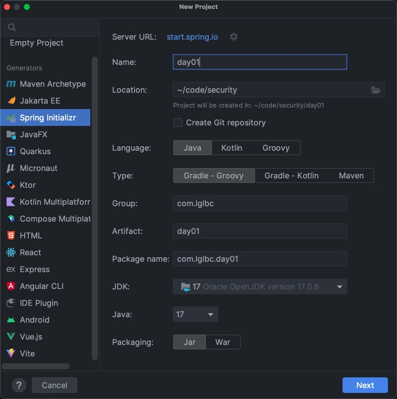

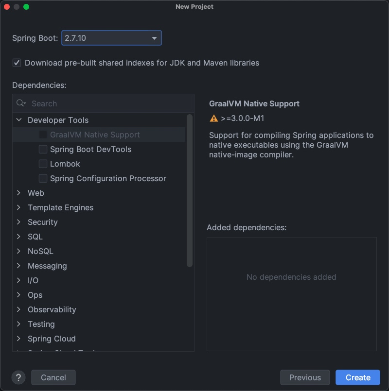
## 修改配置文件为yaml格式
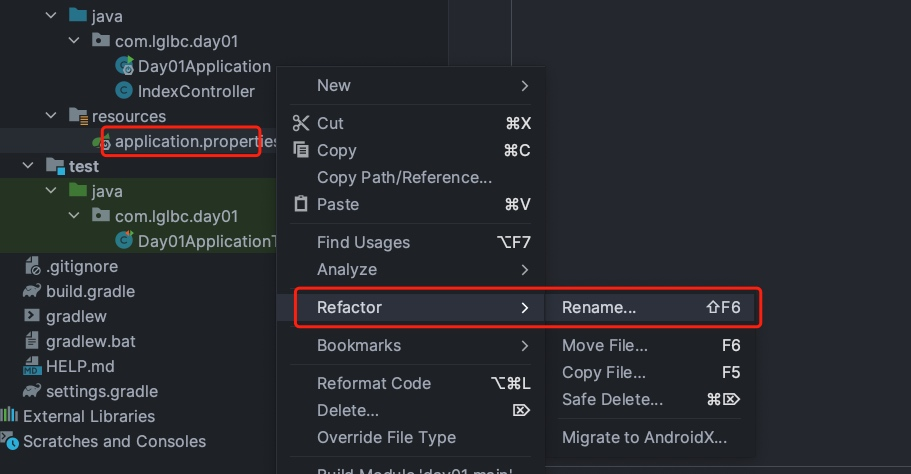
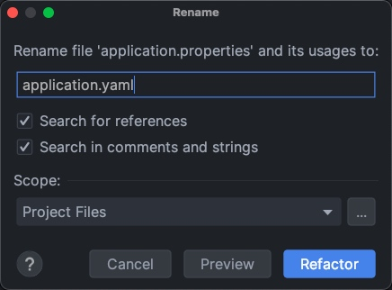


## 配置阿里云仓库
```
repositories {
    maven { url 'https://maven.aliyun.com/nexus/content/groups/public/' }
    maven { url 'https://maven.aliyun.com/nexus/content/repositories/jcenter' }
    maven { url "https://repo.spring.io/plugins-release" }
    mavenCentral()
}
```
## 引入security和web 依赖
```
    implementation 'org.springframework.boot:spring-boot-starter-security'
    implementation 'org.springframework.boot:spring-boot-starter-web'
```
## 创建测试接口

```
/**
 * @Author 编程学习
 * @Date 2023/4/5
 * @Description
 */
@RestController
public class IndexController {
    @RequestMapping("/hello")
    public String hello(){
        return "hello";
    }
}
```
## 启动项目，访问接口
浏览器输入：http://localhost:8080/hello
跳转到了登陆窗口
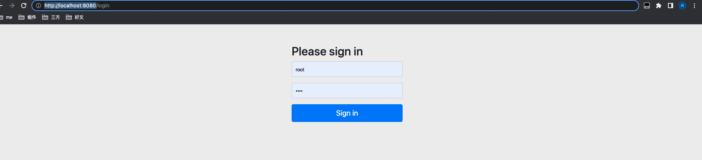
但是我们只是引入了依赖，什么都没配置，我应该从哪里获取用户名和密码呢？

## 获取用户名和密码
在控制台我们找到了这样一段日志：
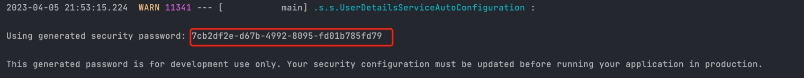
security 给我们自动生成了密码，那么用户名从哪里获取呢？
我们注意到这段日志是UserDetailsServiceAutoConfiguration 打印的，我们点进去看下这个类，是否能找到用户名：

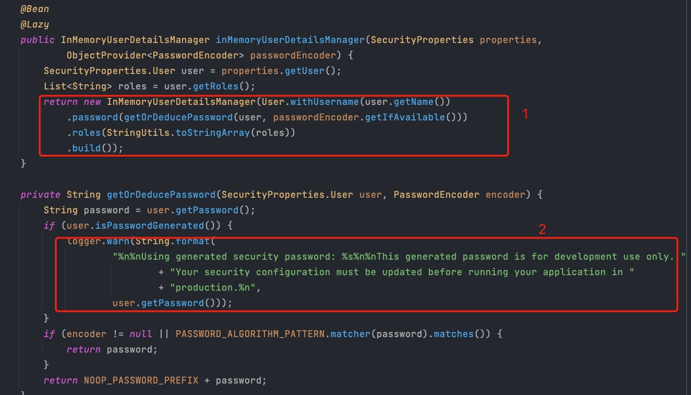
我们找到了刚才打印密码的那段代码块(2图)，并且我们发现1图中好像是在构造用户信息，因为它用到了我们生成的密码，我们继续点击SecurityProperties.User，一探究竟；
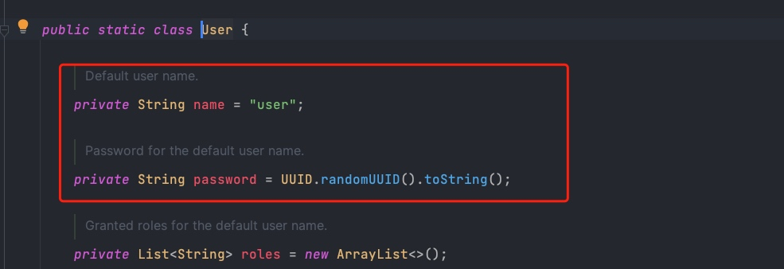
我们看见了这个密码就是我们平时使用的UUID，每次这个类被初始化都会重新生成，但是观察到name却一直是“user”，所以我们尝试使用 用户名:user，密码：从控制台获取，看看是否能登陆成功
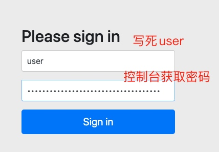
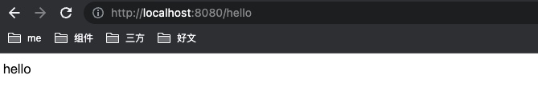
点击登录之后，发现认证通过，并且跳到了我们之前请求的接口，所以验证我们猜想是正确的。

## 如何配置用户名密码
上面那种方式，好像并不靠谱，那么我们如果想自己去定义一个用户名和密码，应该怎么操作呢？
大家先别慌，我们继续定位到刚才那个类：
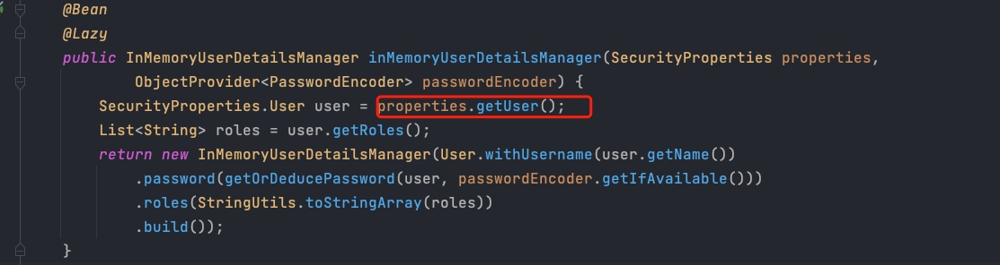
我们发现这个user其实是从properties对象里面获取的，我们进入到这个类
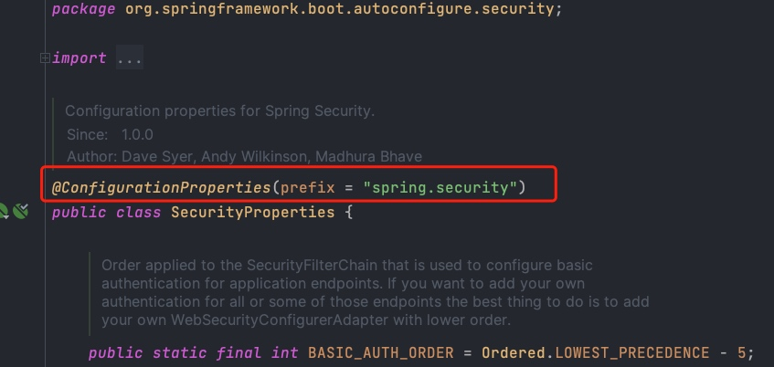
发现这个类是加上了配置注解，并且还加了前缀spring.security，另外properties里面还定义了一个user对象，user：[name,password],那我们是不是可以尝试使用配置文件的方式去定义用户名和密码呢？
根据上面的规则，我们在配置文件中，加上这两个配置
```
spring:
  security:
    user:
      name: example
      password: 123456
```
其实，当你输入这个配置时，idea都已经给我们提示了：
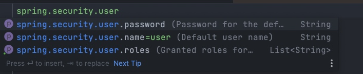

## 重启项目，验证配置
重启发现，之前在控制台打印的密码日志没有了
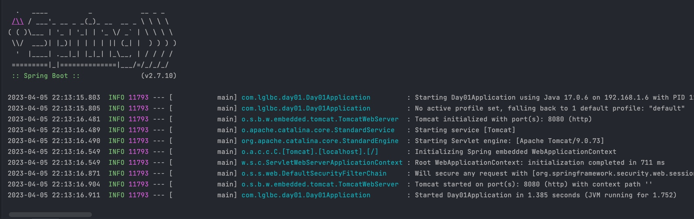
浏览器继续输入:http://localhost:8080/hello

* 输入之前保存的用户名和密码，提示失败
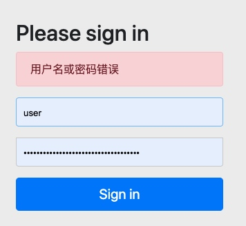
* 输入我们在配置文件中配置的用户名和密码
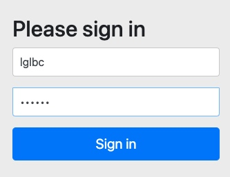
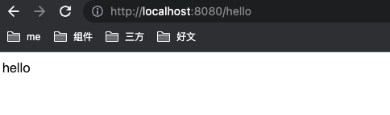
登陆成功

## DEBUG下刚才那块代码
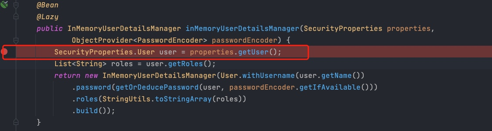
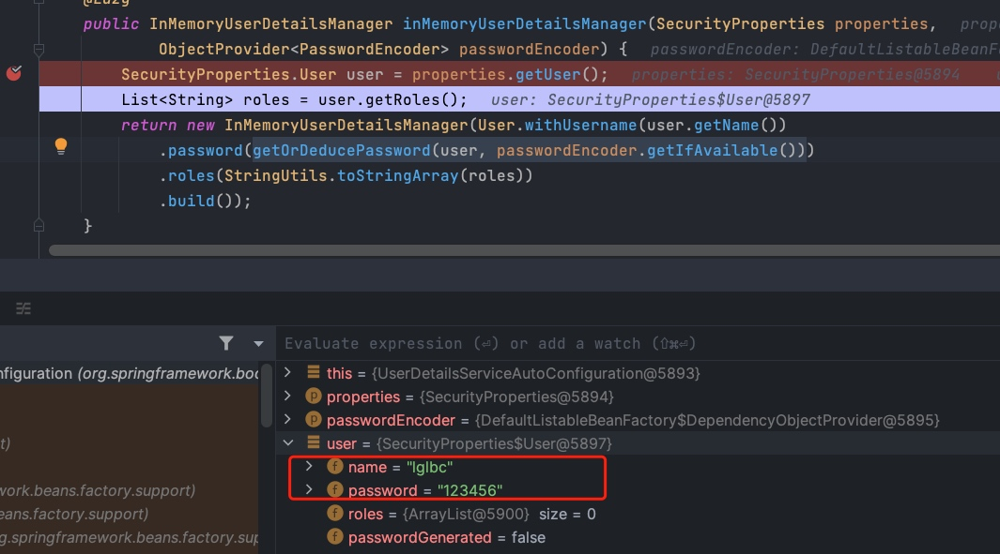
加载的确实是我们配置的用户信息，快速入门到此结束，后面内容更精彩。
