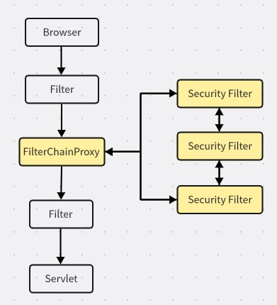
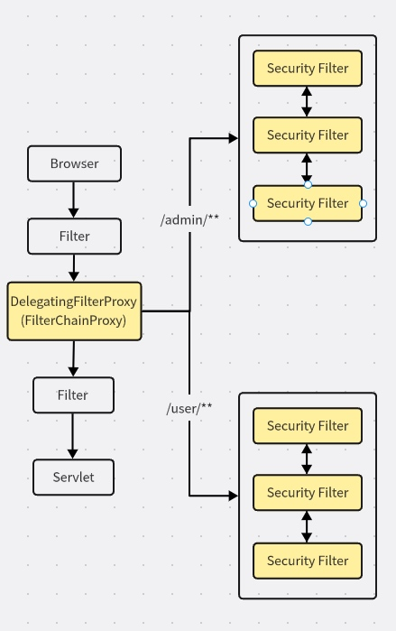
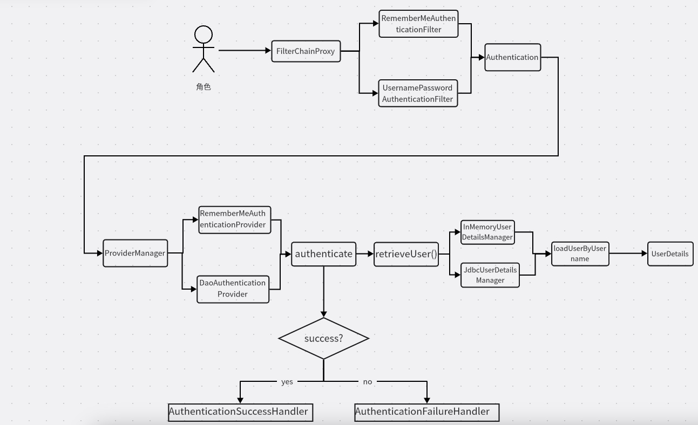

# 3.Spring Security的基本组件及认证流程分析
Spring Security通过一些列的过滤器完成了用户身份认证及其授权工作，每个过滤器都有不同分工，当然这些过滤器并不是全部都一起工作，而是根据我们需要什么功能，才会选取对应的过滤器加入。
当然这些过滤器并不是直接加入web的过滤器中，而是通过一个过滤器代理完成。web过滤器中只会加入一个或多个过滤器代理，然后由这些代理负责管理哪些Security Filter需要加入进来。

如果有多个过滤器链代理的话，那么就会变成这样:

## 组件介绍
### Authentication（Principal）
封装用户身份信息，顶层接口，主要实现如下
* AbstractAuthenticationToken（）
    * RememberMeAuthenticationToken rememberMe 登陆后封装的身份信息
    * UsernamePasswordAuthenticationToken 用户名密码登录后封装的身份信息
### AuthenticationManager
身份认证器的代理，主要负责多个认证器的代理，管理多个AuthenticationProvider,主要实现如下
* ProviderManager （authenticate）

### AuthenticationProvider
真正实现认证工作，多个provider受AuthenticationManager管理，主要实现如下
* AbstractUserDetailsAuthenticationProvider
    * DaoAuthenticationProvider
    * RememberMeAuthenticationProvider

### UserDetailsService
负责定义用户信息的来源，从不同来源加载用户信息，唯一的方法：loadUserByUsername，主要实现类：
* UserDetailsManager
    * InMemoryUserDetailsManager
    * JdbcUserDetailsManager
* 自定义
### UserDetails
定义用户身份信息，比Authentication 信息更详细，主要实现
* User
* 一般我们自定义

### SecurityContextHolder
存放和获取用户身份信息的帮助类

### FilterChainProxy
Spring Securty Filter的入口，FilterChainProxy管理多个filter

### AbstractHttpConfigurer
构建所有过滤器的核心组件，主要方法init()和configure(),主要实现类
* FormLoginConfigurer
* CorsConfigurer
* CsrfConfigurer
* HttpBasicConfigurer
* LogoutConfigurer ...

## 一图理清基本组件关系

视频中有详解解释
