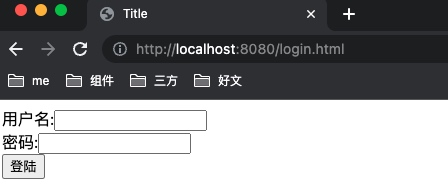
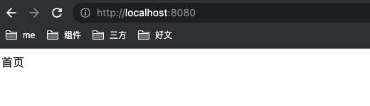
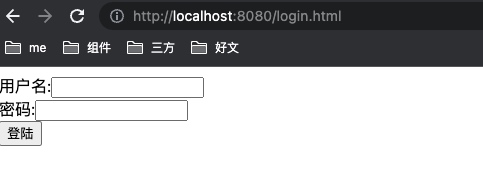
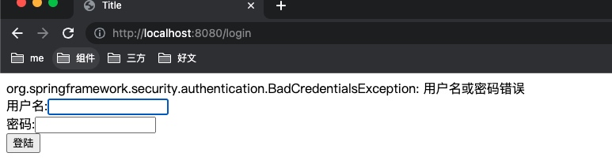
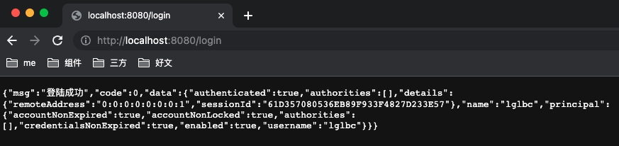
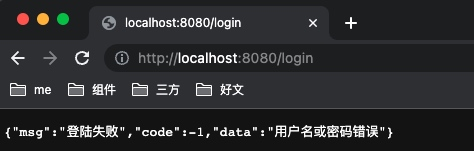

# 4.登录表单配置及原理分析
> 代码：security/day02

## 登录表单配置实操
### 创建项目
如何创建一个SpringSecurity项目，前面章节已经介绍，这里就不重复写了。
### 配置默认用户信息
配置文件添加如下用户信息
```
spring:
  security:
    user:
      name: example
      password: 123456
```
### 基本登录表单配置
#### 添加SecurityConfig
```
@Configuration
public class SecurityConfig {
    @Bean
    public SecurityFilterChain securityFilterChain(HttpSecurity http) throws Exception {
        http.authorizeHttpRequests((auth) ->{
            try {
                auth.anyRequest().authenticated()
                        .and()
                        .formLogin()
                        .loginPage("/login.html")
                        .loginProcessingUrl("/login")
                        .defaultSuccessUrl("/")
                        .failureUrl("/login.html")
                        .permitAll()
                        .and()
                        .csrf().disable();
            } catch (Exception e) {
                throw new RuntimeException(e);
            }

        });
        return http.build();
    }
}
```
* authorizeHttpRequests（）：开启权限配置
* anyRequest().authenticated() 所有请求都需要认证
* and()返回HttpSecurity，从头开始配置
* formLogin()开启表单登陆，引入表单登陆过滤器(默认也会引入)
* loginPage("/login.html") 自定义登录页面
* loginProcessingUrl("/login") 定义登录提交的接口地址
* defaultSuccessUrl 设置登录成功后的跳转地址
* failureUrl 设置登录失败后的跳转地址
* permitAll() 允许这些地址不需要认证
* csrf().disable()security 支持csrf 防护，默认是开启，为了测试方便，这里暂时禁用，后面章节会详细介绍

#### 创建登录页面
在resources/static 下面新建login.html，和上面配置的路径一致
```
<!DOCTYPE html>
<html lang="en">
<head>
    <meta charset="UTF-8">
    <title>Title</title>
</head>
<body>
<form action="/login" method="post">
    用户名:<input name="username" type="text"><br>
    密码:<input name="password" type="password"><br>
    <button type="submit">登陆</button>
</form>
</body>
</html>
```
* action：loginProcessingUrl("/login") 使用此值
* name：默认username和password

我如何知道默认key是username和password 呢？
有两种方法可以确定：
* 第一种：根据默认表单页面，查看网络请求，就能拿到
* 第二种：看源码，这个在视频中给大家演示

#### 验证登录
启动项目后，打开http://localhost:8080

跳转到了我们定义的登录页面，输入上面定义的用户名和密码

我们故意输错密码，看看会是什么表现：

直接跳回登陆页面了，什么错误信息也没显示，为了能显示错误信息，我们需要做如下调整

#### 开启登陆错误信息提示
* 引入thtmeleaf 依赖
`    implementation 'org.springframework.boot:spring-boot-starter-thymeleaf'
`
* 调整security配置
将failureUrl("/login.html") 替换成 failureForwardUrl("/login.html")
* 复制login.html页面 到 resources/templates下面，添加如下内容：
<div th:text="${SPRING_SECURITY_LAST_EXCEPTION}"></div>

* 创建一个控制器
```
    @RequestMapping("/loginFail")
    public String loginFail(){
        return "login";
    }
```

#### 验证登录失败

这里有个问题，为什么我用户名输入的是正确的，反而还是提示用户名或密码错误呢，这个会在后面给大家介绍

### 进阶登录表单配置
#### 修改用户名和密码的key
```
.loginPage("/login.html")
                        .loginProcessingUrl("/login")
                        .defaultSuccessUrl("/")
                        .failureForwardUrl("/loginFail")
                        .passwordParameter("pwd")
                        .usernameParameter("uname")
```
#### 登陆成功后
#### 登陆成功返回JSON
```
                        .formLogin()
                        .loginPage("/login.html")
                        .loginProcessingUrl("/login")
                        .defaultSuccessUrl("/")
                        .failureForwardUrl("/loginFail")
                        .successHandler(new AuthenticationSuccessHandler() {
                            @Override
                            public void onAuthenticationSuccess(HttpServletRequest request, HttpServletResponse response, Authentication authentication) throws IOException, ServletException {
                                Map<String,Object> result = new HashMap<>();
                                result.put("code",0);
                                result.put("msg","登陆成功");
                                result.put("data",authentication);
                                writeResp(result,response);
                            }
                        })
```


#### 登陆失败返回JSON
```
.failureHandler(new AuthenticationFailureHandler() {
                            @Override
                            public void onAuthenticationFailure(HttpServletRequest request, HttpServletResponse response, AuthenticationException exception) throws IOException, ServletException {
                                Map<String,Object> result = new HashMap<>();
                                result.put("code",-1);
                                result.put("msg","登陆失败");
                                result.put("data",exception.getMessage());
                                writeResp(result,response);
                            }
                        })
```



#### 使用Json格式提交登陆请求
这个后面讲解认证器的时候，再给大家介绍。

## 登录表单配置原理及源码
视频中有解析
### 生成默认登录页面

`DefaultLoginPageGeneratingFilter`

```
	private void doFilter(HttpServletRequest request, HttpServletResponse response, FilterChain chain)
			throws IOException, ServletException {
		boolean loginError = isErrorPage(request);
		boolean logoutSuccess = isLogoutSuccess(request);
		if (isLoginUrlRequest(request) || loginError || logoutSuccess) {
			String loginPageHtml = generateLoginPageHtml(request, loginError, logoutSuccess);
			response.setContentType("text/html;charset=UTF-8");
			response.setContentLength(loginPageHtml.getBytes(StandardCharsets.UTF_8).length);
			response.getWriter().write(loginPageHtml);
			return;
		}
		chain.doFilter(request, response);
	}
```
### 生成默认登出页面
`DefaultLogoutPageGeneratingFilter`
```
	protected void doFilterInternal(HttpServletRequest request, HttpServletResponse response, FilterChain filterChain)
			throws ServletException, IOException {
		if (this.matcher.matches(request)) {
			renderLogout(request, response);
		}
		else {
			if (logger.isTraceEnabled()) {
				logger.trace(LogMessage.format("Did not render default logout page since request did not match [%s]",
						this.matcher));
			}
			filterChain.doFilter(request, response);
		}
	}
```

### 认证成功和认证失败 回调
`AbstractAuthenticationProcessingFilter`

```
private void doFilter(HttpServletRequest request, HttpServletResponse response, FilterChain chain)
			throws IOException, ServletException {
		if (!requiresAuthentication(request, response)) {
			chain.doFilter(request, response);
			return;
		}
		try {
			Authentication authenticationResult = attemptAuthentication(request, response);
			if (authenticationResult == null) {
				// return immediately as subclass has indicated that it hasn't completed
				return;
			}
			this.sessionStrategy.onAuthentication(authenticationResult, request, response);
			// Authentication success
			if (this.continueChainBeforeSuccessfulAuthentication) {
				chain.doFilter(request, response);
			}
			successfulAuthentication(request, response, chain, authenticationResult);
		}
		catch (InternalAuthenticationServiceException failed) {
			this.logger.error("An internal error occurred while trying to authenticate the user.", failed);
			unsuccessfulAuthentication(request, response, failed);
		}
		catch (AuthenticationException ex) {
			// Authentication failed
			unsuccessfulAuthentication(request, response, ex);
		}
	}

```