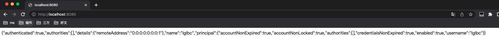
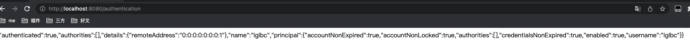
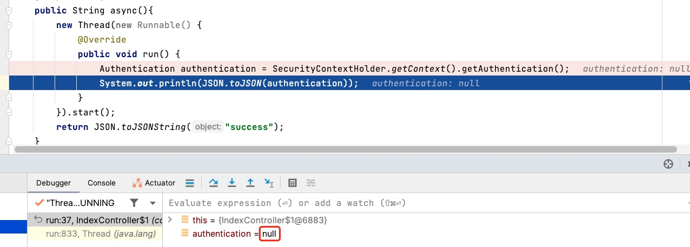
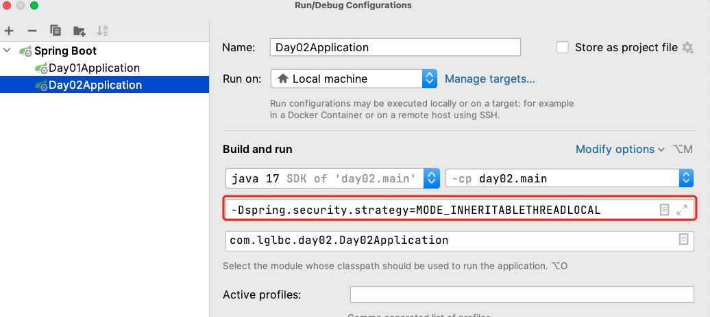
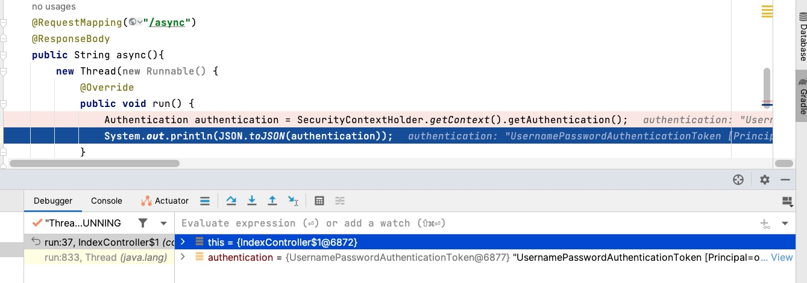

# 5.登录用户数据获取及原理分析
> 代码：security/day02

前面章节我们学习了登录表单的配置并且对源码进行了简单的分析，那么现在有个问题了，既然用户登录了，那么如何在接口中获取用户信息呢，这将是我们这节课带大家一起学习的，并且还会告诉大家器实现原理和源码分析。

## 代码中获取登录用户信息
获取登录用户信息有两种方式
### 通过 SecurityContextHolder 获取
```
    @RequestMapping("/")
    @ResponseBody
    public String index(){
        Authentication authentication = SecurityContextHolder.getContext().getAuthentication();
        return JSON.toJSONString(authentication);
    }
```


返回结果中返回了用户信息，权限信息，还有一个details，这个我们后面是需要实现自己的，扩展我们业务中的信息。

### 注入 Authentication

不管使用哪种方法，都是可以获得当前用户信息，但是如何你想在任何地方都能拿到登录用户信息，则只能使用SecurityContextHolder

## 如何在异步线程中获取当前登录信息
很多同学在学习了通过SecurityContextHolder之后，就想尝试下，发现在正常使用中，是可以拿到用户信息的，但是在异步线程中就拿不到了，这个其实可以通过调整他的策略来实现在异步线程中获取用户信息。
SecurityContextHolder 主要有三种策略：

### MODE_THREADLOCAL
默认策略，使用THREADLOCAL实现，只在当前线程中保存用户信息
### MODE_INHERITABLETHREADLOCAL
支持在多线程中传递用户信息，使用这种策略，当我们启动新线程时，security会将当前线程的用户信息拷贝一份到新线程中
### MODE_GLOBAL
security将数据保存在一个全局变量中，也能解决多线程问题，一般很少用

如果使用默认策略，在异步线程中获取用户信息，返回为空:


调整vm配置，使用MODE_INHERITABLETHREADLOCAL策略
添加VM OPTION:
-Dspring.security.strategy=MODE_INHERITABLETHREADLOCAL



获取到了用户信息

## 登录用户信息保存
`SecurityContextPersistenceFilter`
主要逻辑
```
private void doFilter(HttpServletRequest request, HttpServletResponse response, FilterChain chain)
		HttpRequestResponseHolder holder = new HttpRequestResponseHolder(request, response);
		SecurityContext contextBeforeChainExecution = this.repo.loadContext(holder);
		try {
			SecurityContextHolder.setContext(contextBeforeChainExecution);
			chain.doFilter(holder.getRequest(), holder.getResponse());
		}
		finally {
			SecurityContext contextAfterChainExecution = SecurityContextHolder.getContext();
			SecurityContextHolder.clearContext();
			this.repo.saveContext(contextAfterChainExecution, holder.getRequest(), holder.getResponse());
		}
	}
```
这个过滤器主要做了如下几件事：
* 从repo(SecurityContextRepository)中读取context中读取context，你可以把repo当作一个数据来源，主要有以下几个实现：
    * HttpSessionSecurityContextRepository 默认实现
    * RequestAttributeSecurityContextRepository
    * NullSecurityContextRepository 其实什么都没做，不想用session可以使用这个
* 将context 塞入SecurityContextHolder
* 执行剩下的过滤器
* finally 清除线程变量信息