# 6.基于多种方式配置登录用户：memory、jdbc、MyBatis
> 代码：security/day03

前面章节我们所有的用户信息(用户名和密码)都是基于配置文件配置的，今天这节课我们开始定义不同的用户信息获取来源。

## 基于内存方式
其实我们在配置文件中写的用户信息，最终也是被读到内存中的，大家不知道对这段代码还熟悉么：
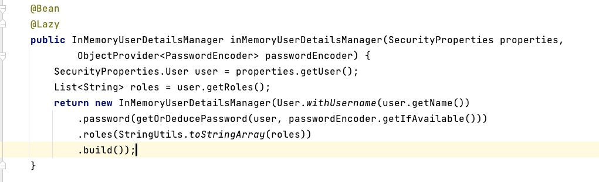
这一块就是基于内存方式构建了用户信息，定义了默认的用户信息来源。

### 配置内存方式
```
@Configuration
public class SecurityConfig {
    @Bean
    public InMemoryUserDetailsManager inMemoryUserDetailsManager(){
        UserDetails userDetails1 = User.withUsername("memory1").password("{noop}memory1").roles("memory1").build();
        UserDetails userDetails2 = User.withUsername("memory2").password("{noop}memory2").roles("memory2").build();
        return new InMemoryUserDetailsManager(userDetails1,userDetails2);
    }

}
```
### 验证登录
memory1
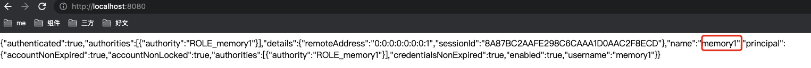

memory2
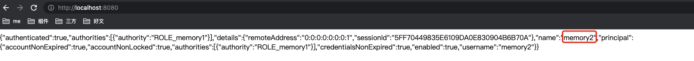
## 基于JDBC 方式
### 引入依赖
```
    implementation 'mysql:mysql-connector-java:8.0.32'
    implementation 'org.springframework.boot:spring-boot-starter-jdbc'
```
### 获取数据库执行脚本
在这个路径下：org/springframework/security/core/userdetails/jdbc/users.ddl
得到脚本后，将_ignorecase 去掉
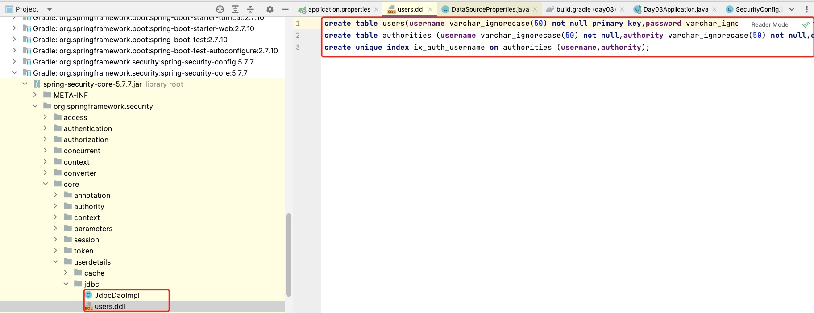
执行之后，得到两张表
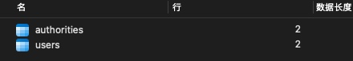
### 配置JDBC Manager
```
    @Autowired
    private DataSource dataSource;
    @Bean
    public JdbcUserDetailsManager jdbcUserDetailsManager(){
        JdbcUserDetailsManager jdbcUserDetailsManager = new JdbcUserDetailsManager(dataSource);
        if(!jdbcUserDetailsManager.userExists("example-jdbc")){
            jdbcUserDetailsManager.createUser(User.withUsername("example-jdbc").username("example-jdbc").password("{noop}example-jdbc").roles("admin").build());
        }
        if(!jdbcUserDetailsManager.userExists("example-jdbc2")){
            jdbcUserDetailsManager.createUser(User.withUsername("example-jdbc2").username("example-jdbc2").password("{noop}example-jdbc2").roles("admin").build());
        }
        return jdbcUserDetailsManager;
    }
```
### 验证登录
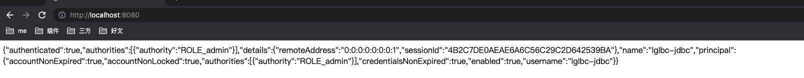
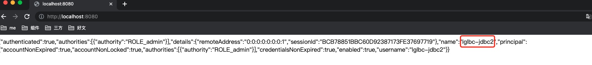
## 基于MyBatis 方式
### 引入依赖
基于上面的依赖之后，需要再引入MyBatis的依赖
```
    implementation 'org.mybatis.spring.boot:mybatis-spring-boot-starter:+'
```
### 定义UserDetails

```
/**
 * @Author 编程学习
 * @Date 2023/4/1
 * @Description
 */
public class User implements UserDetails {
    private Integer id;
    private String username;
    private String password;
    private Boolean enabled;
    private Boolean accountNonExpired;
    private Boolean accountNonLocked;
    private Boolean credentialsNonExpired;
    private List<Role> roles = new ArrayList<>();
    @Override
    public Collection<? extends GrantedAuthority> getAuthorities() {
        List<SimpleGrantedAuthority> authorities = new ArrayList<>();
        for (Role role : roles) {
            authorities.add(new SimpleGrantedAuthority(role.getName()));
        }
        return authorities;
    }

    @Override
    public String getPassword() {
        return password;
    }

    @Override
    public String getUsername() {
        return username;
    }

    @Override
    public boolean isAccountNonExpired() {
        return accountNonExpired;
    }

    @Override
    public boolean isAccountNonLocked() {
        return accountNonLocked;
    }

    @Override
    public boolean isCredentialsNonExpired() {
        return credentialsNonExpired;
    }

    @Override
    public boolean isEnabled() {
        return enabled;
    }

    public void setId(Integer id) {
        this.id = id;
    }

    public void setUsername(String username) {
        this.username = username;
    }

    public void setPassword(String password) {
        this.password = password;
    }

    public void setEnabled(Boolean enabled) {
        this.enabled = enabled;
    }

    public void setAccountNonExpired(Boolean accountNonExpired) {
        this.accountNonExpired = accountNonExpired;
    }

    public void setAccountNonLocked(Boolean accountNonLocked) {
        this.accountNonLocked = accountNonLocked;
    }

    public void setCredentialsNonExpired(Boolean credentialsNonExpired) {
        this.credentialsNonExpired = credentialsNonExpired;
    }

    public void setRoles(List<Role> roles) {
        this.roles = roles;
    }

    public Integer getId() {
        return id;
    }

    public static class Role {
        private Integer id;
        private String name;
        private String nameZh;

        public Integer getId() {
            return id;
        }

        public void setId(Integer id) {
            this.id = id;
        }

        public String getName() {
            return name;
        }

        public void setName(String name) {
            this.name = name;
        }

        public String getNameZh() {
            return nameZh;
        }

        public void setNameZh(String nameZh) {
            this.nameZh = nameZh;
        }
        //省略getter/setter
    }
}
```

### 定义 UserDetailService
```
@Service
public class MyUserDetailService implements UserDetailsService {
    @Autowired
    private UserMapper userMapper;
    @Override
    public UserDetails loadUserByUsername(String username) throws UsernameNotFoundException {
        User user = userMapper.loadUserByUserName(username);
        if (Objects.isNull(user)) {
            throw new UsernameNotFoundException("user is null");
        }
        user.setRoles(userMapper.getRolesByUid(user.getId()));
        return user;
    }
}
```
### 创建mybatis mapper
```
@Mapper
public interface UserMapper {
    @Select("select r.* from user_role ur LEFT JOIN role r on ur.rid=r.id where ur.uid=#{id}")
    public List<User.Role> getRolesByUid(@Param("id") Integer id);

    @Select("select * from user where username=#{uname} limit 1")
    public User loadUserByUserName(String uname);
}
```
### 创建需要的表
```
CREATE TABLE `role` (
`id` int(11) NOT NULL AUTO_INCREMENT,
`name` varchar(32) DEFAULT NULL,
`nameZh` varchar(32) DEFAULT NULL,
PRIMARY KEY (`id`)
) ENGINE=InnoDB DEFAULT CHARSET=utf8;
CREATE TABLE `user` (
`id` int(11) NOT NULL AUTO_INCREMENT,
`username` varchar(32) DEFAULT NULL,
`password` varchar(255) DEFAULT NULL,
`enabled` tinyint(1) DEFAULT NULL,
`accountNonExpired` tinyint(1) DEFAULT NULL,
`accountNonLocked` tinyint(1) DEFAULT NULL,
`credentialsNonExpired` tinyint(1) DEFAULT NULL,
PRIMARY KEY (`id`)
) ENGINE=InnoDB DEFAULT CHARSET=utf8;
CREATE TABLE `user_role` (
`id` int(11) NOT NULL AUTO_INCREMENT,
`uid` int(11) DEFAULT NULL,
`rid` int(11) DEFAULT NULL,
PRIMARY KEY (`id`),
KEY `uid` (`uid`),
KEY `rid` (`rid`)
) ENGINE=InnoDB DEFAULT CHARSET=utf8;


INSERT INTO `role` (`id`, `name`, `nameZh`)
VALUES
(1,'ROLE_dba','数据库管理员'),
(2,'ROLE_admin','系统管理员'),
(3,'ROLE_user','用户');
INSERT INTO `user` (`id`, `username`, `password`, `enabled`,
`accountNonExpired`, `accountNonLocked`, `credentialsNonExpired`)
VALUES
(1,'root','{noop}123',1,1,1,1),
(2,'admin','{noop}123',1,1,1,1),
(3,'sang','{noop}123',1,1,1,1);
INSERT INTO `user_role` (`id`, `uid`, `rid`)
VALUES
(1,1,1),
(2,1,2),
(3,2,2),
(4,3,3);
```
### 验证登录
在启动之前，大家记住要把之前配置的jdbc和内存方式获取用户信息的配置给注销，否则会报如下错误:

至于为什么，请看原理分析

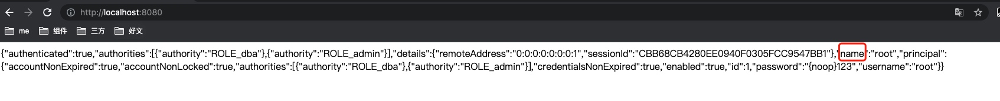
大家有可能注意到，我的密码里面都加上了{noop}，为什么呢？因为加上这个代码就等于告诉security 我的密码没加密，因为security默认给密码使用加密，如果它看到{noop}，就不会对密码进行加密匹配

## 原理分析: 为什么定义了两个UserDetailService,就抛如下异常
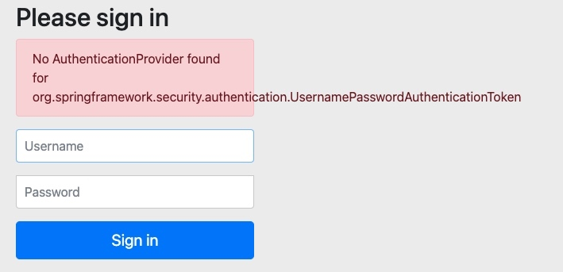
因为security在初始化http的时候，会初始化全局的认证处理器，如果发现有不等于1个UserDetails实现，则不会设置默认的AuthenticationProvider:
`InitializeUserDetailsManagerConfigurer#configure`
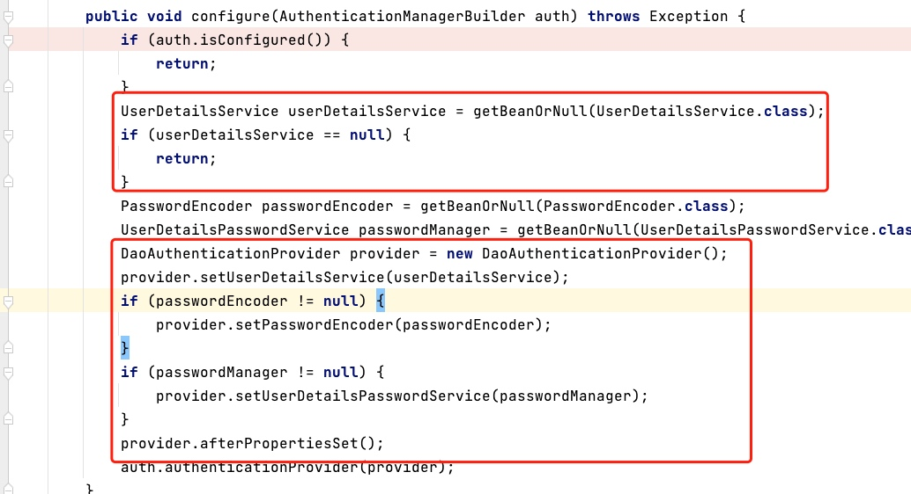
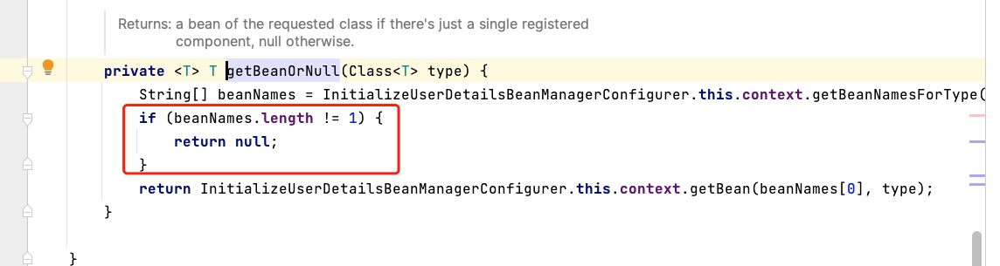

所以当我们定义两个UserDetailService(验证多种用户),那就需要自己定义一个AuthenticationManager，重写他获取provider和UserDetailService的逻辑,这个后面会给大家介绍：如何配置多个数据源，验证不同用户表
