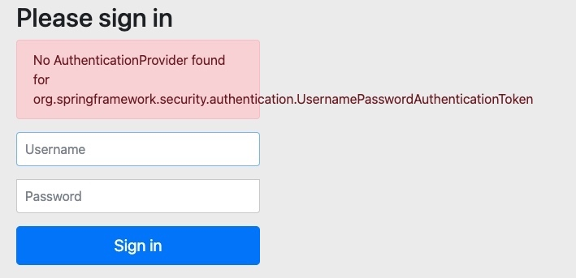
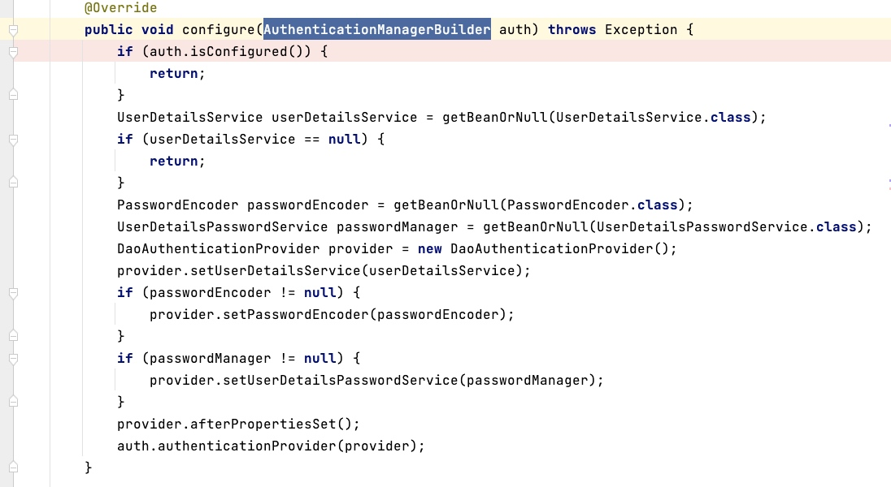
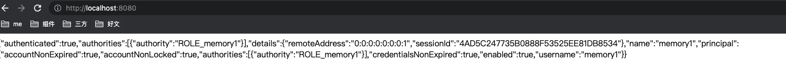
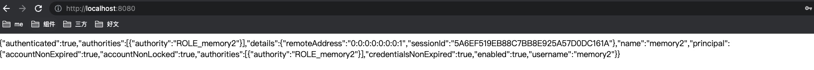

# 7.配置多个数据源：验证不同用户表
> 代码：security/day04

大家对上节课不知道是否还有印象？我们在配置jdbc和mybatis 来源，进行登录后，出现了如下错误
我们后面解决方案是：屏蔽了其中一个来源，登陆成功，也分析了其原因。

但是，但是如果我们真的需要配置多个数据来源，那怎么办呢？因为这种需求其实还蛮多的，如：普通会员和管理系统用户 应该存在不同的表，那么就需要两套数据来源，所以这个问题还是必须要解决！

## 分析源码

因为在源码中，判断了如果有两个UserDetailService存在，就不会给全局的AuthenticationManager设置AuthenticationProvider,因为他是一个provider对应一个UserDetailService,现在我们想要两组，所以我们就需要自己定义AuthenticationManager。

## 代码实现
### 定义两组UserDetailService
```
    @Bean
    public UserDetailsService userDetailsService1(){
        UserDetails userDetails = User.withUsername("memory1").password("{noop}memory1").roles("memory1").build();
        return new InMemoryUserDetailsManager(userDetails);
    }
    @Bean
    public UserDetailsService userDetailsService2(){
        UserDetails userDetails = User.withUsername("memory2").password("{noop}memory2").roles("memory2").build();
        return new InMemoryUserDetailsManager(userDetails);
    }
```

### 定义AuthenticationManager
```
    @Bean
    public AuthenticationManager authenticationManager(){
        DaoAuthenticationProvider provider = new DaoAuthenticationProvider();
        provider.setUserDetailsService(userDetailsService1());
        DaoAuthenticationProvider provider2 = new DaoAuthenticationProvider();
        provider2.setUserDetailsService(userDetailsService2());
        return new ProviderManager(provider2,provider);
    }
```

### 验证登录


