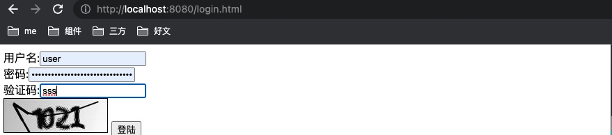
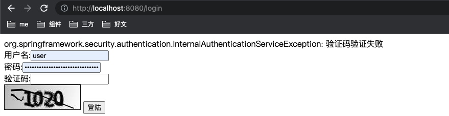

# 8.自定义认证器：实现验证码功能
> 代码：security/day05

SpringSecurity 默认是不支持验证码功能的，但是我们可以自己扩展，这也是我们使用SpringSecurity最大的好处，原生不支持，我们就自己扩展。
## 思路分析
因为系统默认的有一个DaoAuthenticationProvider 认证处理器，但是他只支持用户名和密码方式登录，所以是不能使用现有的认证器，那我们是不是可以实现一个自己的认证器，来覆盖这个默认的认证器呢？
答案当然是可以的，大概实现思路是这样的：
* 创建一个认证器 继承默认的密码认证器DaoAuthenticationProvider
* 定义验证码认证器的逻辑
    * 从session获取保存的验证码
    * 从请求参数中获取用户输入的验证码
    * 比对验证码
    * 如果匹配成功，则调用DaoAuthenticationProvider的authenticate方法，进行原先逻辑认证
    * 如果匹配失败，则抛出异常，不走后面的逻辑
* 将自定义的provider加到AuthenticationManager中

大致思路是这样，那么还有没有别的方式呢？
当然有了，我们还可以通过过滤器实现，但是这个过滤器的优先级要先于认证过滤器之前，这个后面再和大家介绍，这节课我们先看下如何通过自定义认证器来实现验证码校验的功能。

## 代码实现
### 创建验证码处理器
#### 引入依赖
```
    implementation 'com.github.penggle:kaptcha:2.3.2'
```
#### 配置验证码
```
    @Bean
    public Producer producer() {
        Properties properties = new Properties();
        properties.setProperty("kaptcha.image.width", "150");
        properties.setProperty("kaptcha.image.height", "50");
        properties.setProperty("kaptcha.textproducer.char.string", "012");
        properties.setProperty("kaptcha.textproducer.char.length", "4");
        Config config = new Config(properties);
        DefaultKaptcha defaultKaptcha = new DefaultKaptcha();
        defaultKaptcha.setConfig(config);
        return defaultKaptcha;
    }
```
#### 创建验证码入口
```
    @Autowired(required = false)
    private Producer producer;
    @RequestMapping("/kaptcha")
    public void kaptcha(HttpServletResponse response, HttpSession session){
        response.setContentType("image/jpg");
        String text = producer.createText();
        session.setAttribute("KAPTCHA_CODE",text);
        BufferedImage image = producer.createImage(text);
        try(ServletOutputStream outputStream = response.getOutputStream()){
            ImageIO.write(image,"jpg",outputStream);
        } catch (IOException e) {
            throw new RuntimeException(e);
        }
    }
```
### 自定义验证码认证处理器
```
public class KaptchaAuthenticationProvider extends DaoAuthenticationProvider {
    @Override
    public Authentication authenticate(Authentication authentication) throws AuthenticationException {
        HttpServletRequest request = ((ServletRequestAttributes) Objects.requireNonNull(RequestContextHolder.getRequestAttributes())).getRequest();
        String kaptchaCode = (String) request.getSession().getAttribute("KAPTCHA_CODE");
        String inputKaptcha = request.getParameter("kaptcha");
        if (!StrUtil.equals(kaptchaCode, inputKaptcha)) {
            throw new InternalAuthenticationServiceException("验证码验证失败");
        }
        return super.authenticate(authentication);
    }
}
```
### 自定义登录页面
```
<!DOCTYPE html>
<html lang="en" xmlns:th="http://www.thymeleaf.org">
<head>
    <meta charset="UTF-8">
    <title>Title</title>
</head>
<body>
<div th:text="${SPRING_SECURITY_LAST_EXCEPTION}"></div>
<form action="/login" method="post">
    用户名:<input name="username" type="text"><br>
    密码:<input name="password" type="password"><br>
    验证码:<input name="kaptcha" type="text"><br>
    
    <button type="submit">登陆</button>
</form>
</body>
</html>
```
### 配置SecurityFilterchain
```
    @Bean
    public SecurityFilterChain securityFilterChain(HttpSecurity http) throws Exception {
        http.authorizeHttpRequests((auth) ->{
            try {
                auth.antMatchers("/kaptcha").permitAll()
                        .anyRequest().authenticated()
                        .and().formLogin()
                        .loginPage("/login.html")
                        .loginProcessingUrl("/login")
                        .failureForwardUrl("/login.html")
                        .permitAll()
                        .and()
                        .csrf().disable();
            }
            catch (Exception e){
            }
        });
        return http.build();
    }
```

### 配置AuthenticationManager
```
 @Bean
    public UserDetailsService userDetailsService(){
        UserDetails userDetails = User.withUsername("memory1").password("{noop}memory1").roles("memory1").build();
        return new InMemoryUserDetailsManager(userDetails);
    }

    @Bean
    public KaptchaAuthenticationProvider kaptchaAuthenticationProvider(){
        KaptchaAuthenticationProvider kaptchaAuthenticationProvider= new KaptchaAuthenticationProvider();
        kaptchaAuthenticationProvider.setUserDetailsService(userDetailsService());
        return kaptchaAuthenticationProvider;
    }

    @Bean
    public AuthenticationManager authenticationManager(){
        return new ProviderManager(kaptchaAuthenticationProvider());
    }
```
## 验证登录


