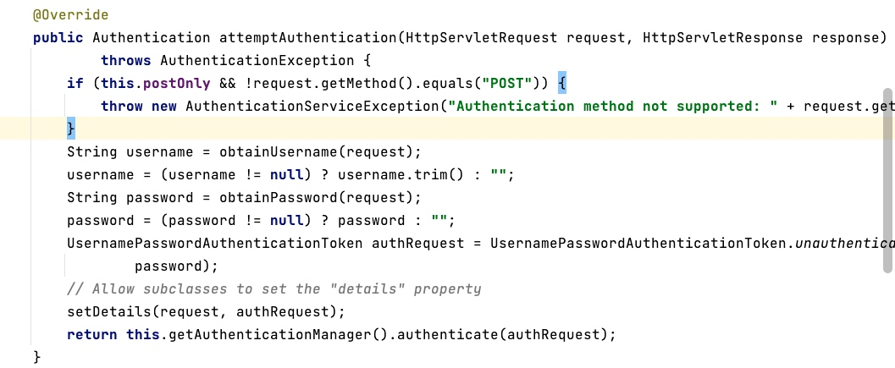

# 9.前后端分离：使用JSON数据格式登录
> 代码：security/day06

在前面的章节中，我们使用表单方式完成登录提交，但是目前基本都是前后端分离项目，很少使用表单提交的方式，基本都是json方式，使用ajax提交，那么我们怎么将表单提交方式改成json格式登录呢？
## 思路分析
通过前面源码部分学习，我们已经知道在HttpSecurity配置中，每新增一种配置，都会加入一个过滤器，或者覆盖默认的过滤器，那么我们使用的表单登录也是同样使用过滤器，我们追踪源码看下他的过滤器：UsernamePasswordAuthenticationFilter，
### 原始表单过滤器提交认证请求的逻辑

* 使用Obtain获取用户名和密码，其实就是通过request.getParameter获取
* 然后将用户名和密码封装在token
* 调用proverManager.authenticate()进行认证
所以基于这块我们可以参考上节课验证码的思路：
### 实现思路
* 写一个过滤器，继承UsernamePasswordAuthenticationFilter
* 从json格式参数中获取用户名和密码
* 然后进行封装成token
* 调用this.getAuthenticationManager().authenticate(authRequest) 完成认证
* 如果不是json格式请求则还是走原先的逻辑，调用父类attemptAuthentication(request, response);按照原先参数传递方式进行认证

## 代码实现

### 定义Json 过滤器
```
public class JsonLoginFilter extends UsernamePasswordAuthenticationFilter {
    @Override
    public Authentication attemptAuthentication(HttpServletRequest request, HttpServletResponse response) throws AuthenticationException {
        if (request.getContentType().equalsIgnoreCase(MediaType.APPLICATION_JSON_VALUE)){
            try {
                Map<String,String> map = new ObjectMapper().readValue(request.getInputStream(), new TypeReference<>() {
                });
                String userName = map.get(getUsernameParameter());
                String passwd = map.get(getPasswordParameter());
                UsernamePasswordAuthenticationToken authenticationToken = new UsernamePasswordAuthenticationToken(userName, passwd);
                return this.getAuthenticationManager().authenticate(authenticationToken);
            } catch (IOException e) {
                throw new RuntimeException(e);
            }
        }

        return super.attemptAuthentication(request, response);
    }
}
```
### 配置Json过滤器
```
    @Bean
    public JsonLoginFilter jsonLoginFilter(){
        JsonLoginFilter jsonLoginFilter = new JsonLoginFilter();
        jsonLoginFilter.setAuthenticationManager(authenticationManager());
        jsonLoginFilter.setAuthenticationFailureHandler(new AuthenticationFailureHandler() {
            @Override
            public void onAuthenticationFailure(HttpServletRequest request, HttpServletResponse response, AuthenticationException exception) throws IOException, ServletException {
                Map<String,Object> result = new HashMap<>();
                result.put("code",-1);
                result.put("msg","登录失败");
                result.put("data",exception.getMessage());
                writeResp(result,response);
            }
        });
        jsonLoginFilter.setAuthenticationSuccessHandler(new AuthenticationSuccessHandler() {
                    @Override
                    public void onAuthenticationSuccess(HttpServletRequest request, HttpServletResponse response, Authentication authentication) throws IOException, ServletException {
                        Map<String,Object> result = new HashMap<>();
                        result.put("code",-1);
                        result.put("msg","登录成功");
                        result.put("data",authentication);
                        writeResp(result,response);
                    }
                });
        return jsonLoginFilter;
    }
```
### 配置SecurigyFilterChain
```
    @Bean
    public SecurityFilterChain securityFilterChain(HttpSecurity http) throws Exception {
        http.authorizeHttpRequests().anyRequest().authenticated()
                .and()
                .addFilterAt(jsonLoginFilter(), UsernamePasswordAuthenticationFilter.class)
                .csrf().disable();
        return http.build();
    }
```