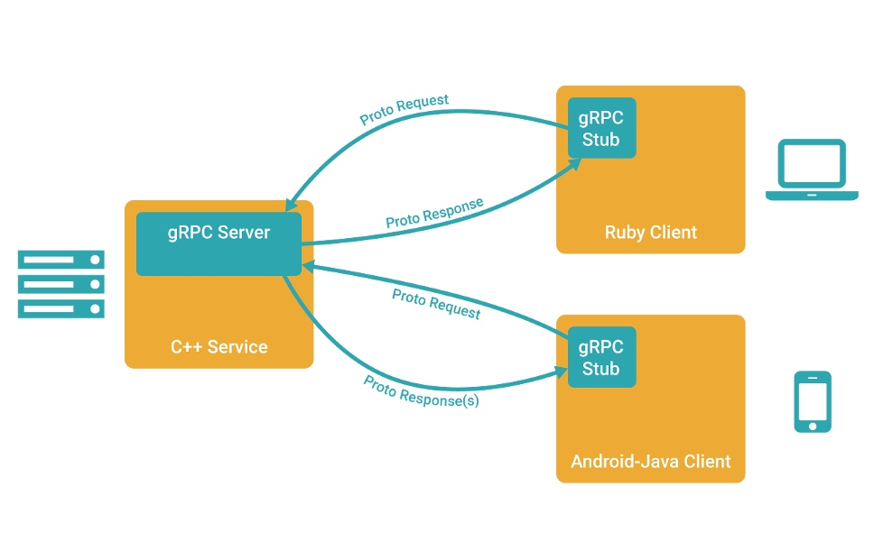

# 1.gRPC 入门解惑
## 什么是 gRPC？
gRPC（gRPC Remote Procedure Call）是一种高性能、开源的远程过程调用（RPC）框架。它允许分布在不同计算机上的应用程序能够像调用本地方法一样进行通信，从而实现了在分布式系统中进行高效的通信。

## 传统 RPC 与 gRPC 的对比
传统的 RPC 模型使用各种协议和编码方式进行通信，这可能导致跨语言通信困难、性能不佳等问题。与此不同，gRPC 使用 Google 开发的 Protocol Buffers（ProtoBuf）进行数据序列化，同时基于 HTTP/2 协议进行通信，从而提供了更高效的通信方式。

## gRPC 的优势和适用场景
* 高性能： gRPC 使用二进制的 ProtoBuf 编码和 HTTP/2 多路复用等技术，从而实现低延迟和高吞吐量的通信。
* 多语言支持： gRPC 支持多种编程语言，包括 Java、Python、Go 等，使得不同团队可以选择自己擅长的语言进行开发。
* 强类型： 使用 ProtoBuf 定义消息和接口，消除了手动解析数据的麻烦。
* 双向流式通信： gRPC 支持双向流式数据传输，适用于实时性要求高的场景。
* 自动代码生成： 根据定义的服务接口和消息，gRPC 可以自动生成客户端和服务端代码，简化开发流程。
## gRPC 在分布式系统中的应用场景
* 微服务通信： gRPC 适用于微服务架构中各个服务之间的通信，能够有效减少通信开销。
* 跨数据中心通信： gRPC 的性能优势使其适用于跨多个数据中心进行通信，提供更好的用户体验。
* 实时通信： 借助双向流式通信，gRPC 适合实时通信场景，如聊天应用和实时数据推送。
* 通过了解 gRPC 的基本概念、与传统 RPC 的不同之处以及它在分布式系统中的优势，你将能够更好地理解为什么 gRPC 是一个值得学习和应用的强大工具。

## 什么是Protocol Buffers（ProtoBuf）
Protocol Buffers（ProtoBuf） 是一种用于序列化结构化数据的轻量级、高效的数据交换格式。它最初由 Google 开发，用于解决跨平台、跨语言通信以及数据持久化的问题。ProtoBuf 使用简单的接口描述语言来定义数据结构和服务接口，并生成相应的代码用于数据的序列化和反序列化。在 gRPC 中，使用 Protocol Buffers（ProtoBuf）进行数据传输非常简单，因为 gRPC 针对 ProtoBuf 提供了内置支持。
## 写一个gRPC 服务的基本过程
### 定义服务和消息
首先，你需要创建一个 .proto 文件来定义服务接口和消息类型。在这个文件中，你可以定义服务方法、请求消息和响应消息。这些定义将用于生成服务端和客户端的代码。
### 生成代码
使用 Protocol Buffers 编译器（protoc）来生成对应编程语言的代码
### 实现服务接口
在服务端，你需要创建一个类来实现定义的服务接口。这个类应该继承自生成的服务接口，并实现相应的方法。
### 创建 gRPC 服务器
在服务端代码中，你需要创建一个 gRPC 服务器，将服务实现类注册到服务器中。
### 创建 gRPC 客户端
在客户端，你可以使用生成的客户端代码来调用 gRPC 服务方法