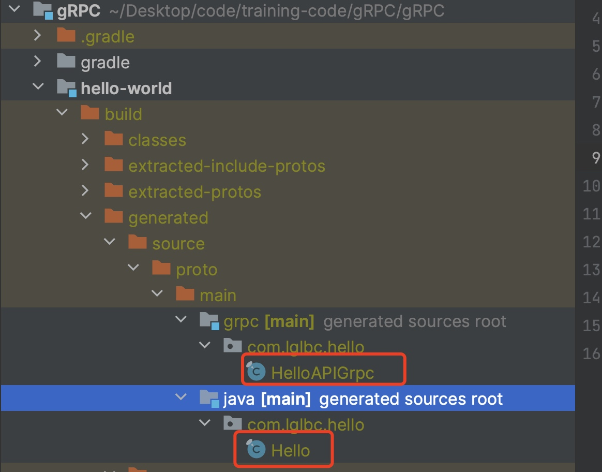
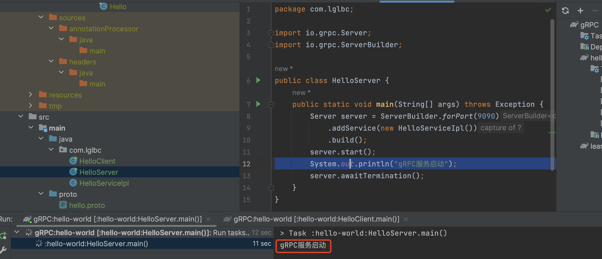
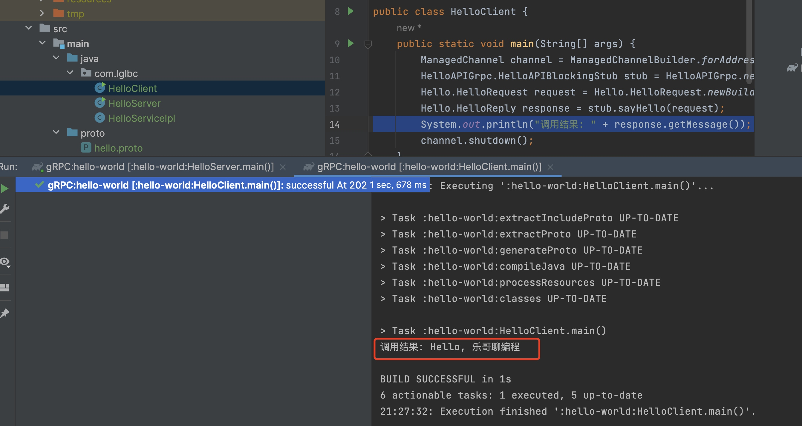

# 2.Hello World gRPC
## 配置gradle
### 引入插件
```
plugins {
    id 'java'
    id 'com.google.protobuf' version '0.9.4'
}
```
### 引入依赖
```
def grpcVersion = '1.57.2' // CURRENT_GRPC_VERSION
def protobufVersion = '3.24.0'
def protocVersion = protobufVersion
```
```
dependencies {
    implementation "io.grpc:grpc-protobuf:${grpcVersion}"
    implementation "io.grpc:grpc-services:${grpcVersion}"
    implementation "io.grpc:grpc-stub:${grpcVersion}"
    compileOnly "org.apache.tomcat:annotations-api:6.0.53"
    implementation "com.google.protobuf:protobuf-java:${protobufVersion}"
    // examples/advanced need this for JsonFormat
    implementation "com.google.protobuf:protobuf-java-util:${protobufVersion}"
    runtimeOnly "io.grpc:grpc-netty-shaded:${grpcVersion}"
    testImplementation platform('org.junit:junit-bom:5.9.1')
    testImplementation 'org.junit.jupiter:junit-jupiter'
}
```
### 配置protobuf
```
protobuf {
    protoc { artifact = "com.google.protobuf:protoc:${protocVersion}" }
    plugins {
        grpc { artifact = "io.grpc:protoc-gen-grpc-java:${grpcVersion}" }
    }
    generateProtoTasks {
        all()*.plugins { grpc {} }
    }
}
```
```
sourceSets {
    main {
        java {
            srcDirs 'build/generated/source/proto/main/grpc'
            srcDirs 'build/generated/source/proto/main/java'
        }
    }
}
```
## 代码实现
### 定义proto 消息
在proto目录下创建hello.proto,内容如下
```
syntax = "proto3";

package com.example.hello;

service HelloAPI {
  rpc SayHello (HelloRequest) returns (HelloReply);
}

message HelloRequest {
  string name = 1;
}

message HelloReply {
  string message = 1;
}

```
参数解释：
* syntax：定义proto版本
* package：同java package
* service：声明一个API-sayHello
* message：定义两个实体（HelloRequest，HelloReply）
### 生成java代码
在根目录下执行如下指令：
```
cd /Users/example/Desktop/code/training-code/gRPC/gRPC

./gradlew generateProto
```
执行后，在目录下面会看到生成的代码，如果有则说明我们的proto没有问题


### 实现ServiceAPI
```
public class HelloServiceIpl extends HelloAPIGrpc.HelloAPIImplBase {
    @Override
    public void sayHello(Hello.HelloRequest request, StreamObserver<Hello.HelloReply> responseObserver) {
        String greeting = "Hello, " + request.getName();
        Hello.HelloReply reply = Hello.HelloReply.newBuilder().setMessage(greeting).build();
        responseObserver.onNext(reply);
        responseObserver.onCompleted();
    }
}
```
### 写一个启动server
```
public class HelloServer {
    public static void main(String[] args) throws Exception {
        Server server = ServerBuilder.forPort(9090)
            .addService(new HelloServiceIpl())
            .build();
        server.start();
        System.out.println("gRPC服务启动");
        server.awaitTermination();
    }
}
```
### 实现客户端调用
```
public class HelloClient {
    public static void main(String[] args) {
        ManagedChannel channel = ManagedChannelBuilder.forAddress("localhost", 9090).usePlaintext().build();
        HelloAPIGrpc.HelloAPIBlockingStub stub = HelloAPIGrpc.newBlockingStub(channel);
        Hello.HelloRequest request = Hello.HelloRequest.newBuilder().setName("Alice").build();
        Hello.HelloReply response = stub.sayHello(request);
        System.out.println("调用结果: " + response.getMessage());
        channel.shutdown();
    }
}
```
## 启动测试
* 启动服务


* 运行客户端

