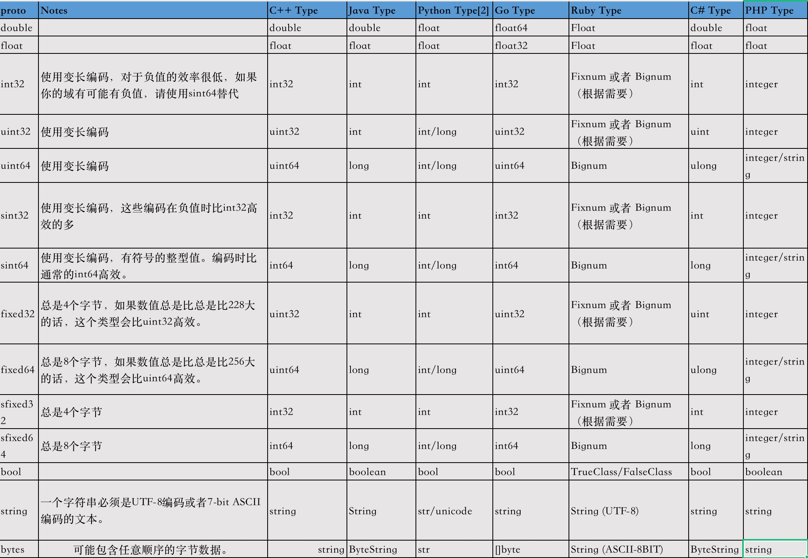

# 3.ProtoBuf3基本使用
## 基本类型
```
syntax = "proto3";

package com.example.hello;

message SimpleProto {
  string use_string=1;
  int32 use_int32=3;
  uint32 use_uint32=4;
  sint32 use_sint32=5;
  int64 use_int64=6;
  fixed32 use_fixed32=7;
  fixed64 use_fixed64=8;
  double use_double=9;
  float use_float=10;
  bool use_bool=11;
  bytes use_bytes=12;
}
```
## 嵌套类型
```
syntax = "proto3";

package com.example.hello;

message NestedProto {
  string name = 1;
  ChildProto child = 2;
  message ChildProto {
    string name = 1;
  }
}
```
## 集合类型
```
syntax = "proto3";

package com.example.hello;

message RepeatProto {
  repeated string name = 1;
  repeated ChildProto child = 2;
}
message ChildProto {
  string name = 1;
}
```
## 枚举类型
```
syntax = "proto3";

package com.example.hello;

message EnumsProto {
  string use_string=1;
  Enums enums = 2;
  enum Enums {
    STATUS_OFF = 0;
    STATUS_ON = 1;
  }
}
```
## 导入其它proto
```
syntax = "proto3";
import "simple.proto";
package com.example.hello;

message ImportProto {
  SimpleProto simple=1;
}
```
## Map类型
```
syntax = "proto3";

package com.example.hello;

message MapProto {
  map<sint32,sint32> map_int=1;
  map<string,sint32> map_str=2;
//  map<float,sint32> map_float=3;
//  map<bytes,sint32> map_double=4;
}
```
## 各语言类型映射

