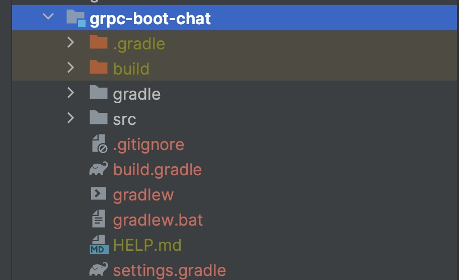
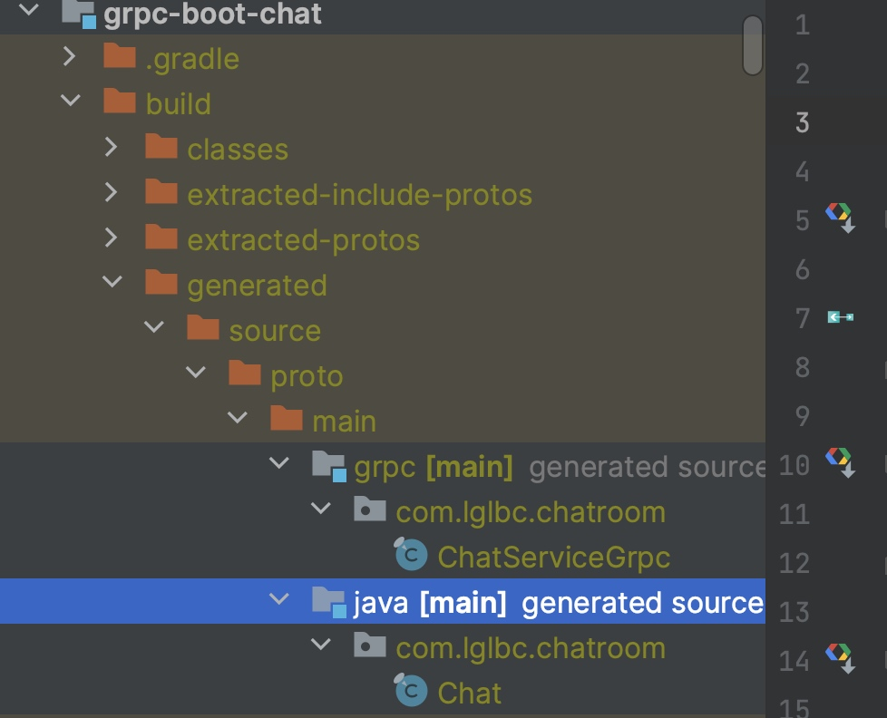
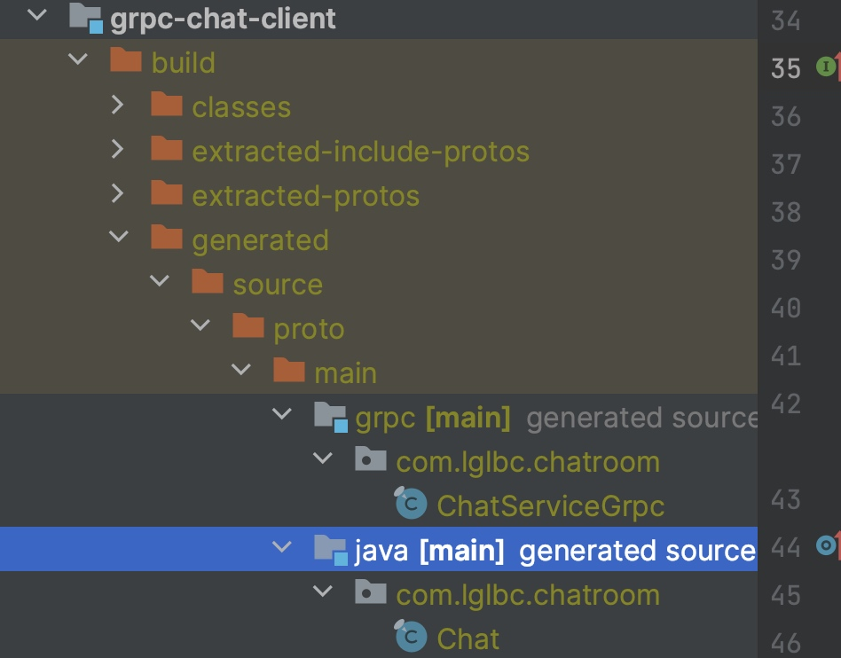
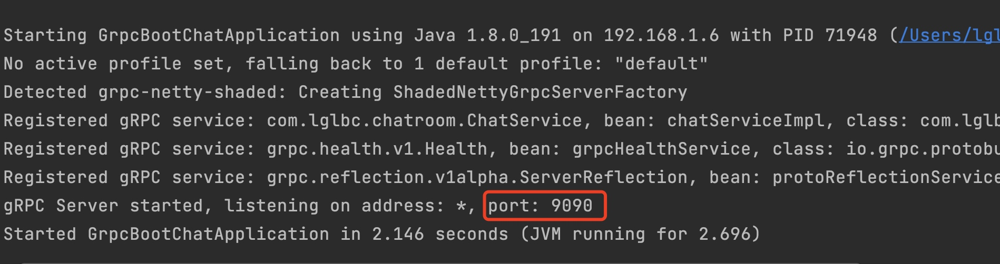
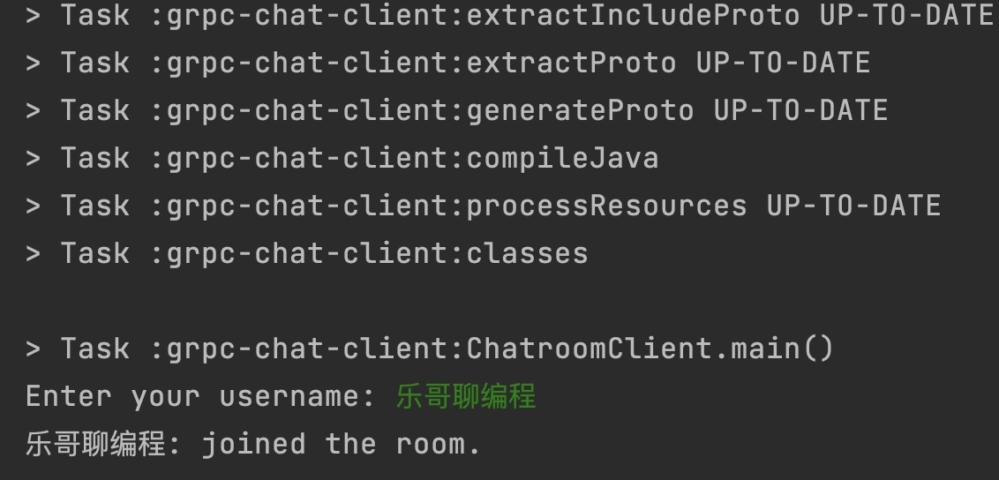
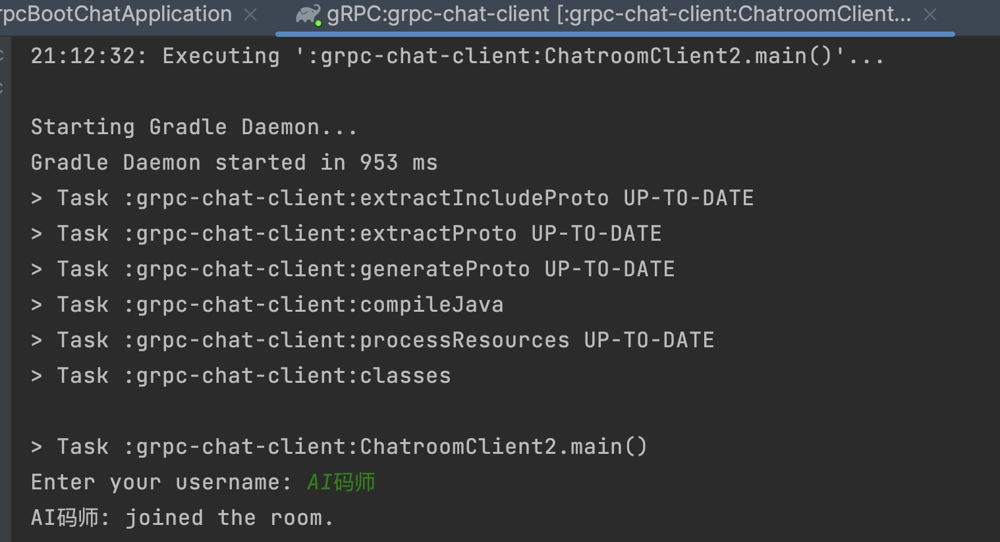
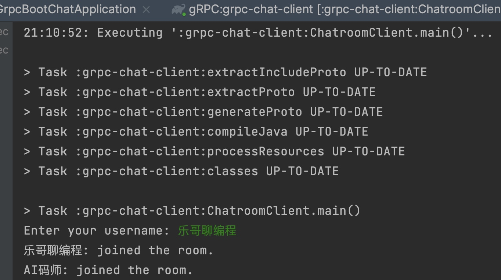
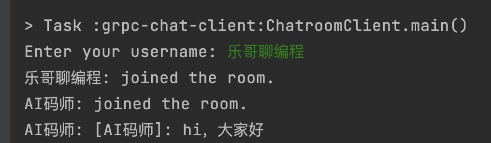
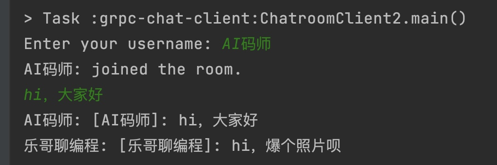

# 6.实战gRPC整合SpringBoot实现简单聊天室

这节课通过整合SpringBoot实现一个简单聊天室
## 聊天室服务端搭建
### 创建一个SpringBoot项目

### 配置gradle
#### 添加插件
```
plugins {
    id 'java'
    id 'com.google.protobuf' version '0.9.4'
    id 'org.springframework.boot' version '2.7.14'
    id 'io.spring.dependency-management' version '1.0.15.RELEASE'
}
```
#### 设置版本信息
```
def grpcVersion = '1.57.2' // CURRENT_GRPC_VERSION
def protobufVersion = '3.24.0'
def protocVersion = protobufVersion
```
#### 必备依赖
```
dependencies {
    implementation "net.devh:grpc-spring-boot-starter:2.14.0.RELEASE"
    implementation "io.grpc:grpc-protobuf:${grpcVersion}"
    implementation "io.grpc:grpc-services:${grpcVersion}"
    implementation "io.grpc:grpc-stub:${grpcVersion}"
    compileOnly "org.apache.tomcat:annotations-api:6.0.53"
    implementation "com.google.protobuf:protobuf-java:${protobufVersion}"
    // examples/advanced need this for JsonFormat
    implementation "com.google.protobuf:protobuf-java-util:${protobufVersion}"
    runtimeOnly "io.grpc:grpc-netty-shaded:${grpcVersion}"
    implementation 'org.springframework.boot:spring-boot-starter'
    testImplementation 'org.springframework.boot:spring-boot-starter-test'
}
```
#### 配置protobuf
```
protobuf {
    protoc { artifact = "com.google.protobuf:protoc:${protocVersion}" }
    plugins {
        grpc { artifact = "io.grpc:protoc-gen-grpc-java:${grpcVersion}" }
    }
    generateProtoTasks {
        all()*.plugins { grpc {} }
    }
}
sourceSets {
    main {
        java {
            srcDirs 'build/generated/source/proto/main/grpc'
            srcDirs 'build/generated/source/proto/main/java'
        }
    }
}
```
### 定义chatproto
```
syntax = "proto3";

package com.example.chatroom;

service ChatService {
  rpc JoinRoom (stream JoinRequest) returns (stream ChatMessage);
  rpc SendMessage (ChatMessage) returns (Empty);
}

message JoinRequest {
  string username = 1;
}

message ChatMessage {
  string username = 1;
  string message = 2;
}

message Empty {}

```
#### 生成java文件
```
 ./gradlew generateProto
```

### 实现核心逻辑
```
package com.example.grpcbootchat;

import com.example.chatroom.Chat;
import com.example.chatroom.ChatServiceGrpc;
import io.grpc.stub.StreamObserver;
import net.devh.boot.grpc.server.service.GrpcService;

import java.util.concurrent.ConcurrentHashMap;

@GrpcService
public class ChatServiceImpl extends ChatServiceGrpc.ChatServiceImplBase {

    private final ConcurrentHashMap<String, StreamObserver<Chat.ChatMessage>> userObservers = new ConcurrentHashMap<>();

    @Override
    public StreamObserver<Chat.JoinRequest> joinRoom(StreamObserver<Chat.ChatMessage> responseObserver) {
        return new StreamObserver<Chat.JoinRequest>() {
            private String username;

            @Override
            public void onNext(Chat.JoinRequest joinRequest) {
                username = joinRequest.getUsername();
                userObservers.put(username, responseObserver);

                broadcastMessage(username, "joined the room.");
            }

            @Override
            public void onError(Throwable t) {
                userObservers.remove(username);
                broadcastMessage(username, "left the room.");
            }

            @Override
            public void onCompleted() {
                userObservers.remove(username);
                broadcastMessage(username, "left the room.");
                responseObserver.onCompleted();
            }
        };
    }

    @Override
    public void sendMessage(Chat.ChatMessage request, StreamObserver<Chat.Empty> responseObserver) {
        String message = "[" + request.getUsername() + "]: " + request.getMessage();
        broadcastMessage(request.getUsername(), message);
        responseObserver.onNext(Chat.Empty.getDefaultInstance());
        responseObserver.onCompleted();
    }

    private void broadcastMessage(String username, String message) {
        Chat.ChatMessage chatMessage = Chat.ChatMessage.newBuilder()
                .setUsername(username)
                .setMessage(message)
                .build();

        for (StreamObserver<Chat.ChatMessage> observer : userObservers.values()) {
            observer.onNext(chatMessage);
        }
    }
}

```
代码解释
* userObservers：维护客户端的channel
* onNext: 维护userObservers
* broadcastMessage：广播消息给其他客户端

## 搭建客户端
客户端比较简单，拷贝之前的实现就可以
### 拷贝服务端生成的java文件


### 实现客户端逻辑
```
package com.example;


import com.example.chatroom.Chat;
import com.example.chatroom.ChatServiceGrpc;
import io.grpc.ManagedChannel;
import io.grpc.ManagedChannelBuilder;
import io.grpc.stub.StreamObserver;

import java.util.Scanner;

public class ChatroomClient {

    public static void main(String[] args) {
        ManagedChannel channel = ManagedChannelBuilder.forAddress("localhost", 9090)
                .usePlaintext()
                .build();

        ChatServiceGrpc.ChatServiceStub stub = ChatServiceGrpc.newStub(channel);

        Scanner scanner = new Scanner(System.in);
        System.out.print("Enter your username: ");
        String username = scanner.nextLine();

        StreamObserver<Chat.ChatMessage> chatStreamObserver = new StreamObserver<Chat.ChatMessage>() {
            @Override
            public void onNext(Chat.ChatMessage chatMessage) {
                System.out.println(chatMessage.getUsername() + ": " + chatMessage.getMessage());
            }

            @Override
            public void onError(Throwable throwable) {
                System.out.println("Error: " + throwable.getMessage());
            }

            @Override
            public void onCompleted() {
                System.out.println("Chat stream completed.");
            }
        };

        StreamObserver<Chat.JoinRequest> joinStreamObserver = stub.joinRoom(chatStreamObserver);

        joinStreamObserver.onNext(Chat.JoinRequest.newBuilder().setUsername(username).build());

        while (true) {
            String message = scanner.nextLine();
            if ("exit".equalsIgnoreCase(message)) {
                joinStreamObserver.onCompleted();
                break;
            }

            Chat.ChatMessage chatMessage = Chat.ChatMessage.newBuilder()
                    .setUsername(username)
                    .setMessage(message)
                    .build();
            stub.sendMessage(chatMessage, new StreamObserver<Chat.Empty>() {
                @Override
                public void onNext(Chat.Empty value) {}

                @Override
                public void onError(Throwable t) {
                    System.out.println("Error sending message: " + t.getMessage());
                }

                @Override
                public void onCompleted() {}
            });
        }

        channel.shutdown();
    }
}

```
## 演示
### 启动服务端

### 启动客户端

再启动一个客户端


发送一个消息


