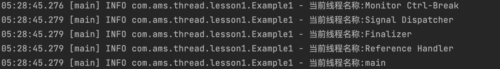
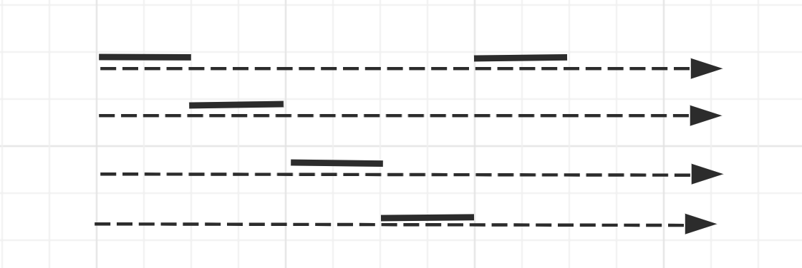
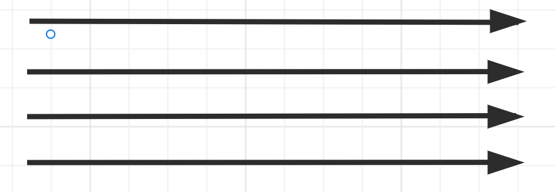
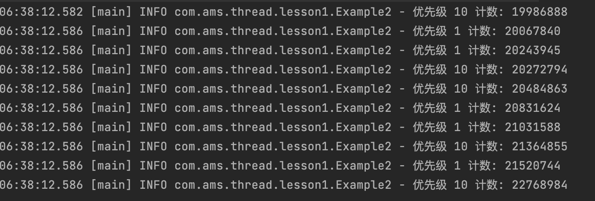
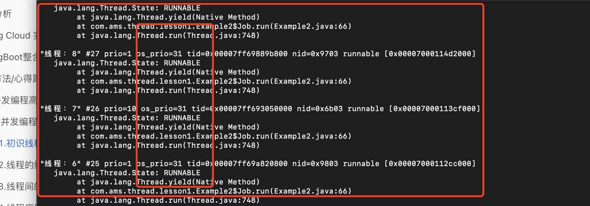
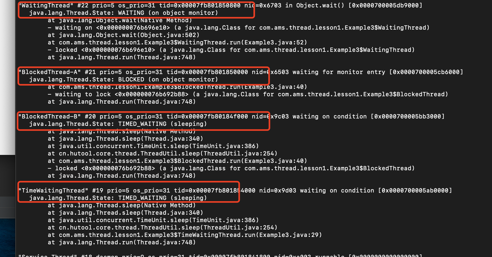
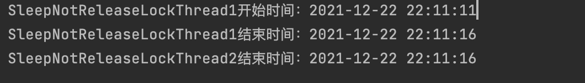
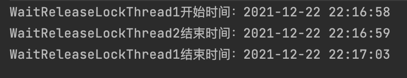
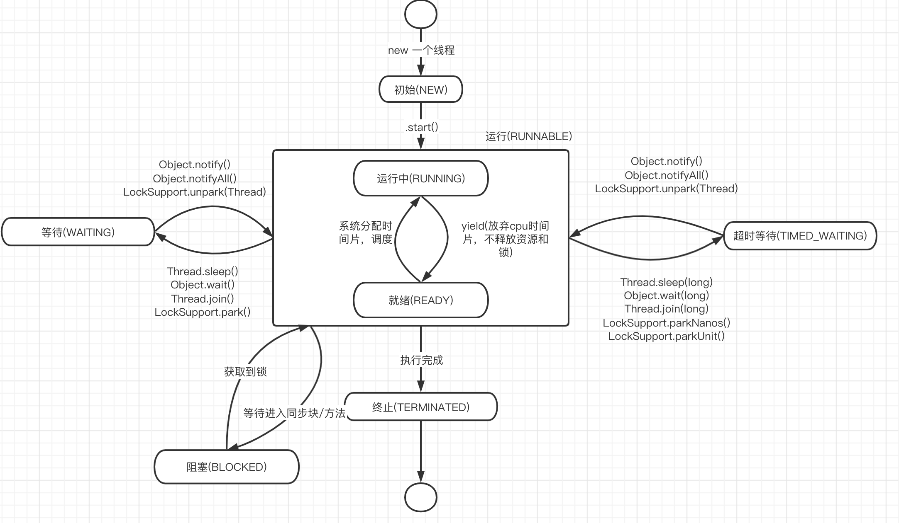

# 1.初识线程

## 什么是线程
用户启动一个程序时，其实就启动了一个进程，然后线程是属于进程的，一个进程是可以创建多个线程，线程是操作系统调度的基本单元。每个线程都拥有自己的计数器、堆和栈等局部变量。操作系统目前都执行多任务并发执行，如果是在单个CPU情况下，就是来回切换线程，是用户感觉这些任务(线程)都是在同时执行。
java 本身就是支持多线程的，我们在启动main方法时，其实就是开辟了一个新的线程去启动，我们可以看下下面的演示代码：
```
package com.ams.thread.lesson1;

import lombok.extern.slf4j.Slf4j;

import java.lang.management.ManagementFactory;
import java.lang.management.ThreadInfo;
import java.lang.management.ThreadMXBean;

/**
 * 演示java 本身就是多线程
 *
 * @author: 示例作者
 * Date: 2021/12/21 5:19 上午
 * Description:
 */
@Slf4j
public class Example1 {
    public static void main(String[] args) {
        ThreadMXBean threadMXBean = ManagementFactory.getThreadMXBean();
        ThreadInfo[] threadInfos = threadMXBean.dumpAllThreads(false, false);
        for (ThreadInfo threadInfo : threadInfos) {
            log.info("当前线程名称:{}",threadInfo.getThreadName());
        }
    }
}

```

从输出结果可以看到，当前已经启动了五个线程，并且最后一个线程是main，也就是用来启动我们main方法的线程。
## 为什么需要引入线程

- 更多的处理器核心

随着计算机处理器的CPU核数越来越多，也就是说我们程序有更多的机会争取到CPU资源，如果我们的程序一直都是以单线程运行，那么这些CPU资源将会被浪费。如果使用多线程技术的话，程序可以把这些任务分发到不同的CPU核上面，并行去处理。

- 更快的响应时间

引入多线程后，任务从串行执行编程并行执行，很将执行时间能够得到显著的提升

## 如何理解并发和并行

- 并发

任务交替执行，同一时刻只有一个任务执行，通过线程进行切换完成，存在多处理器和单处理器中


- 并行

任务同时执行，存在多处理器中

## 线程优先级(理解有这个概念就好)
凡事都有优先级，在java线程中，也是可以通过设置优先级来决定线程一次性被分配的时间片个数。
在java中，通过setProperty（Integer value）来设置线程的优先级，默认是5。针对频繁发生IO阻塞的线程需要设置较高优先级，CPU占用时间长的线程需要设置较低的优先级，确保处理器不会被线程独占。
需要注意的是，在不同操作系统中，针对线程优先级的处理是不同的，有些操作系统会忽略这个配置。所以不能过于依赖通过设置线程优先级来保证最终执行结果。
通过代码验证设置优先级是会生效
```
package com.ams.thread.lesson1;

import cn.hutool.core.thread.ThreadUtil;
import lombok.extern.slf4j.Slf4j;

import java.util.ArrayList;
import java.util.Comparator;
import java.util.List;
import java.util.stream.Collectors;

/**
 * 验证设置线程优先级会被忽略
 *
 * @author: 示例作者
 * Date: 2021/12/21 5:19 上午
 * Description:
 */
@Slf4j
public class Example2 {
    private static volatile boolean start = false;
    private static volatile boolean end = false;


    public static void main(String[] args) {
        List<Job> jobs = new ArrayList<>();
        for (int i = 0; i < 10; i++) {
            Job job = new Job(i % 2 == 0 ? 1 : 10);
            jobs.add(job);
            new Thread(job).start();
        }
        start = true;
        ThreadUtil.sleep(10000);
        end = true;
        List<Job> sortJob = jobs.stream().sorted(new Comparator<Job>() {
            @Override
            public int compare(Job o1, Job o2) {
                return o1.count - o2.count;
            }
        }).collect(Collectors.toList());
        for (Job job : sortJob) {
            log.info("优先级 {} 计数: {}",job.priority,job.count);
        }

    }

    static class Job implements Runnable {
        private int priority;
        private int count;

        public Job(int property) {
            this.priority = property;
        }

        @Override
        public void run() {
            while (!start) {
                Thread.yield();
            }
            while (!end) {
                Thread.yield();
                count++;
            }
        }
    }
}

```
输出结果：设置优先级并没有生效

通过jsatck工具，查看运行时线程内部情况

- top 定位进程id
- jstack pid 进入到进程内部查看线程


## 线程的状态
通过运行以下代码，先看下线程都有哪些状态
### 演示代码
```
package com.ams.thread.lesson1;

import cn.hutool.core.thread.ThreadUtil;
import lombok.extern.slf4j.Slf4j;

import java.util.concurrent.TimeUnit;

/**
 * 测试线程状态
 *
 * @author: 示例作者
 * Date: 2021/12/21 5:19 上午
 * Description:
 */
@Slf4j
public class Example3 {
    public static void main(String[] args) {
        new Thread(new TimeWaitingThread(), "TimeWaitingThread").start();
        new Thread(new BlockedThread(), "BlockedThread-B").start();
        new Thread(new BlockedThread(), "BlockedThread-A").start();
        new Thread(new WaitingThread(), "WaitingThread").start();
    }

    static class TimeWaitingThread implements Runnable {
        @Override
        public void run() {
            while (true) {
                ThreadUtil.sleep(200, TimeUnit.SECONDS);
            }
        }
    }

    static class BlockedThread implements Runnable {
        @Override
        public void run() {
            synchronized (BlockedThread.class) {

                while (true) {
                    ThreadUtil.sleep(200, TimeUnit.SECONDS);
                }
            }
        }
    }

    static class WaitingThread implements Runnable {
        @Override
        public void run() {
            while (true) {
                synchronized (WaitingThread.class) {
                    try {
                        WaitingThread.class.wait();
                    } catch (InterruptedException e) {
                        e.printStackTrace();
                    }
                }
            }
        }
    }
}

```
### 打印线程状态

- jps 找到对应进程（Example3）
- jstack 对应进程pid


### 线程状态

- NEW

初识状态，线程被构建，但是还没有调用start方法

- RUNNABLE

线程处于就绪和正在运行状态，获取CPU使用权，线程会处于就绪中，获取到CPU时间片后，线程会处于running状态。

- BLOCKED

线程阻塞状态：等待其他线程释放锁

- WAITING

线程进入无限等待状态，需要等待其它线程唤醒

- TIME_WAITING

超时等待状态，等到指定时间段后，会自动唤醒

- TERMINATED

线程运行结束，线程终止
### sleep 和 wait的区别
它们俩的区别是：sleep 不释放锁，wait会释放锁

#### 验证sleep释放锁
```
package com.ams.thread.lesson1;

import cn.hutool.core.date.DateUtil;
import cn.hutool.core.thread.ThreadUtil;
import lombok.extern.slf4j.Slf4j;

import java.util.Date;
import java.util.concurrent.TimeUnit;

/**
 * 验证sleep  不释放锁
 *
 * @author: 示例作者
 * Date: 2021/12/21 5:19 上午
 * Description:
 */
@Slf4j
public class Example4 {

    public static void main(String[] args) {
        new Thread(new SleepNotReleaseLockThread1()).start();
        ThreadUtil.sleep(1, TimeUnit.SECONDS);
        new Thread(new SleepNotReleaseLockThread2()).start();
    }
    static class SleepNotReleaseLockThread1 implements Runnable {
        @Override
        public void run() {
            synchronized (Example4.class) {
                System.out.println("开始时间：" + DateUtil.format(new Date(), "yyyy-MM-dd HH:mm:ss"));
                ThreadUtil.sleep(5, TimeUnit.SECONDS);
                System.out.println("结束时间：" + DateUtil.format(new Date(), "yyyy-MM-dd HH:mm:ss"));
            }
        }
    }
    static class SleepNotReleaseLockThread2 implements Runnable {
        @Override
        public void run() {
            synchronized (Example4.class) {
                System.out.println("结束时间：" + DateUtil.format(new Date(), "yyyy-MM-dd HH:mm:ss"));
            }
        }
    }
}

```
从结果可以看出，虽然线程1调用了sleep，但是线程2还是在阻塞状态，等待线程1释放锁，所以验证sleep不会释放锁

#### 验证wait 释放锁
```
package com.ams.thread.lesson1;

import cn.hutool.core.date.DateUtil;
import cn.hutool.core.thread.ThreadUtil;
import lombok.extern.slf4j.Slf4j;

import java.util.Date;
import java.util.concurrent.TimeUnit;

/**
 * 验证wait  释放锁
 *
 * @author: 示例作者
 * Date: 2021/12/21 5:19 上午
 * Description:
 */
@Slf4j
public class Example5 {

    public static void main(String[] args) {
        new Thread(new WaitReleaseLockThread1()).start();
        ThreadUtil.sleep(1, TimeUnit.SECONDS);
        new Thread(new WaitReleaseLockThread2()).start();

    }
    static class WaitReleaseLockThread1 implements Runnable {
        @Override
        public void run() {
            synchronized (Example5.class) {
                System.out.println("WaitReleaseLockThread1开始时间：" + DateUtil.format(new Date(), "yyyy-MM-dd HH:mm:ss"));
                try {
                    Example5.class.wait(5000);
                } catch (InterruptedException e) {
                    e.printStackTrace();
                }
                System.out.println("WaitReleaseLockThread1结束时间：" + DateUtil.format(new Date(), "yyyy-MM-dd HH:mm:ss"));
            }
        }
    }
    static class WaitReleaseLockThread2 implements Runnable {
        @Override
        public void run() {
            synchronized (Example5.class) {
                System.out.println("WaitReleaseLockThread2结束时间：" + DateUtil.format(new Date(), "yyyy-MM-dd HH:mm:ss"));
            }
        }
    }
}

```
从验证结果可以看出，线程2并没有等待线程1执行完毕，说明当线程1调用wait方法时，就已经释放锁了，线程2才能获取到这个锁，所以结论是 wait会释放锁

### 线程状态转换

## Daemon线程
Daemon 是一种守护线程，他等所有业务线程(非daemon线程)结束后，就会将自己进行销毁，结束线程
```
package com.ams.thread.lesson1;

import cn.hutool.core.thread.ThreadUtil;
import lombok.extern.slf4j.Slf4j;

import java.util.concurrent.TimeUnit;

/**
 * 验证Daemon 线程
 *
 * @author: 示例作者
 * Date: 2021/12/21 5:19 上午
 * Description:
 */
@Slf4j
public class Example6 {

    public static void main(String[] args) {
        Thread thread = new Thread(new DaemonThread());
        thread.setDaemon(true);
        thread.start();

    }

    static class DaemonThread implements Runnable {
        @Override
        public void run() {
            ThreadUtil.sleep(3, TimeUnit.SECONDS);
            System.out.printf("daemon 运行结束");
        }
    }
}

```
大家可以尝试去除 thread.setDaemon(true); 这个设置，看看输出结果可有什么不一样？
