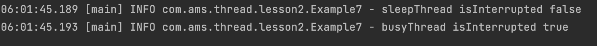
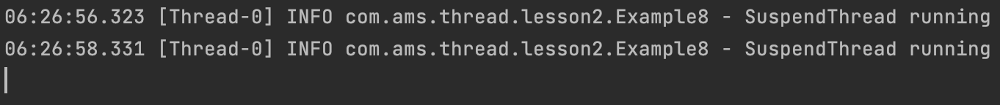
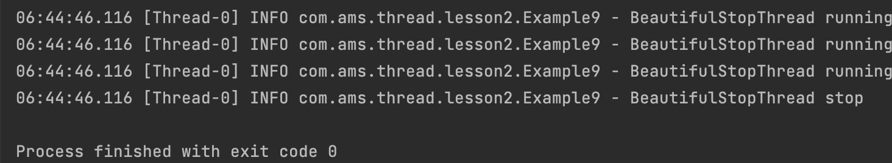

# 2.如何优雅的中断线程

## 启动线程
线程在初始化完成之后，调用start方法就可以启动线程，
## 什么是中断
中断是作为线程的一个标志位，表示运行中的线程是否被其它线程做了中断操作。中断的意思是其他线程对本线程调用interrupt方法，使其标志位变成中断。
线程自身通过检查中断标志位是否为true（通过调用isInterrupted()来进行判断),如果为true，则说明已经被其他线程做了中断操作。
如果有的方法抛出了(InterruptedException),则会在抛出此异常之前，将中断标志进行清除（Thread.interrupted()），如（sleep方法）所以这个时候你如果调用isInterrupted()方法，将会返回false。
我们可以通过一段代码进行演示：
```
package com.ams.thread.lesson2;

import cn.hutool.core.thread.ThreadUtil;
import lombok.extern.slf4j.Slf4j;

import java.util.concurrent.TimeUnit;

/**
 * 验证
 *
 * @author: 示例作者
 * Date: 2021/12/21 5:19 上午
 * Description:
 */
@Slf4j
public class Example7 {

    public static void main(String[] args) {
        Thread sleepThread = new Thread(new SleepThread());
        Thread busyThread = new Thread(new BusyThread());   
        sleepThread.start();
        busyThread.start();
        ThreadUtil.sleep(3000);
        sleepThread.interrupt();
        busyThread.interrupt();
        log.info("sleepThread isInterrupted {}",sleepThread.isInterrupted());
        log.info("busyThread isInterrupted {}",busyThread.isInterrupted());
    }

    static class SleepThread implements Runnable {
        @Override
        public void run() {
           while (true){
               ThreadUtil.sleep(5000);
           }
        }
    }

    static class BusyThread implements Runnable {
        @Override
        public void run() {
           while (true){

           }
        }
    }
}

```
通过输出结果可以看到，sleep在抛出中断异常之前，将标志位清除了;
sleep源码是打不开的，声明了native，使用c++实现的。

## 这些方法已经不建议用了
中断或暂停线程的方法包括：suspend()、resume()、stop().
大家在使用这些方法去停止线程时，发现已经被标注成弃用了，为什么会被启用呢？
原因是由于调用这些方法停止线程后，线程本身所占用的资源(如suspend 不会释放锁)并不会被释放，导致资源一直不能被其它线程使用，我们可以通过下面这段代码验证下：
```
package com.ams.thread.lesson2;

import cn.hutool.core.thread.ThreadUtil;
import lombok.extern.slf4j.Slf4j;

/**
 * 验证
 *
 * @author: 示例作者
 * Date: 2021/12/21 5:19 上午
 * Description:
 */
@Slf4j
public class Example8 {

    public static void main(String[] args) {
        Thread suspendThread = new Thread(new SuspendThread());
        Thread normalThread = new Thread(new NormalThread());
        suspendThread.start();
        ThreadUtil.sleep(5000);
        normalThread.start();
        suspendThread.suspend();
        log.info("suspendThread isInterrupted");
    }

    static class SuspendThread implements Runnable {
        @Override
        public void run() {
            synchronized (Example8.class){
                while (true){
                    ThreadUtil.sleep(2000);
                    log.info("SuspendThread running");
                }
            }
        }
    }
    static class NormalThread implements Runnable {
        @Override
        public void run() {
            synchronized (Example8.class){
                log.info("NormalThread 获取锁");
            }
        }
    }
}

```
通过输出就够可以看到：我在调用线程的suspend()方法后，SuspendThread并没有继续打印，但是NormalThread线程却一直打印没有获得锁的日志。

那么问题就来了：如果这些终止线程的方法，都不可用，那么我怎么能优雅的终止一个线程呢？
## 优雅的终止线程
可以通过两种方式：

- 通过中断标志位进行判断是否终止异常，A线程想停止B线程，则调用B线程的interrupt()方法，B线程通过在运行过程中判断中断标志位是否为true来决定是否终止线程
- 自定义一个变量，通过外界对此变量的操作，使线程进行终止
```
package com.ams.thread.lesson2;

import cn.hutool.core.thread.ThreadUtil;
import lombok.extern.slf4j.Slf4j;

/**
 * 验证
 *
 * @author: 示例作者
 * Date: 2021/12/21 5:19 上午
 * Description:
 */
@Slf4j
public class Example9 {

    public static void main(String[] args) {
        BeautifulStopThread run = new BeautifulStopThread();
        Thread beautifulStopThread = new Thread(run);
        beautifulStopThread.start();
        ThreadUtil.sleep(5000);
//        run.stop();
        beautifulStopThread.interrupt();

    }
    static class BeautifulStopThread implements Runnable {
        boolean boolStop = false;
        @Override
        public void run() {
            synchronized (Example9.class) {
                while (!boolStop && !Thread.currentThread().isInterrupted()) {
                    log.info("BeautifulStopThread running");
                }
                log.info("BeautifulStopThread stop");
            }
        }
        public void stop() {
            this.boolStop = true;
        }
    }
}

```
通过结果可以看出 stop方法和interrupt方法都可以使线程优雅的停止。

