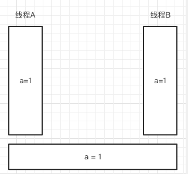
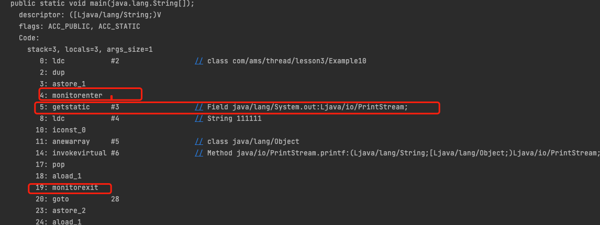
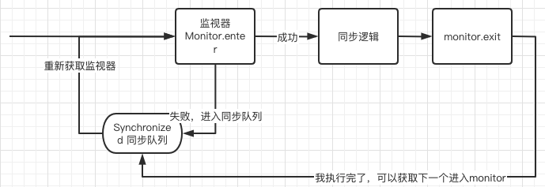
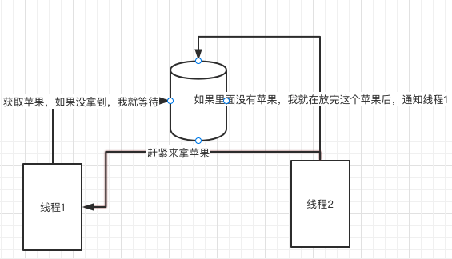
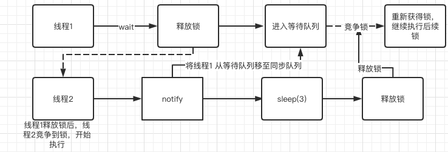
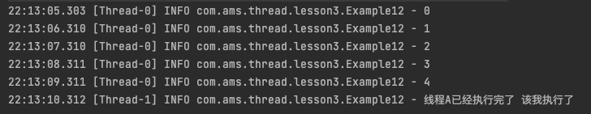
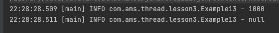

# 3.线程间的通信

线程启动后，它会在自己独有的栈空间里面运行，但是实际上，两个线程之间是会相互通信的，因为只有这样才能使线程间更加灵活，是资源使用的更加充分。
## volatile 和synchronized 关键字
### volatile 关键字
首先：volatile 存在的意义就是保证共享变量的可见性。
#### 什么叫做可见性呢？
可见性体现在：两个线程对同一个共享变量进行操作，其中一个线程对其修改，另外一个线程是看不到这个变化的。
#### 为什么会出现这个原因呢？
这个是由于jvm内存模型决定的，内存模型分为共享区域和线程私有区域，线程启动后会把共享区域的变量作为副本存到自己内部，所以当线程修改变量时，知识对自己生效，其他线程并不会感知到，看下图：

#### volatile 怎么解决可见性的问题呢？
当对volatile 修饰的变量进行修改时，会将当前改变刷新到共享区域，并且使其他存有该变量的线程访问的内存地址失效，重新到共享区域获取该变量。

### synchronized
大家对这个肯定不陌生，这个关键字就是给代码块或者方法加锁的，那么经它修饰后的代码，会变成什么样呢？我们反编译看下如下代码：
```
package com.ams.thread.lesson3;

/**
 * javap -v com.ams.thread.lesson3.Example10
 *
 * @author: 示例作者
 * Date: 2021/12/26 8:57 下午
 * Description:
 */
public class Example10 {
    public static void main(String[] args) {
        synchronized (Example10.class){
					System.out.printf("111111");
        }
    }
}

```

通过反编译后的结果可以看出来：jvm在我们的代码前后加上了monitor和monitorexit,通过这个实现锁的功能，细心的同学可以看出来，反编译结果里面有两个monitorexit，这是jvm为了保证成功释放监视器，做的一个兜底操作。

我们看下，加上synchronized关键字之后，线程间是如何竞争的：

## 等待通知
首先说下本节的场景是什么：

1. 现在有两个线程
2. 线程1需要从苹果篮子里面拿苹果
3. 线程2往苹果篮子里面放苹果

那么线程1 的操作肯定是无限循环下去，一直查询容器里面是否有苹果，有的话我就拿出来，没有我就继续循环；为了防止cpu一直被占用，线程1加上了sleep几秒后再获取，但是这样会造成获取不及时的问题，那么怎么能解决这个问题呢？

jvm 给我们提供了对象级别的 等待和通知方法：当线程1发现篮子里面没有苹果了，就进行等待，线程2只要判断放入苹果之前，篮子是空的，就会在放入苹果之后，通知线程1开始拿苹果。

### 相关方法

- notify：通知一个在对象上等待的线程，使其从wait方法返回(必须重新获得当前对象的锁)
- notifyall：通知对象上等待的所有线程
- wait：调用该方法后，进入waiting状态，释放当前对象锁
- wait(long)：等待指定时间后，如果还没有被唤醒，则唤醒自己，重新获得锁后，返回主方法。
### 演示与流程
```
package com.ams.thread.lesson3;

import cn.hutool.core.thread.ThreadUtil;
import lombok.extern.slf4j.Slf4j;

/**
 *
 * @author: 示例作者
 * Date: 2021/12/26 8:57 下午
 * Description:
 */
@Slf4j
public class Example11 {
    public static Object lock = new Object();
    public static void main(String[] args) {
        new Thread(new WaitThread()).start();
        ThreadUtil.sleep(1000);
        new Thread(new NotifyThread()).start();
    }

    static class NotifyThread implements Runnable{

        @Override
        public void run() {
            synchronized (lock){
                log.info("NotifyThread 获得锁");
                lock.notify();
                log.info("通知等待线程 3秒后执行");
                ThreadUtil.sleep(3000);
            }
        }
    }
    static class WaitThread implements Runnable {
        @Override
        public void run() {
            try {
                synchronized (lock){
                    log.info("WaitThread 获得锁");
                    lock.wait();
                    log.info("WaitThread 重新获得锁 继续执行");
                }
            } catch (InterruptedException e) {
                e.printStackTrace();
            }
        }
    }
}

```
从输出结果可以看出 NotifyThread在调用notify之后，并没有释放锁，而是等后面代码执行完之后，才释放锁。


### join是用来做什么？
如果你有这样一个需求：在多线程中，如果线程A想要等待线程B结束后，才去执行某个方法，在这种场景下，你就可以使用join方法。
```
package com.ams.thread.lesson3;

import cn.hutool.core.thread.ThreadUtil;
import lombok.extern.slf4j.Slf4j;

/**
 * 验证join的作用
 * @author: 示例作者
 * Date: 2021/12/26 8:57 下午
 * Description:
 */
@Slf4j
public class Example12 {
    public static Object lock = new Object();
    public static void main(String[] args) {
        Thread threadA = new Thread(new ThreadA());
        Thread threadB = new Thread(new ThreadB(threadA));
        threadB.start();
        threadA.start();
    }

    static class ThreadA implements Runnable{

        @Override
        public void run() {
            for (int i=0;i<5;i++){
                log.info(String.valueOf(i));
                ThreadUtil.sleep(1000);
            }
        }
    }
    static class ThreadB implements Runnable{
        private Thread thread;
        public ThreadB(Thread thread){
            this.thread = thread;
        }
        @Override
        public void run() {
            try {
                thread.join();
                log.info("线程A已经执行完了 该我执行了");
            } catch (InterruptedException e) {
                e.printStackTrace();
            }
        }
    }
}

```
从输入结果可以看出，虽然线程B在线程A之前执行，但是还线程A先执行完，线程B菜结束执行，所以这就是join在起作用了。

#### 探究下源码
我们可以在深入点，看下join的源码：
最终是调用wait（0），一直等待，知道被唤醒
```
   public final void join() throws InterruptedException {
        join(0);
    }
    
  // join(0)
  if (millis == 0) {
            while (isAlive()) {
                wait(0);
            }
  } else {

public final native void wait(long timeout) throws InterruptedException;
        
```
### 高频ThreadLocal的使用
threadLocal 是线程级的变量，他是一个以当前线程对key，任意对象为值的一个变量。
用法很简单 ，set 设置值，get 获取设置过的值。

#### 为什么都说它会导致内存溢出？
注意：不要在线程池里面使用这个变量，会很容易导致内存溢出的，因为在线程池里面，线程很少会被释放的，所以它维护的变量会越来越大，除非你在任务执行后，对它做了清除操作。
#### 使用
```
package com.ams.thread.lesson3;

import lombok.extern.slf4j.Slf4j;

/**
 * 验证ThreadLocal的使用
 *
 * @author: 示例作者
 * Date: 2021/12/26 8:57 下午
 * Description:
 */
@Slf4j
public class Example13 {
    private static ThreadLocal<Integer> threadLocal = new ThreadLocal<>();

    public static void main(String[] args) {
        threadLocal.set(1000);
        log.info(threadLocal.get() + "");
        threadLocal.remove();
        // 执行remove后，就获取不到了
        log.info(threadLocal.get() + "");
    }
}

```
从执行结果可以看出：执行remove之后，就拿不到存的值了

