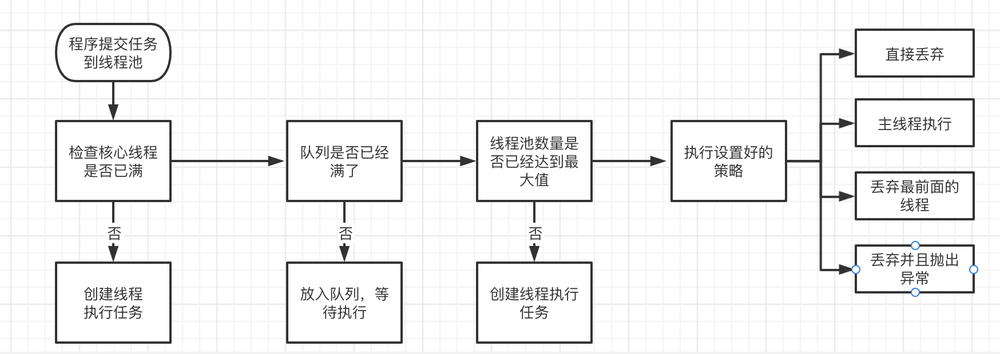
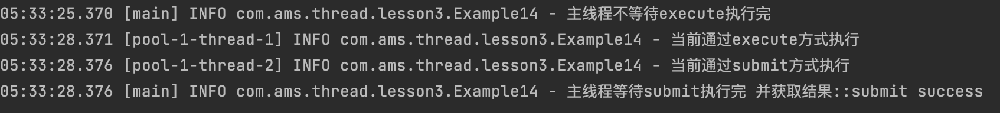

# 4.线程池

虽然线程给我们程序带来了更高的执行效率，但是线程不是创建的越多越好，那么线程创建的过多，会带来什么问题呢？

- 线程之间频繁的进行上下文切换，增加系统的负载
- 线程的创建和销毁本身也是非常消耗资源的

所以为了解决上面这个问题，让线程不再使用结束就销毁，而是重复进行使用，jvm引入了线程池。

## 什么是线程池？
线程池里面存放了若干数量的线程，这些线程给我们程序去使用，使用的时候，就去线程池里面娶一个，用完了再还回来，而不再是自我销毁。
线程池带来的好处：

- 降低资源消耗
- 提高相应速度
- 提高线程的可管理型
## 线程池的实现原理

从图中我们可以看到完整的执行流程

1. 线程提交到线程池
2. 判断核心线程池是否已经达到设定的数量，如果没有达到，则直接创建线程执行任务
3. 如果达到了，则放在队列中，等待执行
4. 如果队列已经满了，则判断线程的数量是否已经达到设定的最大值，如果达到了，则直接执行拒绝策略
5. 如果没有达到，则创建线程执行任务。
## 线程池的使用
### 线程池的创建
```
        ThreadPoolExecutor threadPoolExecutor = new ThreadPoolExecutor(10, 20, 1000, TimeUnit.DAYS, new ArrayBlockingQueue<>(10));

```
### 线程池的基本参数包括：
#### corePoolSize
线程池中的核心线程数量，当线程池中的任务大于这个数量时，将不再创建核心线程，而是将任务放到队列中。

#### runnableTaskQueue
任务队列，当核心线程数量达到上线后，会放到任务队列中

- ArrayBlockingQueue：基于数组，有界阻塞队列
- LinkedBlockingQueue:基于链表的无界阻塞队列
- SynchronizedQueue:只允许一个任务在队列中，必须等待前面的线程执行完，才能放进去
- PriorityBlockingQueue:可以设置优先级的阻塞队列
#### maximumPoolSize
线程最大数量，如果线程中的线程数量超过这个值，会执行拒绝策略，如果使用了无界的队列，该参数就没用了。
#### ThreadFactory
创建线程的工厂
#### RejectExecutionHandler
拒绝策略，用来设定当线程数量已经达到上线而执行的策略

- AboryPolicy:直接抛出异常
- CallRunsPolicy:调用主线程执行
- DiscardOldestPolicy:丢弃队列里的最近一个任务，并执行当前任务
- DiscardPolicy:不处理，直接丢弃
### 提交任务的方式
#### execute
该方法用于不需要返回值的场景
```
       threadPoolExecutor.execute(new Runnable() {
            @Override
            public void run() {
                ThreadUtil.sleep(3000);
                log.info("当前通过execute方式执行");
            }
        });
```
#### submit
通过该方法可以获取线程执行后的返回值
```
        Future<?> future = threadPoolExecutor.submit(new Callable<String>() {
            @Override
            public String call() throws Exception {
                ThreadUtil.sleep(3000);
                log.info("当前通过submit方式执行");
                return "submit success";
            }
        });
```
完整代码
```
package com.ams.thread.lesson3;

import cn.hutool.core.thread.ThreadUtil;
import lombok.extern.slf4j.Slf4j;

import java.util.concurrent.*;

/**
 * 提交任务的两种方式
 *
 * @author: 示例作者
 * Date: 2021/12/26 8:57 下午
 * Description:
 */
@Slf4j
public class Example14 {
    private static ThreadLocal<Integer> threadLocal = new ThreadLocal<>();

    public static void main(String[] args) throws ExecutionException, InterruptedException {
        ThreadPoolExecutor threadPoolExecutor = new ThreadPoolExecutor(10, 20, 1000, TimeUnit.DAYS, new ArrayBlockingQueue<>(10));
        threadPoolExecutor.execute(new Runnable() {
            @Override
            public void run() {
                ThreadUtil.sleep(3000);
                log.info("当前通过execute方式执行");
            }
        });
        log.info("主线程不等待execute执行完");
        Future<?> future = threadPoolExecutor.submit(new Callable<String>() {
            @Override
            public String call() throws Exception {
                ThreadUtil.sleep(3000);
                log.info("当前通过submit方式执行");
                return "submit success";
            }
        });
        log.info("主线程等待submit执行完 并获取结果::"+future.get());
        threadPoolExecutor.shutdown();
    }


}

```

## 关闭线程池
关闭线程的方式也有两种

- shutdown
- shuwdownNow
### 两者的区别是什么呢？
shutdownNow 中断那些正在执行和暂停的任务，通过遍历线程，依次执行interrupt方
法，设置中断位，如果任务不响应这个中断的话，将永远不会停止。

shutdown 只中断空闲的任务，没有在执行的任务。
## 如何合理的配置线程池呢？
CPU密集型：需要做大量的计算任务
IO密集型：需要做比较耗时的文件读写操作

我这里有几点建议：
CPU密集型：N(cpu)+1
IO密集型：2*N(cpu)
