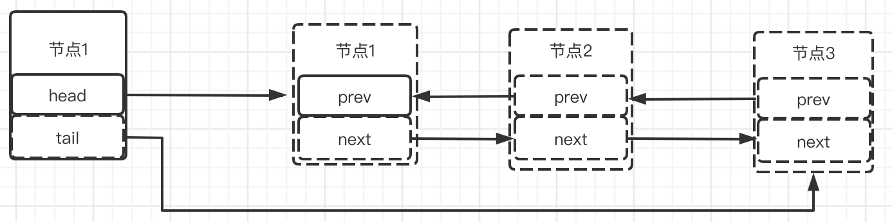
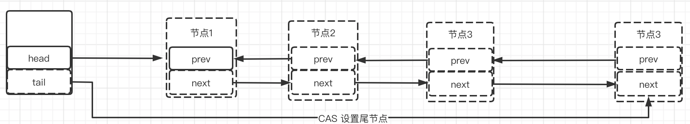
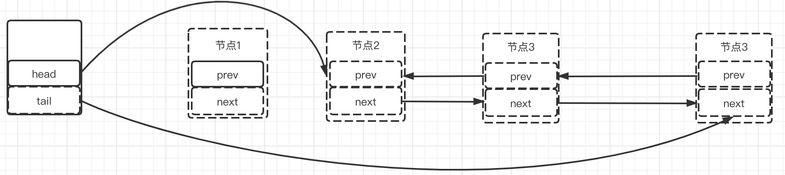
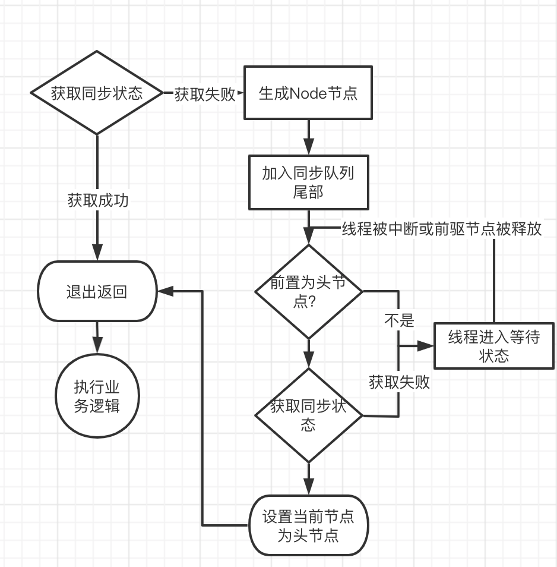
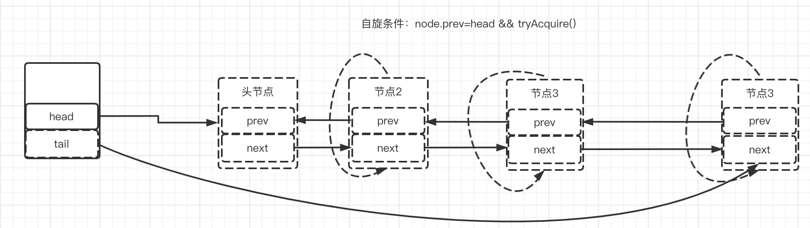

# 7.队列同步器实现原理

## 同步队列
当前线程获取锁失败，会构造一个Node节点，添加到同步队列的尾端，同时阻塞当前线程，当同步状态释放时，会唤醒首节点，让首节点再次竞争获取锁

###  Node 节点信息

- waitStatus
   - CANCELLED:取消状态
   - SIGNAL：当前节点的线程如果释放了同步状态，将会通知后续节点，使后继节点得以运行
   - CONDITION:节点在等待队列中，如果其他线程调用了signal()方法后，会从等待队列移到同步队列中
   - PROPAGATE：表示下一次共享状态被无条件广播下去，
   - INITIAL：初始状态
- prev:前驱节点
- next:后驱节点
- nextWaiter:等待队列中的后继节点
- thread:获取同步状态的线程
### 同步队列的结构

### 设置尾节点的过程
1.当线程获取同步状态失败时，会加入到同步队列中
2.加入同步队列的尾节点时，必须要保证线程安全
3.在加入尾节点时，通过cas机制，compareAndSetTail()保证线程安全
4.只有设置成功后，才与之前的尾节点建立联系。

### 设置首节点的过程
1.设置首节点是没有线程安全问题的
2.因为释放同步状态时，只会唤醒后继节点
3.后继节点获取到同步状态时，就会将自己设置为首节点，并断开与原首节点的引用。

## 独占锁获取的流程

### 节点自旋获取同步状态

1. 前驱节点为头节点
2. 获取同步状态成功

满足上面两个条件，则退出自旋

### 锁的释放
调用release释放锁，通过unparkSuccessor唤醒头节点的后驱节点
```
    public final boolean release(int arg) {
        if (tryRelease(arg)) {
            Node h = head;
            if (h != null && h.waitStatus != 0)
                unparkSuccessor(h);
            return true;
        }
        return false;
    }
```

