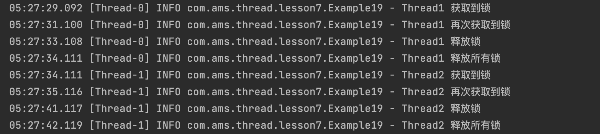

# 8.重入锁

## 什么是重入锁？
从字面意思理解就是“重新进入同步区域”，同一个线程，多次获取一把锁。
## 哪些锁支持重入呢？
### Synchronized
synchronized是支持重入的，它是隐式的获取去重入锁，如下：
```
package com.ams.thread.lesson7;

import lombok.extern.slf4j.Slf4j;

/**
 *
 * @author: 示例作者
 * Date: 2021/12/30 6:08 上午
 * Description:
 */
@Slf4j
public class Example17 {
    public static void main(String[] args) {
        new Thread(new Thread1()).start();
    }

    static class Thread1 implements Runnable {

        @Override
        public void run() {
            synchronized (Example17.class) {
                synchronized (Example17.class) {
                    log.info("成功获取重入锁");
                }
            }
        }
    }
}

```
### ReentrantLock
reentrantLock 也是支持重入的，不过他是需要显示的获取重入锁，并且它还可以支持非公平和公平锁：
```
package com.ams.thread.lesson7;

import lombok.extern.slf4j.Slf4j;

import java.util.Locale;
import java.util.concurrent.locks.Lock;
import java.util.concurrent.locks.ReentrantLock;

/**
 *
 * @author: 示例作者
 * Date: 2021/12/30 6:08 上午
 * Description:
 */
@Slf4j
public class Example18 {
    private static ReentrantLock lock = new ReentrantLock();
    public static void main(String[] args) {
        new Thread(new Thread1()).start();
    }

    static class Thread1 implements Runnable {

        @Override
        public void run() {
            lock.lock();
            lock.lock();
            log.info("获取到重入锁");
            lock.unlock();
            lock.unlock();

        }
    }
}

```
## 实现重入锁，关键点是什么？
### 重复进入
当前线程本次获取锁之后，下次在获取改锁的时候，判断为当前线程则直接进入，不阻塞。
### 锁的释放
如果线程进入了n次，那么它只有释放n次之后，才是真正的释放锁。

我们前面实现了一个锁，但是它是不支持重入的，我们现在给他进行改造：

## 手写一个重入锁
### 改造的关键点：

- 获取锁时，需要判断当前锁是否被占用，如果没有被占用则获取，否则判断是否是当前线程占用，如果是则计数加1，否则等待锁释放。
- 锁的释放，锁释放时要判断是否是当前线程，如果是，则计数减1，直到为0 ，才是真正释放锁
### 上代码
```
package com.ams.thread.lesson7;

import java.util.concurrent.TimeUnit;
import java.util.concurrent.locks.AbstractQueuedSynchronizer;
import java.util.concurrent.locks.Condition;
import java.util.concurrent.locks.Lock;

/**
 * 实现重入锁
 *
 * @author: 示例作者
 * Date: 2021/12/30 6:09 上午
 * Description:
 */
public class ReentrantMutexLock implements Lock {
    private final LockAQS lockAQS = new LockAQS();

    @Override
    public void lock() {
        lockAQS.acquire(1);
    }

    @Override
    public void lockInterruptibly() throws InterruptedException {
        lockAQS.acquireInterruptibly(1);
    }

    @Override
    public boolean tryLock() {
        return lockAQS.tryAcquire(1);
    }

    @Override
    public boolean tryLock(long time, TimeUnit unit) throws InterruptedException {
        return lockAQS.tryAcquireNanos(1, unit.toNanos(time));
    }

    @Override
    public void unlock() {
        lockAQS.release(1);
    }

    @Override
    public Condition newCondition() {
        return lockAQS.newCondition();
    }

    private static class LockAQS extends AbstractQueuedSynchronizer {
        /**
         * 重新获取锁的逻辑，只有当前同步状态为0，才允许获取成功
         *
         * @param arg
         * @return
         */
        @Override
        protected boolean tryAcquire(int arg) {
            // 通过cas机制去设置新值，如果当前锁没有被占用，则期望值肯定为0 并且新值为 获取的资源数量
            if (compareAndSetState(0, 1)) {
                setExclusiveOwnerThread(Thread.currentThread());
                return true;
                // 当前则为重新获取同一把锁，则进行计数加1
            } else if (getExclusiveOwnerThread() == Thread.currentThread()) {
                return compareAndSetState(getState(), getState() + 1);
            }
            return false;
        }

        @Override
        protected boolean tryRelease(int arg) {
            // 首先判断当前state 如果当前状态值不是大于0 则释放非法
            if (getState() == 0) {
                return false;
            }
            //  判断当前获取锁的线程是否是当前线程 如果是的，则可以释放锁，否则抛出异常
            if (Thread.currentThread() != getExclusiveOwnerThread())
                throw new IllegalMonitorStateException();
            // 计数减去当前获取的资源
            setState(getState() - 1);
            // 计数为0，则代表全部释放，将独占线程标识置空
            if (getState() == 0) {
                setExclusiveOwnerThread(null);
            }
            return true;
        }

        Condition newCondition() {
            return new ConditionObject();
        }
    }

}

```
```
package com.ams.thread.lesson7;

import cn.hutool.core.thread.ThreadUtil;
import com.ams.thread.lesson5.MyMutexLock;
import lombok.extern.slf4j.Slf4j;

/**
 * 验证重入锁
 * @author: 示例作者
 * Date: 2021/12/30 6:08 上午
 * Description:
 */
@Slf4j
public class Example19 {
private static ReentrantMutexLock reentrantMutexLock = new ReentrantMutexLock();

    public static void main(String[] args) {
        new Thread(new Thread1()).start();
        new Thread(new Thread2()).start();
    }
    static class Thread1 implements Runnable {

        @Override
        public void run() {
            reentrantMutexLock.lock();
            ThreadUtil.sleep(1000);
            log.info("Thread1 获取到锁");
            ThreadUtil.sleep(1000);
            reentrantMutexLock.lock();
            ThreadUtil.sleep(1000);
            log.info("Thread1 再次获取到锁");
            ThreadUtil.sleep(1000);
            reentrantMutexLock.unlock();
            ThreadUtil.sleep(1000);
            log.info("Thread1 释放锁");
            reentrantMutexLock.unlock();
            ThreadUtil.sleep(1000);
            log.info("Thread1 释放所有锁");
        }
    }
    static class Thread2 implements Runnable {

        @Override
        public void run() {
            reentrantMutexLock.lock();
            ThreadUtil.sleep(1000);
            log.info("Thread2 获取到锁");
            reentrantMutexLock.lock();
            ThreadUtil.sleep(1000);
            log.info("Thread2 再次获取到锁");
            ThreadUtil.sleep(5000);
            ThreadUtil.sleep(1000);
            reentrantMutexLock.unlock();
            log.info("Thread2 释放锁");
            reentrantMutexLock.unlock();
            ThreadUtil.sleep(1000);
            log.info("Thread2 释放所有锁");
        }
    }
}

```
通过执行结果可以看出：输出结果是按照我们期望执行的。
需要注意的是，使用该锁在调用unlock方法时，锁被立即释放，并不会等待当前方法块执行完，和synchronized同步块，所以严禁在unlock方法后继续写需要进行同步逻辑


