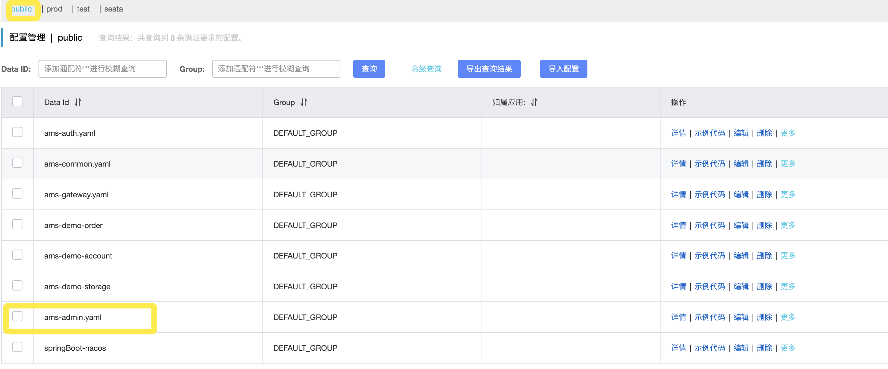
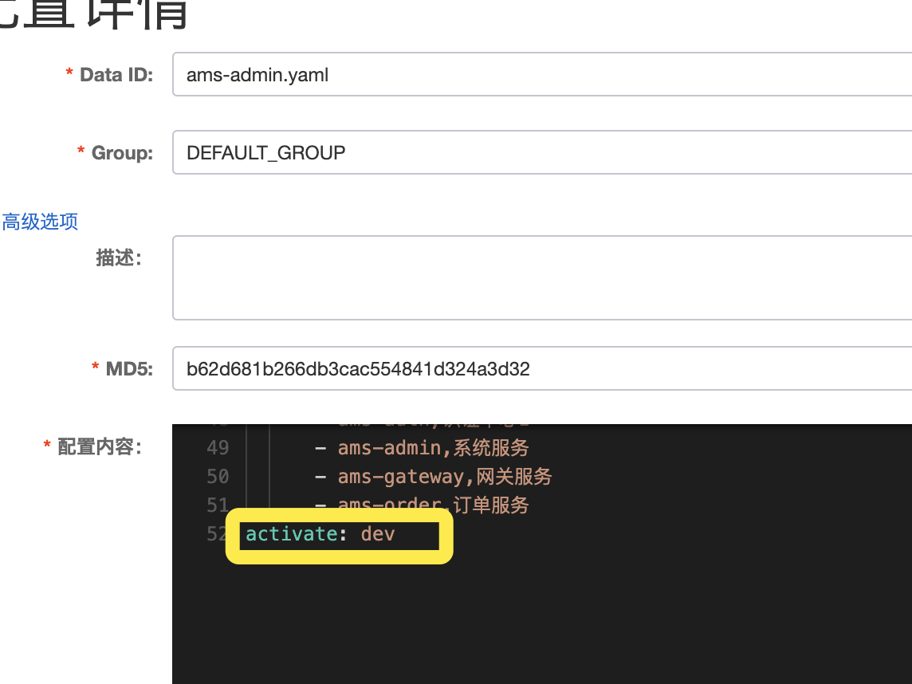
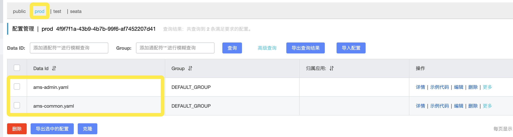
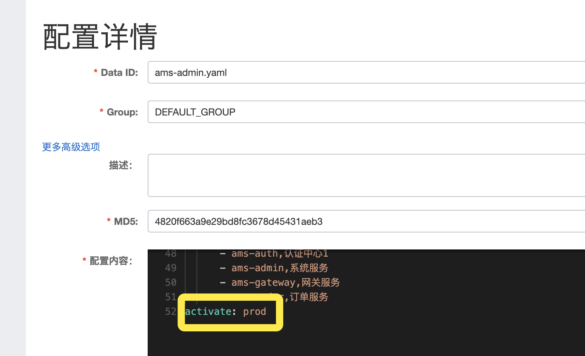
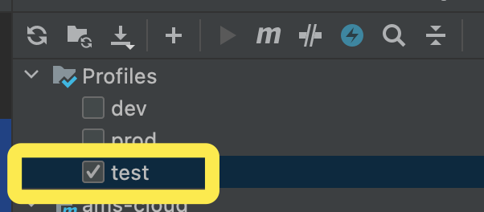
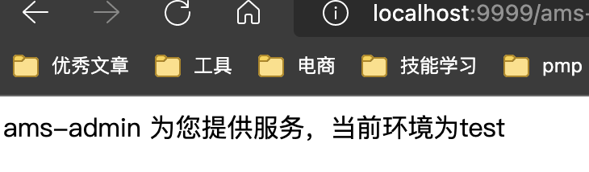
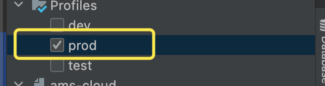
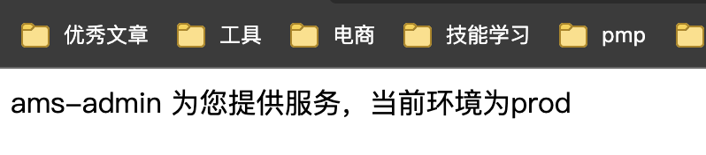
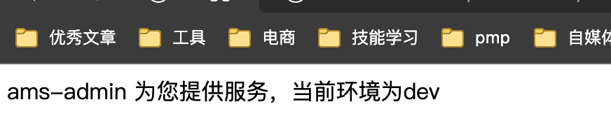

# 11.SpringCloud+Nacos+Maven 实现多环境切换

问题：
在开发过程中往往会有多种环境，如开发环境、测试环境、生产环境等等。如果将配置文件写在一个文件里，上不同环境时手动切换，这肯定是不建议的，特别是针对现在微服务架构模式。


实现多环境切换有很多方式，既然我们项目已经用了nacos,那我们就直接使用nacos的命名空间和maven profile来实现。
## 创建nacos 配置文件

- dev

 这里用户就是默认的命名空间：public



- prod

创建新的命名空间：prod。保存好命名空间的ID，后面需要用到
复制两个配置文件到prod命名空间。



- test

创建新的命名空间：test。保存好命名空间的ID，后面需要用到
复制两个配置文件到test命名空间。
## 编辑build打包
```
       <resources>
            <resource>
                <directory>src/main/resources</directory>
                <filtering>true</filtering>
            </resource>
        </resources>
```
## 编辑profiles
```
  
  <!--配置测试开发生产环境-->
    <profiles>
        <profile>
            <!--开发环境-->
            <id>dev</id>
            <!-- 加了这个，默认选中 -->
            <activation>
                <activeByDefault>true</activeByDefault>
            </activation>
            <properties>
                <activatedProperties>dev</activatedProperties>
                <!-- dev对应的命名空间id 默认public 为空 -->
                <nacosNamespace></nacosNamespace>
                <nacosAddress>http://192.168.64.2:8848</nacosAddress>
            </properties>
        </profile>
        <profile>
            <!--测试环境-->
            <id>test</id>
            <properties>
                <activatedProperties>test</activatedProperties>
                <!-- test对应的命名空间id -->
                <nacosNamespace>5dc70563-7aab-4870-b5eb-c2ab47ba5f86</nacosNamespace>
                <!-- test环境对应的nacos地址 -->
                <nacosAddress>http://192.168.64.2:8848</nacosAddress>
            </properties>
        </profile>
        <!--生产环境-->
        <profile>
            <id>prod</id>
            <properties>
                <activatedProperties>prod</activatedProperties>
                <!-- prod对应的命名空间id -->
                <nacosNamespace>4f9f7f1a-43b9-4b7b-99f6-af7452207d41</nacosNamespace>
                <nacosAddress>http://192.168.64.2:8848</nacosAddress>
            </properties>
        </profile>
    </profiles>
```
## 修改bootstrap.yml
这里修改ams-admin服务，用来测试
```
spring:
  application:
    name: ams-admin
  cloud:
    nacos:
      # 注册中心
      discovery:
      # 前面定义的变量
        server-addr: @nacosAddress@
      # 配置中心
      config:
        server-addr: ${spring.cloud.nacos.discovery.server-addr}
        file-extension: yaml
        # 前面定义的变量
        namespace: @nacosNamespace@
        shared-configs[0]:
          data-id: ams-common.yaml
          refresh: true
```
## 启动测试

- test




- prod




- dev



