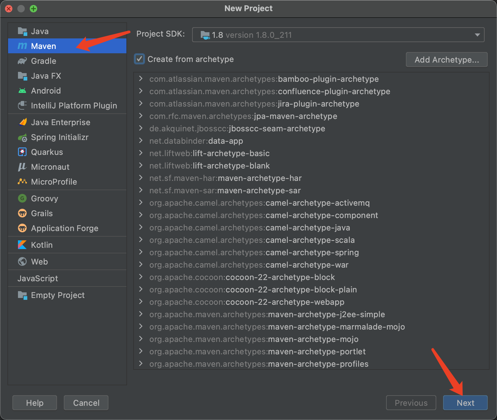
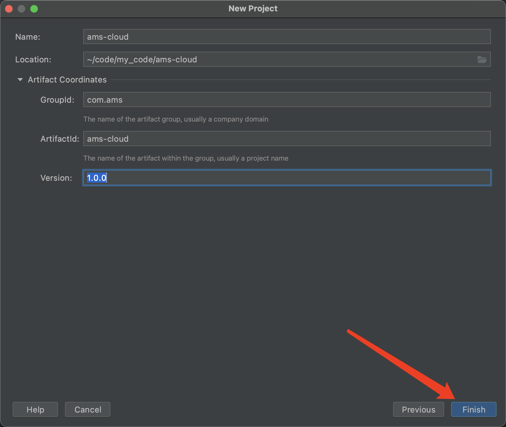
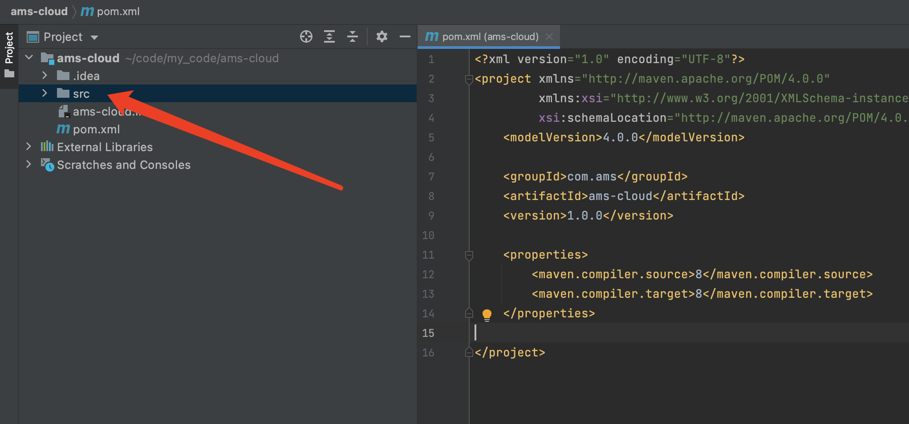
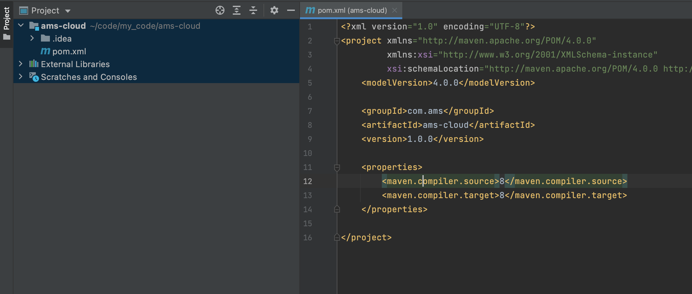
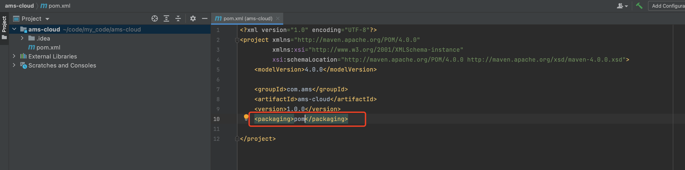

# 2.SpringCloud  父工程搭建

## 创建MAVEN项目
### 创建maven

### 填写基本信息

点击finish 即完成创建。
### 删除SRC，父工程不需要



## 修改POM信息
### 修改打包方式为pom

### 修改父项目为SpringBoot
```
    <parent>
        <groupId>org.springframework.boot</groupId>
        <artifactId>spring-boot-starter-parent</artifactId>
        <version>2.5.4</version>
        <relativePath/> <!-- lookup parent from repository -->
    </parent>
```
### 添加即将要用的版本信息
```
    <properties>
        <spring-boot.version>2.5.4</spring-boot.version>
        <spring-cloud.version>2020.0.3</spring-cloud.version>
        <spring-cloud-alibaba.version>2021.1</spring-cloud-alibaba.version>
        <ams.version>1.0.0</ams.version>
        <hutool.version>5.5.8</hutool.version>
    </properties>
```
### 添加常用依赖,建议不要因太多，可以通过公共模块引入
```
<dependencies>
        <dependency>
            <groupId>org.projectlombok</groupId>
            <artifactId>lombok</artifactId>
        </dependency>
        <dependency>
            <groupId>cn.hutool</groupId>
            <artifactId>hutool-all</artifactId>
            <version>${hutool.version}</version>
        </dependency>
    </dependencies>
```
### 添加SpringCloud 相关的依赖控制
这简单说下dependencyManagement 的作用：
在多模块项目中，通过在父工程引入dependencyManagement控制，来管理子工程依赖的版本，子工程直接引入依赖，不再需要填写版本号，由父工程统一管理，父工程自己并不会引入这些依赖的
```
    <dependencyManagement>
        <dependencies>
        <!--Spring Cloud 相关依赖-->
        <dependency>
            <groupId>org.springframework.cloud</groupId>
            <artifactId>spring-cloud-dependencies</artifactId>
            <version>${spring-cloud.version}</version>
            <type>pom</type>
            <scope>import</scope>
        </dependency>

        <!--Spring Cloud & Alibaba 相关依赖-->
        <dependency>
            <groupId>com.alibaba.cloud</groupId>
            <artifactId>spring-cloud-alibaba-dependencies</artifactId>
            <version>${spring-cloud-alibaba.version}</version>
            <type>pom</type>
            <scope>import</scope>
        </dependency>
                  <dependency>
                <groupId>mysql</groupId>
                <artifactId>mysql-connector-java</artifactId>
                <version>${mysql.version}</version>
            </dependency>

            <dependency>
                <groupId>com.alibaba</groupId>
                <artifactId>druid-spring-boot-starter</artifactId>
                <version>${druid.version}</version>
            </dependency>

            <dependency>
                <groupId>com.baomidou</groupId>
                <artifactId>mybatis-plus-boot-starter</artifactId>
                <version>${mybatis-plus.version}</version>
            </dependency>
        </dependencies>
    </dependencyManagement>
```
### 完成的pom信息如下
```
<?xml version="1.0" encoding="UTF-8"?>
<project xmlns="http://maven.apache.org/POM/4.0.0"
         xmlns:xsi="http://www.w3.org/2001/XMLSchema-instance"
         xsi:schemaLocation="http://maven.apache.org/POM/4.0.0 http://maven.apache.org/xsd/maven-4.0.0.xsd">
    <modelVersion>4.0.0</modelVersion>

    <groupId>com.ams</groupId>
    <artifactId>ams-cloud</artifactId>
    <version>1.0.0</version>
    <packaging>pom</packaging>
    <parent>
        <groupId>org.springframework.boot</groupId>
        <artifactId>spring-boot-starter-parent</artifactId>
        <version>2.5.4</version>
        <relativePath/> <!-- lookup parent from repository -->
    </parent>
    <properties>
        <spring-boot.version>2.5.4</spring-boot.version>
        <spring-cloud.version>2020.0.3</spring-cloud.version>
        <spring-cloud-alibaba.version>2021.1</spring-cloud-alibaba.version>
        <ams.version>1.0.0</ams.version>
        <hutool.version>5.5.8</hutool.version>
    </properties>
    <dependencies>
        <dependency>
            <groupId>org.projectlombok</groupId>
            <artifactId>lombok</artifactId>
        </dependency>
        <dependency>
            <groupId>cn.hutool</groupId>
            <artifactId>hutool-all</artifactId>
            <version>${hutool.version}</version>
        </dependency>
    </dependencies>
    <dependencyManagement>
        <dependencies>
        <!--Spring Cloud 相关依赖-->
        <dependency>
            <groupId>org.springframework.cloud</groupId>
            <artifactId>spring-cloud-dependencies</artifactId>
            <version>${spring-cloud.version}</version>
            <type>pom</type>
            <scope>import</scope>
        </dependency>

        <!--Spring Cloud & Alibaba 相关依赖-->
        <dependency>
            <groupId>com.alibaba.cloud</groupId>
            <artifactId>spring-cloud-alibaba-dependencies</artifactId>
            <version>${spring-cloud-alibaba.version}</version>
            <type>pom</type>
            <scope>import</scope>
        </dependency>
        </dependencies>
    </dependencyManagement>
</project>
```
到此，父工程搭建结束。
## 总结
本篇文章介绍了如何创建SpringCloud 父工程以及dependencyManagement相关概念介绍，下一期将介绍如何整合SpringSecurity，实现认证中心
