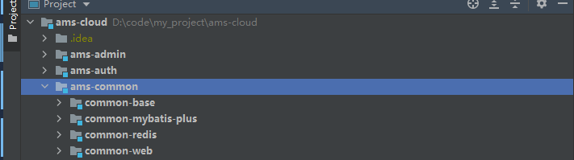

# 3.SpringCloud 整合common模块 
## 创建新模块 ams-common
当前目录结构

## 基础包封装
### 引入必备依赖
```c
    <dependencies>
        <dependency>
            <groupId>com.fasterxml.jackson.core</groupId>
            <artifactId>jackson-databind</artifactId>
        </dependency>
        <dependency>
            <groupId>com.fasterxml.jackson.core</groupId>
            <artifactId>jackson-core</artifactId>
        </dependency>
    </dependencies>
```
### 创建返回结果合响应实体
```c
package com.ams.common.result;
/**
 * Created with IntelliJ IDEA.
 *
 * @date： 2021/11/24
 * @description：
 * @modifiedBy：
 * @version: 1.0
 */
public interface IResultCode {

    String getCode();

    String getMsg();

}

```
```c
package com.ams.common.result;

import com.fasterxml.jackson.annotation.JsonInclude;
import lombok.Data;

import java.io.Serializable;

/**
 * Created with IntelliJ IDEA.
 *
 * @date： 2021/11/24
 * @description：
 * @modifiedBy：
 * @version: 1.0
 */
@Data
@JsonInclude(JsonInclude.Include.NON_NULL)
public class R<T> implements Serializable {

    private String code;

    private T data;

    private String msg;

    private Integer total;

    public static <T> R<T> ok() {
        return ok(null);
    }

    public static <T> R<T> ok(T data) {
        ResultCode rce = ResultCode.SUCCESS;
        if (data instanceof Boolean && Boolean.FALSE.equals(data)) {
            rce = ResultCode.SYSTEM_EXECUTION_ERROR;
        }
        return result(rce, data);
    }

    public static <T> R<T> ok(T data, Long total) {
        R<T> result = new R<>();
        result.setCode(ResultCode.SUCCESS.getCode());
        result.setMsg(ResultCode.SUCCESS.getMsg());
        result.setData(data);
        result.setTotal(total.intValue());
        return result;
    }


    public static <T> R<T> failed() {
        return result(ResultCode.SYSTEM_EXECUTION_ERROR.getCode(), ResultCode.SYSTEM_EXECUTION_ERROR.getMsg(), null);
    }

    public static <T> R<T> failed(String msg) {
        return result(ResultCode.SYSTEM_EXECUTION_ERROR.getCode(), msg, null);
    }

    public static <T> R<T> judge(boolean status) {
        if (status) {
            return ok();
        } else {
            return failed();
        }
    }

    public static <T> R<T> failed(IResultCode resultCode) {
        return result(resultCode.getCode(), resultCode.getMsg(), null);
    }

    public static <T> R<T> failed(IResultCode resultCode, String msg) {
        return result(resultCode.getCode(), msg, null);
    }

    private static <T> R<T> result(IResultCode resultCode, T data) {
        return result(resultCode.getCode(), resultCode.getMsg(), data);
    }

    private static <T> R<T> result(String code, String msg, T data) {
        R<T> result = new R<>();
        result.setCode(code);
        result.setData(data);
        result.setMsg(msg);
        return result;
    }


    public static boolean isSuccess(R<?> result) {
        return result != null && ResultCode.SUCCESS.getCode().equals(result.getCode());
    }
}

```
```c
package com.ams.common.result;

import lombok.AllArgsConstructor;
import lombok.NoArgsConstructor;

import java.io.Serializable;

/**
 * Created with IntelliJ IDEA.
 *
 * @date： 2021/11/24
 * @description：
 * @modifiedBy：
 * @version: 1.0
 */
@AllArgsConstructor
@NoArgsConstructor
public enum ResultCode implements IResultCode, Serializable {

    SUCCESS("000000", "成功"),
    SYSTEM_EXECUTION_ERROR("999999", "系统执行出错"),
    USERNAME_OR_PASSWORD_ERROR("A00100", "用户名或密码错误"),
    USER_NOT_EXIST("A00101", "用户不存在"),
    CLIENT_AUTHENTICATION_FAILED("A00212", "客户端认证失败"),
    ACCESS_UNAUTHORIZED("A00213", "未授权"),
    TOKEN_INVALID_OR_EXPIRED("A00214", "token非法或失效"),
    TOKEN_ACCESS_FORBIDDEN("A00215", "token禁止访问"),
    FLOW_LIMITING("B0210", "系统限流"),
    DEGRADATION("B0220", "系统功能降级"),
    SERVICE_NO_AUTHORITY("B0221", "服务未授权"),
    ;

    @Override
    public String getCode() {
        return code;
    }

    @Override
    public String getMsg() {
        return msg;
    }

    private String code;

    private String msg;

    @Override
    public String toString() {
        return "{" +
                "\"code\":\"" + code + '\"' +
                ", \"msg\":\"" + msg + '\"' +
                '}';
    }

}

```
这里目前就封装一些基本的
## redis 封装
在ams-common下添加新模块 common-redis
### 引入依赖
```c
    <dependencies>
        <dependency>
            <groupId>com.ams</groupId>
            <artifactId>common-base</artifactId>
            <version>${ams.version}</version>
        </dependency>

        <dependency>
            <groupId>org.springframework.boot</groupId>
            <artifactId>spring-boot-starter-data-redis</artifactId>
        </dependency>
        <dependency>
            <groupId>org.apache.commons</groupId>
            <artifactId>commons-pool2</artifactId>
        </dependency>
        <dependency>
            <groupId>org.springframework.boot</groupId>
            <artifactId>spring-boot-configuration-processor</artifactId>
            <optional>true</optional>
        </dependency>
    </dependencies>
```
### 创建redis 配置文件
```c
package com.ams.common.redis.config;

import com.fasterxml.jackson.annotation.JsonAutoDetect;
import com.fasterxml.jackson.annotation.PropertyAccessor;
import com.fasterxml.jackson.databind.ObjectMapper;
import com.fasterxml.jackson.databind.jsontype.impl.LaissezFaireSubTypeValidator;
import org.springframework.boot.autoconfigure.AutoConfigureBefore;
import org.springframework.boot.autoconfigure.data.redis.RedisAutoConfiguration;
import org.springframework.context.annotation.Bean;
import org.springframework.context.annotation.Configuration;
import org.springframework.data.redis.connection.lettuce.LettuceConnectionFactory;
import org.springframework.data.redis.core.RedisTemplate;
import org.springframework.data.redis.serializer.Jackson2JsonRedisSerializer;
import org.springframework.data.redis.serializer.StringRedisSerializer;
/**
 * Created with IntelliJ IDEA.
 *
 * @date： 2021/11/24
 * @description：
 * @modifiedBy：
 * @version: 1.0
 */
@Configuration
@AutoConfigureBefore(RedisAutoConfiguration.class)
public class RedisConfig {
    @Bean
    public RedisTemplate<String, Object> redisTemplate(LettuceConnectionFactory lettuceConnectionFactory) {

        RedisTemplate<String, Object> redisTemplate = new RedisTemplate<>();
        redisTemplate.setConnectionFactory(lettuceConnectionFactory);

        // 用Jackson2JsonRedisSerializer来序列化和反序列化redis的value值
        StringRedisSerializer stringRedisSerializer = new StringRedisSerializer();
        redisTemplate.setKeySerializer(stringRedisSerializer); // key
        Jackson2JsonRedisSerializer jackson2JsonRedisSerializer = new Jackson2JsonRedisSerializer(Object.class);
        ObjectMapper objectMapper = new ObjectMapper();
        // 指定要序列化的域(field,get,set)，访问修饰符(public,private,protected)
        objectMapper.setVisibility(PropertyAccessor.ALL, JsonAutoDetect.Visibility.ANY);
        objectMapper.activateDefaultTyping(LaissezFaireSubTypeValidator.instance, ObjectMapper.DefaultTyping.NON_FINAL);
        jackson2JsonRedisSerializer.setObjectMapper(objectMapper);

        redisTemplate.setValueSerializer(jackson2JsonRedisSerializer); //value

        redisTemplate.setHashKeySerializer(stringRedisSerializer);
        redisTemplate.setHashValueSerializer(jackson2JsonRedisSerializer);

        redisTemplate.afterPropertiesSet();
        return redisTemplate;
    }

}

```
### 创建操作redis 工具类
```c
package com.ams.common.redis.util;

import org.springframework.beans.factory.annotation.Autowired;
import org.springframework.data.redis.core.RedisTemplate;
import org.springframework.stereotype.Component;
import org.springframework.util.CollectionUtils;

import java.util.HashSet;
import java.util.List;
import java.util.Map;
import java.util.Set;
import java.util.concurrent.TimeUnit;

/**
 * Created with IntelliJ IDEA.
 *
 * @date： 2021/11/24
 * @description：
 * @modifiedBy：
 * @version: 1.0
 */
@Component
public class RedisUtils {

    /**
     * 注入redisTemplate bean
     */
    @Autowired
    private RedisTemplate<String, Object> redisTemplate;

    /**
     * 指定缓存失效时间
     *
     * @param key  键
     * @param time 时间(秒)
     * @return
     */
    public boolean expire(String key, long time) {
        try {
            if (time > 0) {
                redisTemplate.expire(key, time, TimeUnit.SECONDS);
            }
            return true;
        } catch (Exception e) {
            e.printStackTrace();
            return false;
        }
    }

    /**
     * 根据key获取过期时间
     *
     * @param key 键 不能为null
     * @return 时间(秒) 返回0代表为永久有效
     */
    public long getExpire(String key) {
        return redisTemplate.getExpire(key, TimeUnit.SECONDS);
    }

    /**
     * 判断key是否存在
     *
     * @param key 键
     * @return true 存在 false不存在
     */
    public boolean hasKey(String key) {
        try {
            return redisTemplate.hasKey(key);
        } catch (Exception e) {
            e.printStackTrace();
            return false;
        }
    }

    /**
     * 删除缓存
     *
     * @param key 可以传一个值 或多个
     */
    @SuppressWarnings("unchecked")
    public void del(String... key) {
        if (key != null && key.length > 0) {
            if (key.length == 1) {
                redisTemplate.delete(key[0]);
            } else {
                redisTemplate.delete((List<String>) CollectionUtils.arrayToList(key));
            }
        }
    }
    // ============================String(字符串)=============================

    /**
     * 普通缓存获取
     *
     * @param key 键
     * @return 值
     */
    public Object get(String key) {
        return key == null ? null : redisTemplate.opsForValue().get(key);
    }

    /**
     * 普通缓存放入
     *
     * @param key   键
     * @param value 值
     * @return true成功 false失败
     */
    public boolean set(String key, Object value) {
        try {
            redisTemplate.opsForValue().set(key, value);
            return true;
        } catch (Exception e) {
            e.printStackTrace();
            return false;
        }
    }

    /**
     * 普通缓存放入并设置时间
     *
     * @param key   键
     * @param value 值
     * @param time  时间(秒) time要大于0 如果time小于等于0 将设置无限期
     * @return true成功 false 失败
     */
    public boolean set(String key, Object value, long time) {
        try {
            if (time > 0) {
                redisTemplate.opsForValue().set(key, value, time, TimeUnit.SECONDS);
            } else {
                set(key, value);
            }
            return true;
        } catch (Exception e) {
            e.printStackTrace();
            return false;
        }
    }

    /**
     * 递增
     *
     * @param key   键
     * @param delta 要增加几(大于0)
     * @return
     */
    public long incr(String key, long delta) {
        if (delta < 0) {
            throw new RuntimeException("递增因子必须大于0");
        }
        return redisTemplate.opsForValue().increment(key, delta);
    }

    /**
     * 递减
     *
     * @param key   键
     * @param delta 要减少几(小于0)
     * @return
     */
    public long decr(String key, long delta) {
        if (delta < 0) {
            throw new RuntimeException("递减因子必须大于0");
        }
        return redisTemplate.opsForValue().increment(key, -delta);
    }
    // ================================Hash(哈希)=================================

    /**
     * HashGet
     *
     * @param key  键 不能为null
     * @param item 项 不能为null
     * @return 值
     */
    public Object hget(String key, String item) {
        return redisTemplate.opsForHash().get(key, item);
    }

    /**
     * 获取hashKey对应的所有键值
     *
     * @param key 键
     * @return 对应的多个键值
     */
    public Map<Object, Object> hmget(String key) {
        return redisTemplate.opsForHash().entries(key);
    }

    /**
     * HashSet
     *
     * @param key 键
     * @param map 对应多个键值
     * @return true 成功 false 失败
     */
    public boolean hmset(String key, Map<String, Object> map) {
        try {
            redisTemplate.opsForHash().putAll(key, map);
            return true;
        } catch (Exception e) {
            e.printStackTrace();
            return false;
        }
    }

    /**
     * HashSet 并设置时间
     *
     * @param key  键
     * @param map  对应多个键值
     * @param time 时间(秒)
     * @return true成功 false失败
     */
    public boolean hmset(String key, Map<String, Object> map, long time) {
        try {
            redisTemplate.opsForHash().putAll(key, map);
            if (time > 0) {
                expire(key, time);
            }
            return true;
        } catch (Exception e) {
            e.printStackTrace();
            return false;
        }
    }

    /**
     * 向一张hash表中放入数据,如果不存在将创建
     *
     * @param key   键
     * @param item  项
     * @param value 值
     * @return true 成功 false失败
     */
    public boolean hset(String key, String item, Object value) {
        try {
            redisTemplate.opsForHash().put(key, item, value);
            return true;
        } catch (Exception e) {
            e.printStackTrace();
            return false;
        }
    }

    /**
     * 向一张hash表中放入数据,如果不存在将创建
     *
     * @param key   键
     * @param item  项
     * @param value 值
     * @param time  时间(秒) 注意:如果已存在的hash表有时间,这里将会替换原有的时间
     * @return true 成功 false失败
     */
    public boolean hset(String key, String item, Object value, long time) {
        try {
            redisTemplate.opsForHash().put(key, item, value);
            if (time > 0) {
                expire(key, time);
            }
            return true;
        } catch (Exception e) {
            e.printStackTrace();
            return false;
        }
    }

    /**
     * 删除hash表中的值
     *
     * @param key  键 不能为null
     * @param item 项 可以使多个 不能为null
     */
    public void hdel(String key, Object... item) {
        redisTemplate.opsForHash().delete(key, item);
    }

    /**
     * 判断hash表中是否有该项的值
     *
     * @param key  键 不能为null
     * @param item 项 不能为null
     * @return true 存在 false不存在
     */
    public boolean hHasKey(String key, String item) {
        return redisTemplate.opsForHash().hasKey(key, item);
    }

    /**
     * hash递增 如果不存在,就会创建一个 并把新增后的值返回
     *
     * @param key  键
     * @param item 项
     * @param by   要增加几(大于0)
     * @return
     */
    public double hincr(String key, String item, double by) {
        return redisTemplate.opsForHash().increment(key, item, by);
    }

    /**
     * hash递减
     *
     * @param key  键
     * @param item 项
     * @param by   要减少记(小于0)
     * @return
     */
    public double hdecr(String key, String item, double by) {
        return redisTemplate.opsForHash().increment(key, item, -by);
    }
    // ============================Set(集合)=============================

    /**
     * 根据key获取Set中的所有值
     *
     * @param key 键
     * @return
     */
    public Set<Object> sGet(String key) {
        try {
            return redisTemplate.opsForSet().members(key);
        } catch (Exception e) {
            e.printStackTrace();
            return null;
        }
    }

    /**
     * 根据value从一个set中查询,是否存在
     *
     * @param key   键
     * @param value 值
     * @return true 存在 false不存在
     */
    public boolean sHasKey(String key, Object value) {
        try {
            return redisTemplate.opsForSet().isMember(key, value);
        } catch (Exception e) {
            e.printStackTrace();
            return false;
        }
    }

    /**
     * 将数据放入set缓存
     *
     * @param key    键
     * @param values 值 可以是多个
     * @return 成功个数
     */
    public long sSet(String key, Object... values) {
        try {
            return redisTemplate.opsForSet().add(key, values);
        } catch (Exception e) {
            e.printStackTrace();
            return 0;
        }
    }

    /**
     * 将set数据放入缓存
     *
     * @param key    键
     * @param time   时间(秒)
     * @param values 值 可以是多个
     * @return 成功个数
     */
    public long sSetAndTime(String key, long time, Object... values) {
        try {
            Long count = redisTemplate.opsForSet().add(key, values);
            if (time > 0) {
                expire(key, time);
            }
            return count;
        } catch (Exception e) {
            e.printStackTrace();
            return 0;
        }
    }

    /**
     * 获取set缓存的长度
     *
     * @param key 键
     * @return
     */
    public long sGetSetSize(String key) {
        try {
            return redisTemplate.opsForSet().size(key);
        } catch (Exception e) {
            e.printStackTrace();
            return 0;
        }
    }

    /**
     * 移除值为value的
     *
     * @param key    键
     * @param values 值 可以是多个
     * @return 移除的个数
     */
    public long setRemove(String key, Object... values) {
        try {
            Long count = redisTemplate.opsForSet().remove(key, values);
            return count;
        } catch (Exception e) {
            e.printStackTrace();
            return 0;
        }
    }
    // ===============================List(列表)=================================

    /**
     * 获取list缓存的内容
     *
     * @param key   键
     * @param start 开始
     * @param end   结束 0 到 -1代表所有值
     * @return
     */
    public List<Object> lGet(String key, long start, long end) {
        try {
            return redisTemplate.opsForList().range(key, start, end);
        } catch (Exception e) {
            e.printStackTrace();
            return null;
        }
    }

    /**
     * 获取list缓存的长度
     *
     * @param key 键
     * @return
     */
    public long lGetListSize(String key) {
        try {
            return redisTemplate.opsForList().size(key);
        } catch (Exception e) {
            e.printStackTrace();
            return 0;
        }
    }

    /**
     * 通过索引 获取list中的值
     *
     * @param key   键
     * @param index 索引 index>=0时， 0 表头，1 第二个元素，依次类推；index<0时，-1，表尾，-2倒数第二个元素，依次类推
     * @return
     */
    public Object lGetIndex(String key, long index) {
        try {
            return redisTemplate.opsForList().index(key, index);
        } catch (Exception e) {
            e.printStackTrace();
            return null;
        }
    }

    /**
     * 将list放入缓存
     *
     * @param key   键
     * @param value 值
     * @return
     */
    public boolean lSet(String key, Object value) {
        try {
            redisTemplate.opsForList().rightPush(key, value);
            return true;
        } catch (Exception e) {
            e.printStackTrace();
            return false;
        }
    }

    /**
     * 将list放入缓存
     *
     * @param key   键
     * @param value 值
     * @param time  时间(秒)
     * @return
     */
    public boolean lSet(String key, Object value, long time) {
        try {
            redisTemplate.opsForList().rightPush(key, value);
            if (time > 0) {
                expire(key, time);
            }
            return true;
        } catch (Exception e) {
            e.printStackTrace();
            return false;
        }
    }

    /**
     * 将list放入缓存
     *
     * @param key   键
     * @param value 值
     * @return
     */
    public boolean lSet(String key, List<Object> value) {
        try {
            redisTemplate.opsForList().rightPushAll(key, value);
            return true;
        } catch (Exception e) {
            e.printStackTrace();
            return false;
        }
    }

    /**
     * 将list放入缓存
     *
     * @param key   键
     * @param value 值
     * @param time  时间(秒)
     * @return
     */
    public boolean lSet(String key, List<Object> value, long time) {
        try {
            redisTemplate.opsForList().rightPushAll(key, value);
            if (time > 0) {
                expire(key, time);
            }
            return true;
        } catch (Exception e) {
            e.printStackTrace();
            return false;
        }
    }

    /**
     * 根据索引修改list中的某条数据
     *
     * @param key   键
     * @param index 索引
     * @param value 值
     * @return
     */
    public boolean lUpdateIndex(String key, long index, Object value) {
        try {
            redisTemplate.opsForList().set(key, index, value);
            return true;
        } catch (Exception e) {
            e.printStackTrace();
            return false;
        }
    }

    /**
     * 移除N个值为value
     *
     * @param key   键
     * @param count 移除多少个
     * @param value 值
     * @return 移除的个数
     */
    public long lRemove(String key, long count, Object value) {
        try {
            Long remove = redisTemplate.opsForList().remove(key, count, value);
            return remove;
        } catch (Exception e) {
            e.printStackTrace();
            return 0;
        }
    }

    /**
     * 根据正则表达式获取key列表
     *
     * @param patternKey 正则表达式
     * @return 匹配key列表
     */
    public Set<String> keys(String patternKey) {
        try {
            Set<String> keys = redisTemplate.keys(patternKey);
            return keys;
        } catch (Exception e) {
            e.printStackTrace();
            return new HashSet<>();
        }
    }

}

```
### 编写spring.factories，使配置自动注入
```c
org.springframework.boot.autoconfigure.EnableAutoConfiguration=\
  com.ams.common.redis.config.RedisConfig,\
  com.ams.common.redis.util.RedisUtils


```
## mybatisPlus 封装
在ams-common下添加新模块 common-mybatis-plus
### 引入依赖
```c
    <dependencies>
        <dependency>
            <groupId>mysql</groupId>
            <artifactId>mysql-connector-java</artifactId>
        </dependency>

        <dependency>
            <groupId>com.alibaba</groupId>
            <artifactId>druid-spring-boot-starter</artifactId>
        </dependency>

        <dependency>
            <groupId>com.baomidou</groupId>
            <artifactId>mybatis-plus-boot-starter</artifactId>
        </dependency>
    </dependencies>
```
### 配置mybatis-plus
#### 创建自动注入配置文件
```c
package com.ams.common.mybatis.handler;

import com.baomidou.mybatisplus.core.handlers.MetaObjectHandler;
import org.apache.ibatis.reflection.MetaObject;
import org.springframework.stereotype.Component;

import java.time.LocalDateTime;

/**
 * Created with IntelliJ IDEA.
 *
 * @date： 2021/11/24
 * @description：
 * @modifiedBy：
 * @version: 1.0
 */
@Component
public class MyMetaObjectHandler implements MetaObjectHandler {

    /**
     * 新增填充创建时间
     *
     * @param metaObject
     */
    @Override
    public void insertFill(MetaObject metaObject) {
        this.strictInsertFill(metaObject, "createTime", () -> LocalDateTime.now(), LocalDateTime.class);
        this.strictUpdateFill(metaObject, "updateTime", () -> LocalDateTime.now(), LocalDateTime.class);
    }

    /**
     * 更新填充更新时间
     *
     * @param metaObject
     */
    @Override
    public void updateFill(MetaObject metaObject) {
        this.strictUpdateFill(metaObject, "updateTime", () -> LocalDateTime.now(), LocalDateTime.class);
    }

}

```
#### 创建主配置文件
```c
package com.ams.common.mybatis.config;

import com.ams.common.mybatis.handler.MyMetaObjectHandler;
import com.baomidou.mybatisplus.annotation.DbType;
import com.baomidou.mybatisplus.autoconfigure.ConfigurationCustomizer;
import com.baomidou.mybatisplus.core.config.GlobalConfig;
import com.baomidou.mybatisplus.extension.plugins.MybatisPlusInterceptor;
import com.baomidou.mybatisplus.extension.plugins.inner.PaginationInnerInterceptor;
import org.apache.ibatis.type.TypeHandlerRegistry;
import org.springframework.context.annotation.Bean;
import org.springframework.context.annotation.Configuration;
import org.springframework.transaction.annotation.EnableTransactionManagement;
/**
 * Created with IntelliJ IDEA.
 *
 * @date： 2021/11/24
 * @description：
 * @modifiedBy：
 * @version: 1.0
 */
@Configuration
@EnableTransactionManagement
public class MybatisPlusConfig {


    /**
     * 分页插件
     */
    @Bean
    public MybatisPlusInterceptor mybatisPlusInterceptor() {
        MybatisPlusInterceptor interceptor = new MybatisPlusInterceptor();
        interceptor.addInnerInterceptor(new PaginationInnerInterceptor(DbType.MYSQL));
        return interceptor;
    }

    /**
     * 自动填充数据库创建人、创建时间、更新人、更新时间
     */
    @Bean
    public GlobalConfig globalConfig() {
        GlobalConfig globalConfig = new GlobalConfig();
        globalConfig.setMetaObjectHandler(new MyMetaObjectHandler());
        return globalConfig;
    }

}
```
### 编写spring.factories，使配置自动注入
```c
org.springframework.boot.autoconfigure.EnableAutoConfiguration=\
  com.ams.common.mybatis.config.MybatisPlusConfig,\
  com.ams.common.mybatis.handler.MyMetaObjectHandler


```
## web组件封装
在ams-common 下添加common-web 模块
### 引入依赖
#### spring boot相关
```c
       <dependency>
            <groupId>com.ams</groupId>
            <artifactId>common-base</artifactId>
            <version>${ams.version}</version>
        </dependency>

        <dependency>
            <groupId>org.springframework.boot</groupId>
            <artifactId>spring-boot-starter-web</artifactId>
        </dependency>

        <dependency>
            <groupId>org.springframework.boot</groupId>
            <artifactId>spring-boot-starter-aop</artifactId>
            <optional>true</optional>
        </dependency>
```
#### feign 相关
```c
<dependency>
            <groupId>io.github.openfeign</groupId>
            <artifactId>feign-core</artifactId>
        </dependency>

        <dependency>
            <groupId>io.github.openfeign</groupId>
            <artifactId>feign-httpclient</artifactId>
        </dependency>
```
#### JWT相关
```c
 <dependency>
            <groupId>com.nimbusds</groupId>
            <artifactId>nimbus-jose-jwt</artifactId>
        </dependency>
```
### 创建配置文件
#### 创建feign配置
主要是在服务间调用前，对头信息进行处理，将头信息无感知的从调用方传到被调用方，并且添加了调用方服务名，用来区分是哪个服务进行调用
```c
/**
 * Created with IntelliJ IDEA.
 *
 * @date： 2021/11/24
 * @description：
 * @modifiedBy：
 * @version: 1.0
 */
@Configuration
public class FeignConfig {
    @Value("${spring.application.name}")
    private String applicationName;
    /**
     * 让DispatcherServlet向子线程传递RequestContext
     *
     * @param servlet servlet
     * @return 注册bean
     */
    @Bean
    public ServletRegistrationBean<DispatcherServlet> dispatcherRegistration(DispatcherServlet servlet) {
        servlet.setThreadContextInheritable(true);
        return new ServletRegistrationBean<>(servlet, "/**");
    }

    /**
     * 覆写拦截器，在feign发送请求前取出原来的header并转发
     *
     * @return 拦截器
     */
    @Bean
    public RequestInterceptor requestInterceptor() {
        return (template) -> {
            ServletRequestAttributes attributes = (ServletRequestAttributes) RequestContextHolder
                    .getRequestAttributes();
            HttpServletRequest request = attributes.getRequest();
            //获取请求头
            Enumeration<String> headerNames = request.getHeaderNames();
            if (headerNames != null) {
                while (headerNames.hasMoreElements()) {
                    String name = headerNames.nextElement();
                    String values = request.getHeader(name);
                    //将请求头保存到模板中
                    template.header(name, values);
                }
                System.out.println("当前服务名称：："+applicationName);
                template.header("serviceName",applicationName);
            }

        };
    }
}
```
#### 创建全局异常捕获处理器
```c
package com.ams.common.web.exception;

import com.ams.common.result.R;
import lombok.extern.slf4j.Slf4j;
import org.springframework.http.HttpStatus;
import org.springframework.web.bind.annotation.ExceptionHandler;
import org.springframework.web.bind.annotation.ResponseStatus;
import org.springframework.web.bind.annotation.RestControllerAdvice;
/**
 * Created with IntelliJ IDEA.
 *
 * @date： 2021/11/24
 * @description：
 * @modifiedBy：
 * @version: 1.0
 */
@Slf4j
@RestControllerAdvice
public class GlobalExceptionHandler {
    @ResponseStatus(HttpStatus.OK)
    @ExceptionHandler(IllegalArgumentException.class)
    public <T> R<T> handleIllegalArgumentException(IllegalArgumentException e) {
        log.error("非法参数异常，异常原因：{}", e.getMessage(), e);
        return R.failed(e.getMessage());
    }
}

```
### 编写spring.factories，使配置自动注入
```c
org.springframework.boot.autoconfigure.EnableAutoConfiguration=\
  com.ams.common.web.config.FeignConfig,\
  com.ams.common.web.exception.GlobalExceptionHandler
```
