# 4.SpringCloud 整合spring security

## 创建认证中心模块
### 新增模块
右键点击父工程，按序点击
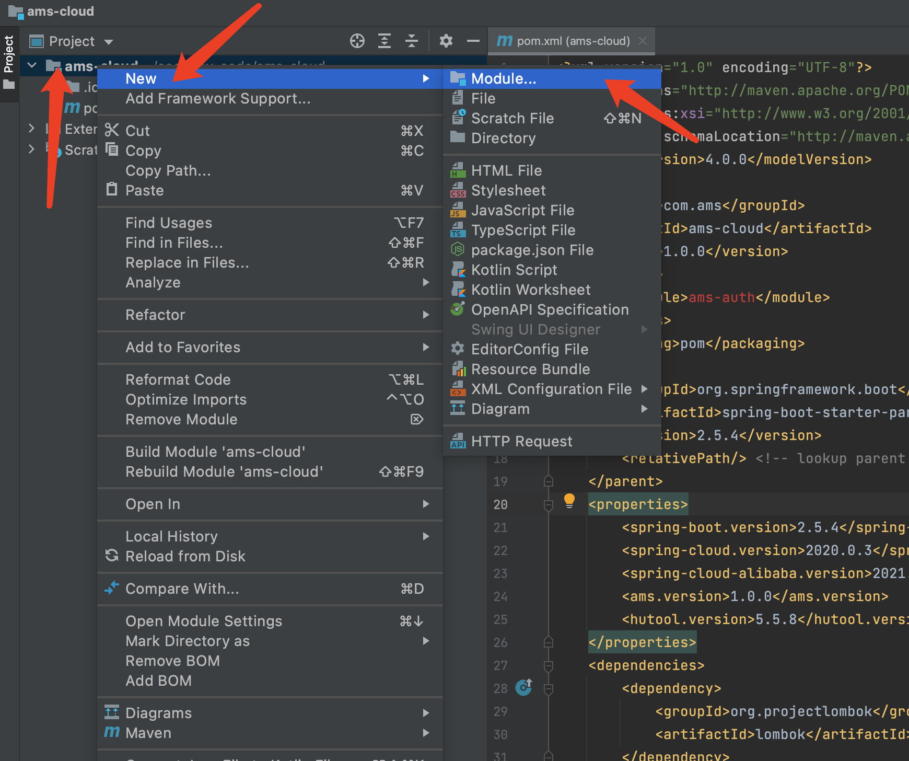
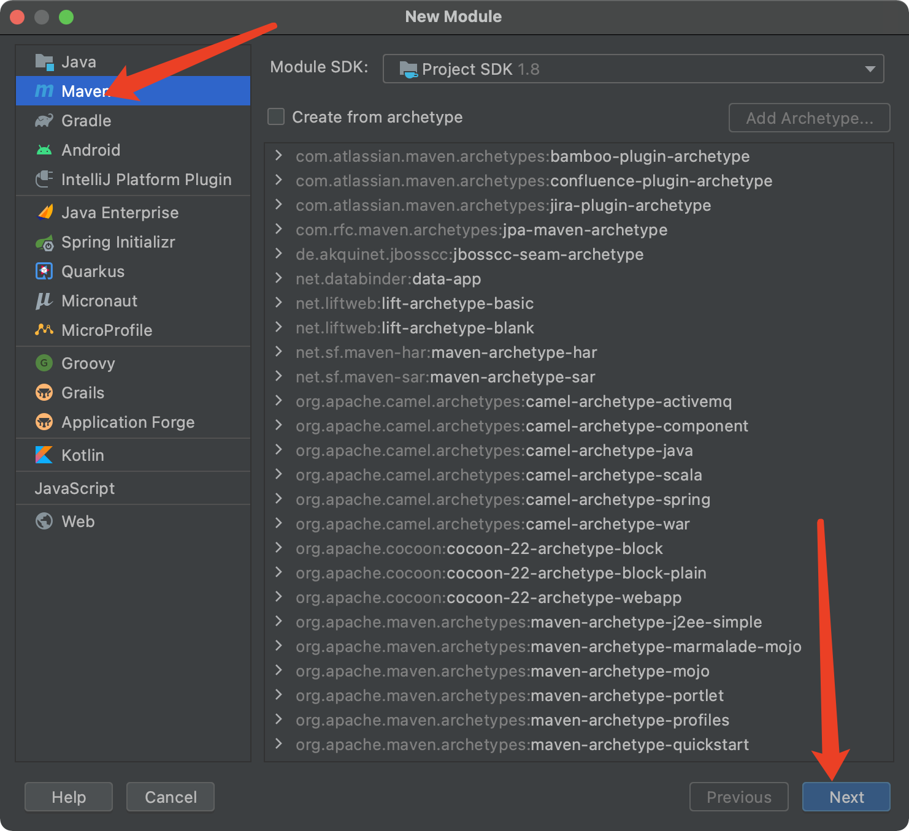
点击next
### 填写基本信息，自动填充父模块信息
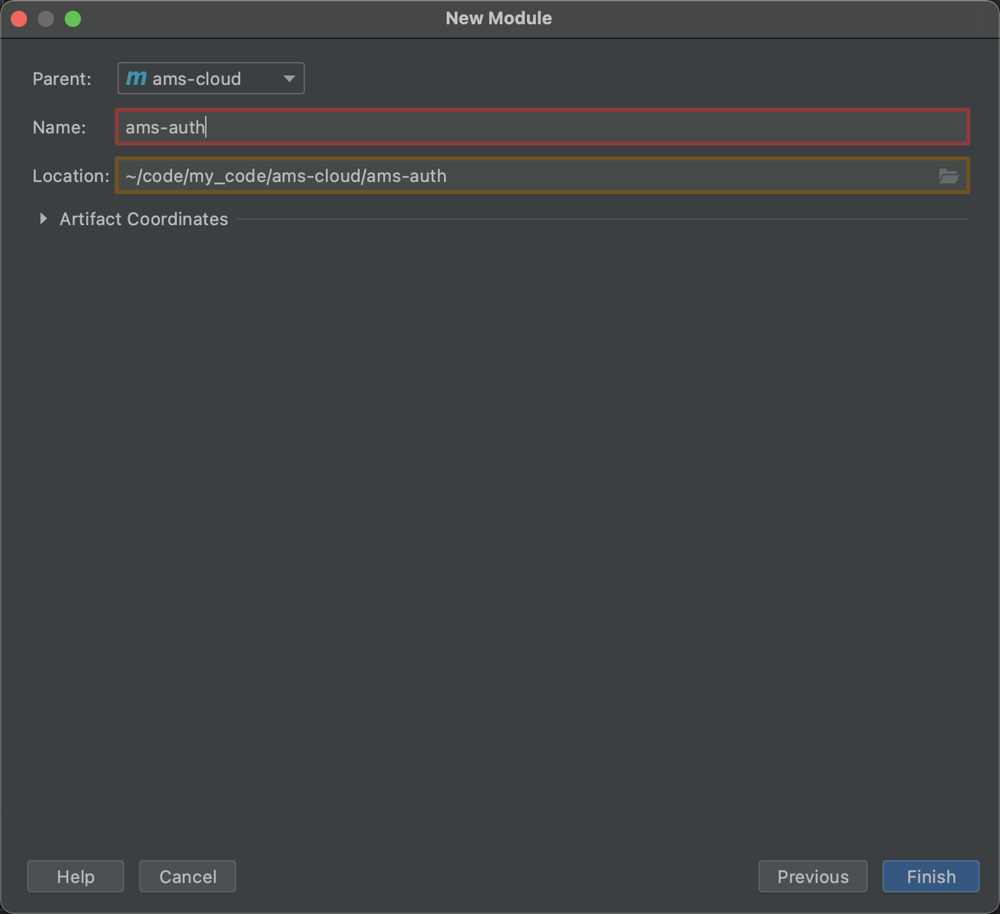
点击finish,即可完成创建
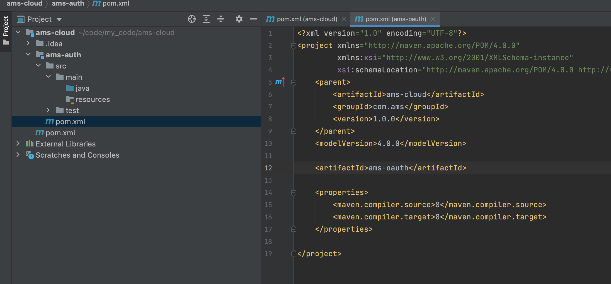

## 集成spring security
### 添加依赖
注意是在auth模块的pom中添加
#### 添加SpringCloud 相关依赖
```
 <!--Spring Cloud & Alibaba -->
        <dependency>
            <groupId>org.springframework.cloud</groupId>
            <artifactId>spring-cloud-starter-bootstrap</artifactId>
        </dependency>

        <!-- 注册中心 -->
        <dependency>
            <groupId>com.alibaba.cloud</groupId>
            <artifactId>spring-cloud-starter-alibaba-nacos-discovery</artifactId>
        </dependency>

        <dependency>
            <groupId>org.springframework.cloud</groupId>
            <artifactId>spring-cloud-starter-loadbalancer</artifactId>
        </dependency>

        <!-- 配置中心 -->
        <dependency>
            <groupId>com.alibaba.cloud</groupId>
            <artifactId>spring-cloud-starter-alibaba-nacos-config</artifactId>
        </dependency>
```
#### 添加SpringSecurity相关依赖
```
  <dependency>
            <groupId>org.springframework.security</groupId>
            <artifactId>spring-security-oauth2-jose</artifactId>
        </dependency>
        <dependency>
            <groupId>org.springframework.boot</groupId>
            <artifactId>spring-boot-starter-web</artifactId>
        </dependency>
        <!-- OAuth2 认证服务器-->
        <dependency>
            <groupId>org.springframework.security.oauth.boot</groupId>
            <artifactId>spring-security-oauth2-autoconfigure</artifactId>
        </dependency>

        <dependency>
            <groupId>org.springframework.security</groupId>
            <artifactId>spring-security-oauth2-jose</artifactId>
        </dependency>
```
### 添加启动类
```
/**
 * Created with IntelliJ IDEA.
 *
 * @date： 2021/11/24
 * @description：
 * @modifiedBy：
 * @version: 1.0
 */
@SpringBootApplication
@EnableDiscoveryClient
public class AuthApp {
    public static void main(String[] args) {
        SpringApplication.run(AuthApp.class, args);
    }
}
```
### spring security 基本组件介绍
#### ClientDetailsService
通过实现该service，用来添加获取客户端逻辑
#### UserDetails
通过实现该类，用来封装用户信息，也可以说是用来扩展用户信息的
#### UserDetailsService
通过实现该service，用来添加根据用户名 来获取用户信息的逻辑，可以从数据库获取，也可以从其他服务中获取用户信息
#### AuthorizationServerConfigurerAdapter
该类用来添加一些授权服务配置，如配置客户端ClientDetailsService
#### WebSecurityConfigurerAdapter
该类用来配置HttpSecurity
相关信息，如对那些资源需要拦截认证，对哪些资源进行放行等
#### DaoAuthenticationProvider
默认的用户名和密码授权认证提供者
## 主要配置介绍
### 创建用户封装类
```
package com.ams.auth.security.details.user;

import lombok.AllArgsConstructor;
import lombok.Builder;
import lombok.Data;
import lombok.NoArgsConstructor;
import org.springframework.security.core.GrantedAuthority;
import org.springframework.security.core.authority.SimpleGrantedAuthority;
import org.springframework.security.core.userdetails.UserDetails;

import java.util.Collection;

/**
 * Created with IntelliJ IDEA.
 *
 * @date： 2021/11/24
 * @description：
 * @modifiedBy：
 * @version: 1.0
 */
/**
 * 系统管理用户认证信息
 *
 * @author <a href="mailto:author@example.com">example-author</a>
 * @date 2021/9/27
 */
@Data
@Builder
@AllArgsConstructor
@NoArgsConstructor
public class SysUserDetails implements UserDetails {

    /**
     * 扩展字段
     */
    private Long userId;

    /**
     * 默认字段
     */
    private String username;
    private String password;
    private Boolean enabled;
    private Collection<SimpleGrantedAuthority> authorities;


    @Override
    public Collection<? extends GrantedAuthority> getAuthorities() {
        return this.authorities;
    }

    @Override
    public String getPassword() {
        return this.password;
    }

    @Override
    public String getUsername() {
        return this.username;
    }

    @Override
    public boolean isAccountNonExpired() {
        return true;
    }

    @Override
    public boolean isAccountNonLocked() {
        return true;
    }

    @Override
    public boolean isCredentialsNonExpired() {
        return true;
    }

    @Override
    public boolean isEnabled() {
        return this.enabled;
    }
}

```
### 创建根据用户名获取封装的用户信息的service
目前只是写死的用户信息，后面会通过feign从管理端服务获取用户信息，暂时只是为了服务能跑通
```
package com.ams.auth.security.details.user;

import com.ams.auth.comm.enums.PasswordEncoderTypeEnum;
import lombok.RequiredArgsConstructor;
import lombok.extern.slf4j.Slf4j;
import org.springframework.security.authentication.AccountExpiredException;
import org.springframework.security.authentication.DisabledException;
import org.springframework.security.authentication.LockedException;
import org.springframework.security.core.authority.SimpleGrantedAuthority;
import org.springframework.security.core.userdetails.UserDetails;
import org.springframework.security.core.userdetails.UserDetailsService;
import org.springframework.security.core.userdetails.UsernameNotFoundException;
import org.springframework.security.crypto.bcrypt.BCryptPasswordEncoder;
import org.springframework.stereotype.Service;

import java.util.ArrayList;
import java.util.Collection;
/**
 * Created with IntelliJ IDEA.
 *
 * @date： 2021/11/24
 * @description：
 * @modifiedBy：
 * @version: 1.0
 */
@Service("sysUserDetailsService")
@Slf4j
@RequiredArgsConstructor
public class SysUserDetailsServiceImpl implements UserDetailsService {
    @Override
    public UserDetails loadUserByUsername(String username) throws UsernameNotFoundException {
        // 后面从管理端获取用户信息
        SysUserDetails userDetails = loadUser(username);
        if (!userDetails.isEnabled()) {
            throw new DisabledException("该账户已被禁用!");
        } else if (!userDetails.isAccountNonLocked()) {
            throw new LockedException("该账号已被锁定!");
        } else if (!userDetails.isAccountNonExpired()) {
            throw new AccountExpiredException("该账号已过期!");
        }
        return userDetails;
    }

    private SysUserDetails loadUser(String username) {
        Collection<SimpleGrantedAuthority> authorities =new ArrayList<>();
        authorities.add(new SimpleGrantedAuthority("admin"));
        return SysUserDetails.builder()
                .userId(1L)
                .username(username)
                .enabled(true)
                .authorities(authorities)
                .password(PasswordEncoderTypeEnum.BCRYPT.getPrefix() + new BCryptPasswordEncoder().encode("123456789")).build();
    }

}

```
### 创建客户端信息获取service
```
package com.ams.auth.security.details.client;

import com.ams.auth.comm.enums.PasswordEncoderTypeEnum;
import lombok.RequiredArgsConstructor;
import org.springframework.cache.annotation.Cacheable;
import org.springframework.security.oauth2.provider.ClientDetails;
import org.springframework.security.oauth2.provider.ClientDetailsService;
import org.springframework.security.oauth2.provider.client.BaseClientDetails;
import org.springframework.stereotype.Service;

/**
 * Created with IntelliJ IDEA.
 *
 * @date： 2021/11/24
 * @description：
 * @modifiedBy：
 * @version: 1.0
 */
@Service
@RequiredArgsConstructor
public class ClientDetailsServiceImpl implements ClientDetailsService {
    @Override
    @Cacheable(cacheNames = "auth", key = "'oauth-client:'+#clientId")
    public ClientDetails loadClientByClientId(String clientId) {
        // 后面通过feign从管理端获取，目前写死
        BaseClientDetails clientDetails = new BaseClientDetails(
                "ams",
                "",
                "all",
                "password,client_credentials,refresh_token,authorization_code",
                "",
                "http://www.baidu.com"

        );
        clientDetails.setClientSecret(PasswordEncoderTypeEnum.NOOP.getPrefix() + "ams");
        clientDetails.setAccessTokenValiditySeconds(3600);
        clientDetails.setRefreshTokenValiditySeconds(36000000);
        return clientDetails;
    }
}

```
### 创建安全配置
这里主要配置了如下内容:

- 设置哪些资源不被拦截
- 设置基本认证
- 添加默认的用户名和密码认证器提供者DaoAuthenticationProvider
- 设置用户名密码验证提供者中的用户获取来源sysUserDetailsService
```
package com.ams.auth.security.config;

import lombok.RequiredArgsConstructor;
import lombok.extern.slf4j.Slf4j;
import org.springframework.context.annotation.Bean;
import org.springframework.context.annotation.Configuration;
import org.springframework.security.authentication.AuthenticationManager;
import org.springframework.security.authentication.dao.DaoAuthenticationProvider;
import org.springframework.security.config.annotation.authentication.builders.AuthenticationManagerBuilder;
import org.springframework.security.config.annotation.web.builders.HttpSecurity;
import org.springframework.security.config.annotation.web.configuration.EnableWebSecurity;
import org.springframework.security.config.annotation.web.configuration.WebSecurityConfigurerAdapter;
import org.springframework.security.core.userdetails.UserDetailsService;
import org.springframework.security.crypto.factory.PasswordEncoderFactories;
import org.springframework.security.crypto.password.PasswordEncoder;

/**
 * Created with IntelliJ IDEA.
 *
 * @date： 2021/11/24
 * @description：
 * @modifiedBy：
 * @version: 1.0
 */
@Configuration
@EnableWebSecurity
@Slf4j
@RequiredArgsConstructor
public class WebSecurityConfig extends WebSecurityConfigurerAdapter {

    private final UserDetailsService sysUserDetailsService;


    @Override
    protected void configure(HttpSecurity http) throws Exception {
        http
                .authorizeRequests().antMatchers("/oauth/**").permitAll()
                .anyRequest().authenticated()
                .and()
                .httpBasic()
                .and()
                .csrf().disable();
    }

    /**
     * 认证管理对象
     *
     * @return
     * @throws Exception
     */
    @Bean
    public AuthenticationManager authenticationManagerBean() throws Exception {
        return super.authenticationManagerBean();
    }

    /**
     * 添加自定义认证器
     *
     * @param auth
     */
    @Override
    public void configure(AuthenticationManagerBuilder auth) throws Exception {
        auth.authenticationProvider(daoAuthenticationProvider());
    }

    /**
     * 设置默认的用户名密码认证授权提供者
     *
     * @return
     */
    @Bean
    public DaoAuthenticationProvider daoAuthenticationProvider() {
        DaoAuthenticationProvider provider = new DaoAuthenticationProvider();
        provider.setUserDetailsService(sysUserDetailsService);
        provider.setPasswordEncoder(passwordEncoder());
        provider.setHideUserNotFoundExceptions(false); // 是否隐藏用户不存在异常，默认:true-隐藏；false-抛出异常；
        return provider;
    }

    @Bean
    public PasswordEncoder passwordEncoder() {
        return PasswordEncoderFactories.createDelegatingPasswordEncoder();
    }


}

```
### 添加授权服务相关配置
这里配置了如下内容：

- 设置oauth客户端 获取信息来源 clientDetailsService
- 设置默认的token存储方式(后面改成redis存储)
- 添加token增强器(在token中添加用户信息)
- 添加token 加密方式
```
package com.ams.auth.security.config;

import cn.hutool.core.collection.CollectionUtil;
import com.ams.auth.security.details.client.ClientDetailsServiceImpl;
import com.ams.auth.security.details.user.SysUserDetails;
import lombok.RequiredArgsConstructor;
import lombok.SneakyThrows;
import org.springframework.context.annotation.Bean;
import org.springframework.context.annotation.Configuration;
import org.springframework.core.io.ClassPathResource;
import org.springframework.security.authentication.AuthenticationManager;
import org.springframework.security.oauth2.common.DefaultOAuth2AccessToken;
import org.springframework.security.oauth2.config.annotation.configurers.ClientDetailsServiceConfigurer;
import org.springframework.security.oauth2.config.annotation.web.configuration.AuthorizationServerConfigurerAdapter;
import org.springframework.security.oauth2.config.annotation.web.configuration.EnableAuthorizationServer;
import org.springframework.security.oauth2.config.annotation.web.configurers.AuthorizationServerEndpointsConfigurer;
import org.springframework.security.oauth2.config.annotation.web.configurers.AuthorizationServerSecurityConfigurer;
import org.springframework.security.oauth2.provider.CompositeTokenGranter;
import org.springframework.security.oauth2.provider.TokenGranter;
import org.springframework.security.oauth2.provider.token.DefaultTokenServices;
import org.springframework.security.oauth2.provider.token.TokenEnhancer;
import org.springframework.security.oauth2.provider.token.TokenEnhancerChain;
import org.springframework.security.oauth2.provider.token.store.JwtAccessTokenConverter;
import org.springframework.security.oauth2.provider.token.store.KeyStoreKeyFactory;

import java.security.KeyPair;
import java.util.ArrayList;
import java.util.Arrays;
import java.util.List;
import java.util.Map;

/**
 * Created with IntelliJ IDEA.
 *
 * @date： 2021/11/24
 * @description：
 * @modifiedBy：
 * @version: 1.0
 */
@Configuration
@EnableAuthorizationServer
@RequiredArgsConstructor
public class AuthorizationServerConfig extends AuthorizationServerConfigurerAdapter {

    private final AuthenticationManager authenticationManager;
    private final ClientDetailsServiceImpl clientDetailsService;

    /**
     * OAuth2客户端
     */
    @Override
    @SneakyThrows
    public void configure(ClientDetailsServiceConfigurer clients) {
        clients.withClientDetails(clientDetailsService);
    }

    /**
     * 配置授权（authorization）以及令牌（token）的访问端点和令牌服务(token services)
     */
    @Override
    public void configure(AuthorizationServerEndpointsConfigurer endpoints) {
        // Token增强
        TokenEnhancerChain tokenEnhancerChain = new TokenEnhancerChain();
        List<TokenEnhancer> tokenEnhancers = new ArrayList<>();
        tokenEnhancers.add(tokenEnhancer());
        tokenEnhancers.add(jwtAccessTokenConverter());
        tokenEnhancerChain.setTokenEnhancers(tokenEnhancers);

        // 获取原有默认授权模式(授权码模式、密码模式、客户端模式、简化模式)的授权者
        List<TokenGranter> granterList = new ArrayList<>(Arrays.asList(endpoints.getTokenGranter()));

        CompositeTokenGranter compositeTokenGranter = new CompositeTokenGranter(granterList);
        endpoints
                .authenticationManager(authenticationManager)
                .accessTokenConverter(jwtAccessTokenConverter())
                .tokenEnhancer(tokenEnhancerChain)
                .tokenGranter(compositeTokenGranter)
                .reuseRefreshTokens(true)
                .tokenServices(tokenServices(endpoints))
        ;
    }

    public DefaultTokenServices tokenServices(AuthorizationServerEndpointsConfigurer endpoints) {
        TokenEnhancerChain tokenEnhancerChain = new TokenEnhancerChain();
        List<TokenEnhancer> tokenEnhancers = new ArrayList<>();
        tokenEnhancers.add(tokenEnhancer());
        tokenEnhancers.add(jwtAccessTokenConverter());
        tokenEnhancerChain.setTokenEnhancers(tokenEnhancers);

        DefaultTokenServices tokenServices = new DefaultTokenServices();
        tokenServices.setTokenStore(endpoints.getTokenStore());
        tokenServices.setSupportRefreshToken(true);
        tokenServices.setClientDetailsService(clientDetailsService);
        tokenServices.setTokenEnhancer(tokenEnhancerChain);
        return tokenServices;

    }

    /**
     * JWT内容增强
     */
    @Bean
    public TokenEnhancer tokenEnhancer() {
        return (accessToken, authentication) -> {
            Map<String, Object> additionalInfo = CollectionUtil.newHashMap();
            Object principal = authentication.getUserAuthentication().getPrincipal();
            if (principal instanceof SysUserDetails){
                SysUserDetails sysUserDetails = (SysUserDetails) principal;
                additionalInfo.put("userId", sysUserDetails.getUserId());
                additionalInfo.put("username", sysUserDetails.getUsername());
                ((DefaultOAuth2AccessToken) accessToken).setAdditionalInformation(additionalInfo);
            }

            return accessToken;
        };
    }

    /**
     * 使用非对称加密算法对token签名
     */
    @Bean
    public JwtAccessTokenConverter jwtAccessTokenConverter() {
        JwtAccessTokenConverter converter = new JwtAccessTokenConverter();
        converter.setKeyPair(keyPair());
        return converter;
    }

    /**
     * 密钥库中获取密钥对(公钥+私钥)
     */
    @Bean
    public KeyPair keyPair() {
        KeyStoreKeyFactory factory = new KeyStoreKeyFactory(new ClassPathResource("jwt.jks"), "123456".toCharArray());
        KeyPair keyPair = factory.getKeyPair("jwt", "123456".toCharArray());
        return keyPair;
    }
}

```
### 生成jks 文件
使用java 命令行进行生成
```
keytool -genkey -alias jwt -keyalg RSA -keysize 1024 -keystore jwt.jks -validity 365
```
按照提示依次输入
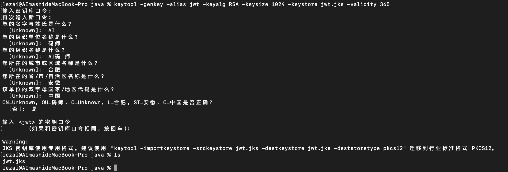
拷贝jks到项目的resource目录中

## 创建获取token 入口
为了能够捕获在认证过程中出现的所有异常，这里通过复写security中的token入口，来实现此目的
内容其实少，就是手动去调用tokenPoint的方法触发
```
package com.ams.auth.security;

import cn.hutool.json.JSONUtil;
import com.ams.auth.comm.RequestUtils;
import com.ams.auth.comm.result.R;
import lombok.AllArgsConstructor;
import lombok.extern.slf4j.Slf4j;
import org.springframework.security.oauth2.common.OAuth2AccessToken;
import org.springframework.security.oauth2.provider.endpoint.TokenEndpoint;
import org.springframework.web.HttpRequestMethodNotSupportedException;
import org.springframework.web.bind.annotation.PostMapping;
import org.springframework.web.bind.annotation.RequestMapping;
import org.springframework.web.bind.annotation.RequestParam;
import org.springframework.web.bind.annotation.RestController;

import java.security.Principal;
import java.util.Map;
/**
 * Created with IntelliJ IDEA.
 *
 * @date： 2021/11/24
 * @description：
 * @modifiedBy：
 * @version: 1.0
 */
@RestController
@RequestMapping("/oauth")
@AllArgsConstructor
@Slf4j
public class AuthController {

    private final TokenEndpoint tokenEndpoint;

    @PostMapping("/token")
    public Object postAccessToken(
            Principal principal,
            @RequestParam Map<String, String> parameters
    ) throws HttpRequestMethodNotSupportedException {
        OAuth2AccessToken accessToken = tokenEndpoint.postAccessToken(principal, parameters).getBody();
        return R.ok(accessToken);
    }
}

```
### 添加异常统一处理类
```
package com.ams.auth.comm.exception;

import com.ams.auth.comm.result.R;
import com.ams.auth.comm.result.ResultCode;
import lombok.extern.slf4j.Slf4j;
import org.springframework.core.annotation.Order;
import org.springframework.http.HttpStatus;
import org.springframework.security.authentication.InternalAuthenticationServiceException;
import org.springframework.security.core.userdetails.UsernameNotFoundException;
import org.springframework.security.oauth2.common.exceptions.InvalidClientException;
import org.springframework.security.oauth2.common.exceptions.InvalidGrantException;
import org.springframework.security.oauth2.common.exceptions.InvalidTokenException;
import org.springframework.web.bind.annotation.ExceptionHandler;
import org.springframework.web.bind.annotation.ResponseStatus;
import org.springframework.web.bind.annotation.RestControllerAdvice;

/**
 * Created with IntelliJ IDEA.
 *
 * @date： 2021/11/24
 * @description：
 * @modifiedBy：
 * @version: 1.0
 */
@RestControllerAdvice
@Slf4j
@Order(-1)
public class AuthExceptionHandler {

    /**
     * 用户不存在
     *
     * @param e
     * @return
     */
    @ResponseStatus(HttpStatus.BAD_REQUEST)
    @ExceptionHandler(UsernameNotFoundException.class)
    public R handleUsernameNotFoundException(UsernameNotFoundException e) {
        return R.failed(ResultCode.USER_NOT_EXIST);
    }

    /**
     * 用户名和密码异常
     *
     * @param e
     * @return
     */
    @ResponseStatus(HttpStatus.BAD_REQUEST)
    @ExceptionHandler(InvalidGrantException.class)
    public R handleInvalidGrantException(InvalidGrantException e) {
        return R.failed(ResultCode.USERNAME_OR_PASSWORD_ERROR);
    }

    /**
     * 用户名和密码异常
     *
     * @param e
     * @return
     */
    @ResponseStatus(HttpStatus.BAD_REQUEST)
    @ExceptionHandler(InvalidClientException.class)
    public R handleInvalidGrantException(InvalidClientException e) {
        return R.failed(ResultCode.CLIENT_AUTHENTICATION_FAILED);
    }


    /**
     * 账户异常(禁用、锁定、过期)
     *
     * @param e
     * @return
     */
    @ResponseStatus(HttpStatus.BAD_REQUEST)
    @ExceptionHandler({InternalAuthenticationServiceException.class})
    public R handleInternalAuthenticationServiceException(InternalAuthenticationServiceException e) {
        return R.failed(e.getMessage());
    }

    /**
     * token 无效或已过期
     *
     * @param e
     * @return
     */
    @ResponseStatus(HttpStatus.BAD_REQUEST)
    @ExceptionHandler({InvalidTokenException.class})
    public R handleInvalidTokenExceptionException(InvalidTokenException e) {
        return R.failed(e.getMessage());
    }

}

```
### 添加bootsrap.yml
在ams-auth->resources 下创建bootstrap.yml文件，并配置nacos客户端信息
cloud.lebao.site:8848 -> 换成你自己的nacos地址
```
server:
  port: 20001
spring:
  application:
    name: ams-auth
  cloud:
    nacos:
      # 注册中心
      discovery:
        server-addr: http://cloud.lebao.site:8848
      # 配置中心
      config:
        server-addr: ${spring.cloud.nacos.discovery.server-addr}
        file-extension: yaml
        shared-configs[0]:
          data-id: ams-common.yaml
          refresh: true
logging:
  level:
    spring.: DEBUG

```
### 在nacos中添加配置

- ams-auth.yaml
```
TEST: 111 # 随便配置的，后面需要按需配置
```

- ams-common.yaml
```
redis:
  host: cloud.lebao.site
  port: 6379
  password: root
mysql:
  host: cloud.lebao.site
  port: 3306
  username: root
  password: root
```
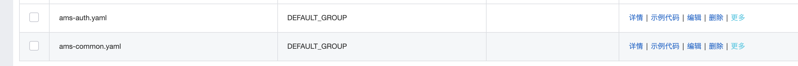

## 测试获取token
### 用户名和密码获取

- 接口地址：[http://localhost:20001/oauth/token](http://localhost:20001/oauth/token?grant_type=password&username=ams&password=123456789)
- 请求方式：POST
- 请求参数

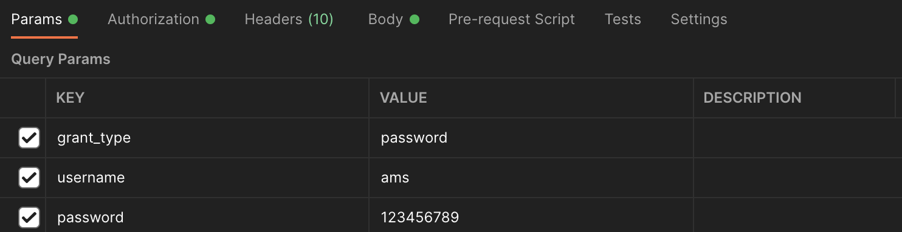

- header配置：Content-Type = application/json
- 客户端信息

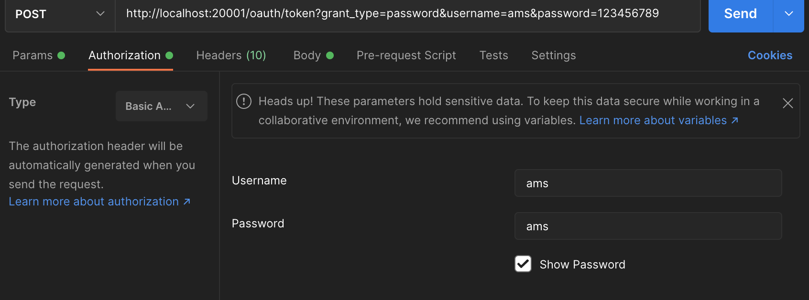

- 请求结果

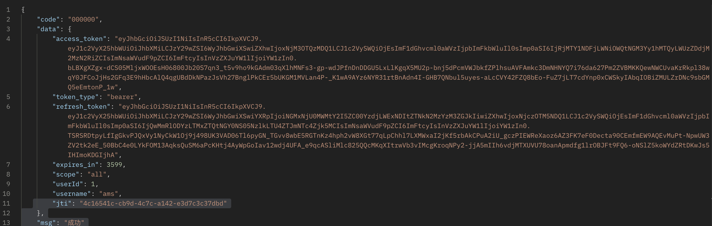

### 刷新token

- 接口地址：[http://localhost:20001/oauth/token](http://localhost:20001/oauth/token?grant_type=password&username=ams&password=123456789)
- 请求方式：POST
- 请求参数

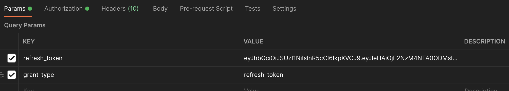

- 客户端信息配置

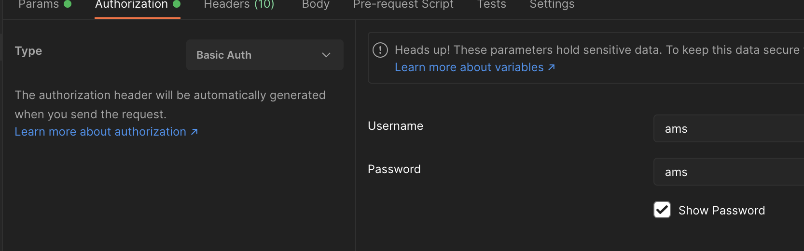

- 请求结果

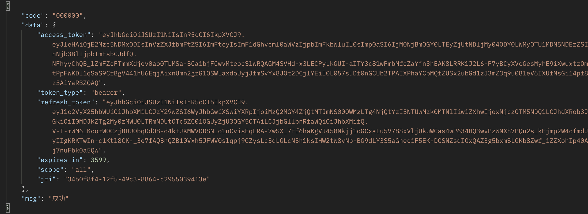

### 获取授权码

-  链接：[http://localhost:20001/oauth/authorize?response_type=code&client_id=ams](http://localhost:20001/oauth/authorize?response_type=code&client_id=ams)
- 用户名和密码登陆

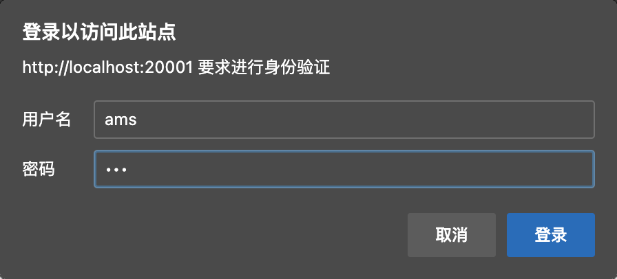
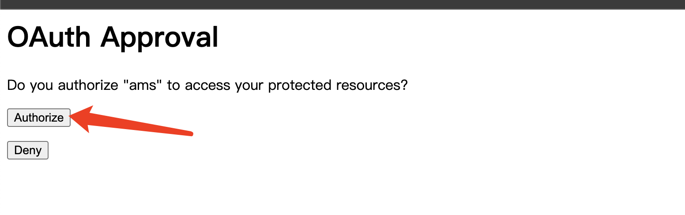


- 拿到授权码：BfhrVd
### 根据授权码获取token

- 接口地址：[http://localhost:20001/oauth/token](http://localhost:20001/oauth/token?grant_type=password&username=ams&password=123456789)
- 请求方式：POST
- 请求参数

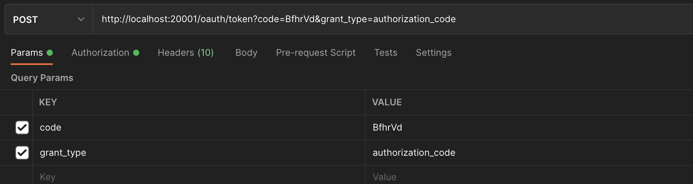

- 返回token

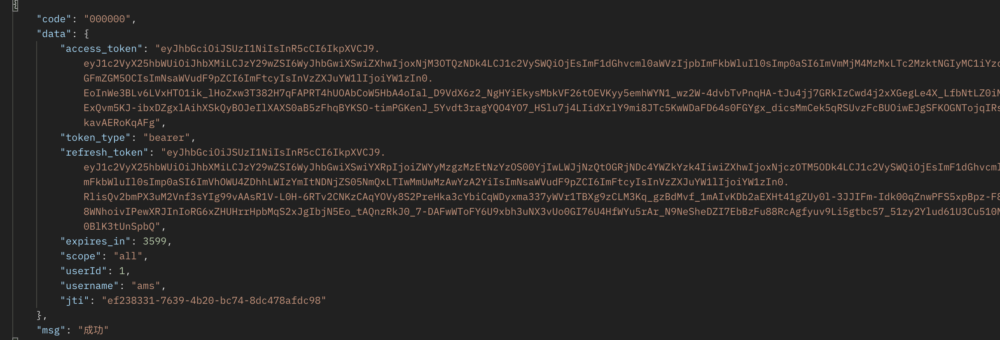

## 总结
本篇文章介绍了如何集成SpringSecurity，介绍了SpringSecurity核心组件以及分别是用来做什么的，但是这里只是简单使用了他的获取token功能，下一期会整合网关实现一套完整的认证系统。

