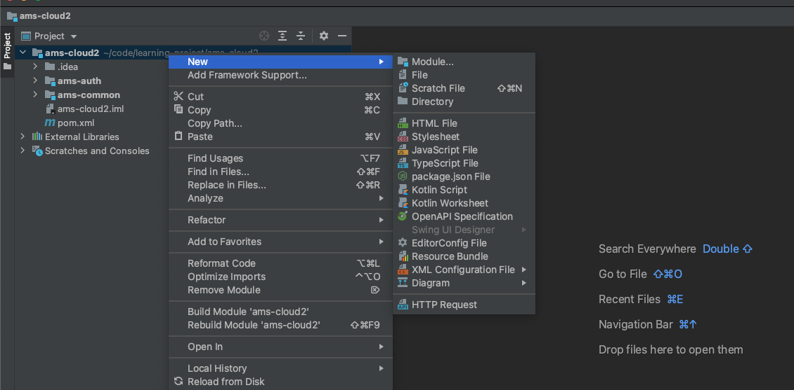
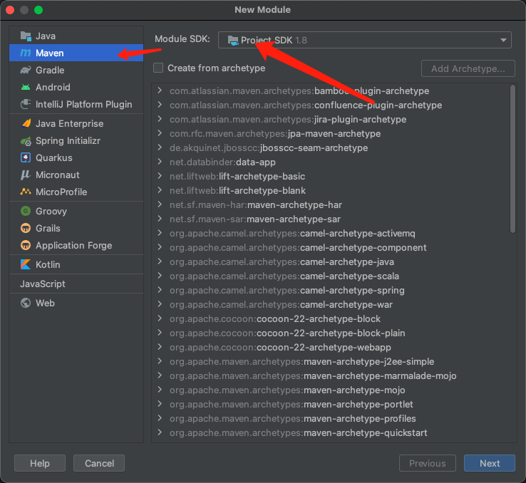
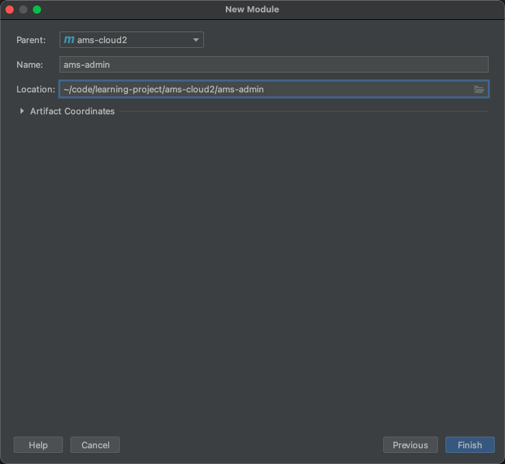
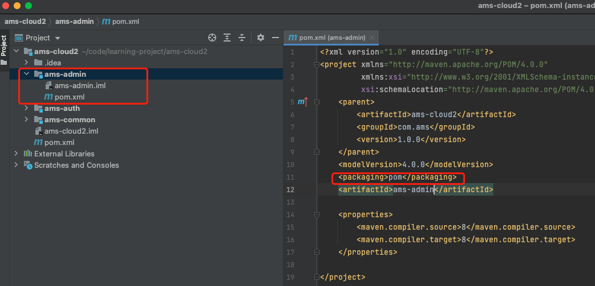
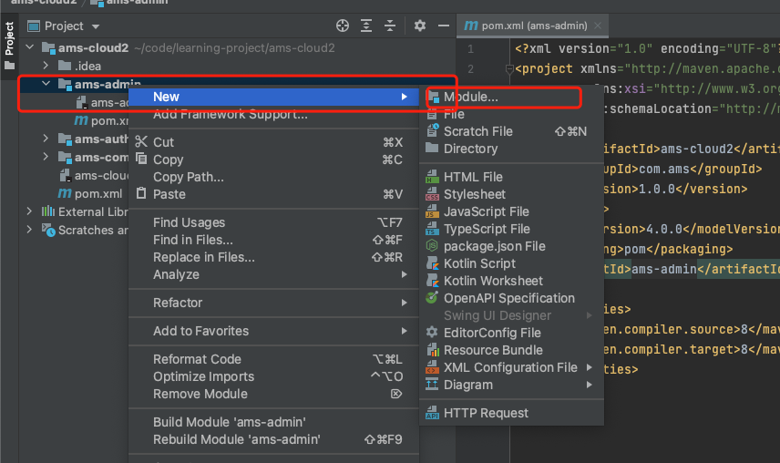
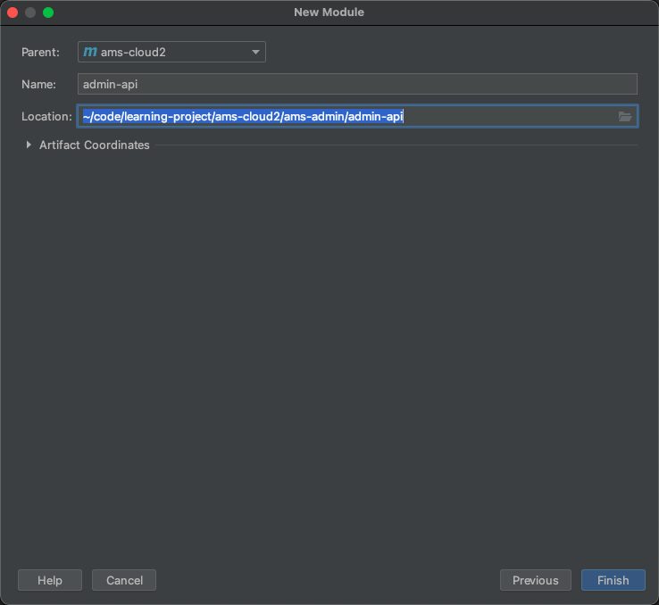
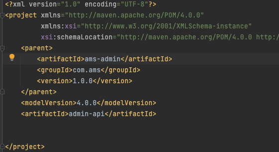
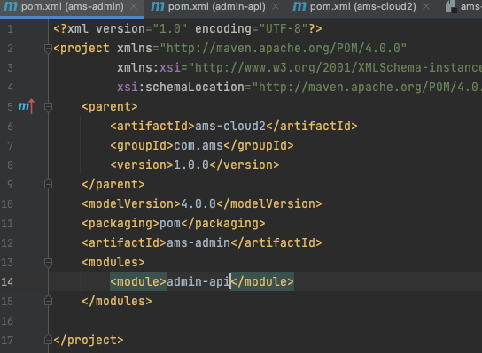

# 5.SpringCloud 整合admin 模块

## 引言
这篇通过集成admin模块，实现用户，角色和权限相关接口，全部从数据库中获取，并且重构auth模块，auth模块通过feign 调用admin服务，获取用户信息和客户端信息。
## 开整
### 创建admin 父工程
在ams-cloud 下添加新的子模块 ams-admin



因为ams-admin是一个父工程，所以需要移除src模块并在pom中添加<packaging>pom</packaging>


### 创建子模块 admin-api
在admin下创建子模块 admin-api


#### 调整pom文件，修复父子关系


#### 引入依赖
```
<dependencies>
    <dependency>
        <groupId>com.ams</groupId>
        <artifactId>common-base</artifactId>
        <version>${ams.version}</version>
    </dependency>

    <dependency>
        <groupId>com.ams</groupId>
        <artifactId>common-web</artifactId>
        <version>${ams.version}</version>
    </dependency>

    <dependency>
        <groupId>com.baomidou</groupId>
        <artifactId>mybatis-plus-boot-starter</artifactId>
        <optional>true</optional>
    </dependency>
    <!-- openfeign依赖 1. http客户端选择okhttp 2. loadbalancer替换ribbon -->
    <dependency>
        <groupId>org.springframework.cloud</groupId>
        <artifactId>spring-cloud-starter-openfeign</artifactId>
    </dependency>

    <dependency>
        <groupId>io.github.openfeign</groupId>
        <artifactId>feign-okhttp</artifactId>
    </dependency>

</dependencies>
```
#### 创建dto
##### 添加客户端dto
```
package com.ams.admin.dto;

import lombok.Data;

/**
 * Created with IntelliJ IDEA.
 *
 * @date： 2021/11/24
 * @description：
 * @modifiedBy：
 * @version: 1.0
 */
@Data
public class OAuth2ClientDTO {

    /**
     * 客户端ID
     */
    private String clientId;

    /**
     * 客户端密钥
     */
    private String clientSecret;

    /**
     * 资源id列表
     */
    private String resourceIds;

    /**
     * 授权范围
     */
    private String scope;

    /**
     * 授权方式
     */
    private String authorizedGrantTypes;

    /**
     * 回调地址
     */
    private String webServerRedirectUri;

    /**
     * 权限列表
     */
    private String authorities;

    /**
     * 认证令牌时效
     */
    private Integer accessTokenValidity;

    /**
     * 刷新令牌时效
     */
    private Integer refreshTokenValidity;

    /**
     * 扩展信息
     */
    private String additionalInformation;

    /**
     * 是否自动放行
     */
    private String autoapprove;

}

```
##### 添加角色权限dto
```
package com.ams.admin.dto;
import lombok.Data;
import lombok.experimental.Accessors;

import java.util.List;
/**
 * Created with IntelliJ IDEA.
 *
 * @date： 2021/11/24
 * @description：
 * @modifiedBy：
 * @version: 1.0
 */
@Data
@Accessors(chain = true)
public class RolePermissionDTO {
    private Long roleId;
    private List<Long> permissionIds;
    private Long menuId;
}

```
##### 用户信息dto
```
package com.ams.admin.dto;

import lombok.Data;

import java.util.List;

/**
 * Created with IntelliJ IDEA.
 *
 * @date： 2021/11/24
 * @description：
 * @modifiedBy：
 * @version: 1.0
 */
@Data
public class UserAuthDTO {

    /**
     * 用户ID
     */
    private Long userId;

    /**
     * 用户名
     */
    private String username;

    /**
     * 用户密码
     */
    private String password;

    /**
     * 用户状态：1-有效；0-禁用
     */
    private Integer status;

    /**
     * 用户角色编码集合 ["ROOT","ADMIN"]
     */

    private List<String> roles;


}

```
#### 创建feign接口
##### 创建获取客户端信息的feign
```
package com.ams.admin.api;

import com.ams.admin.dto.OAuth2ClientDTO;
import com.ams.common.result.R;
import org.springframework.cloud.openfeign.FeignClient;
import org.springframework.web.bind.annotation.GetMapping;
import org.springframework.web.bind.annotation.RequestParam;
/**
 * Created with IntelliJ IDEA.
 *
 * @date： 2021/11/24
 * @description：
 * @modifiedBy：
 * @version: 1.0
 */
@FeignClient(value = "ams-admin", contextId = "oauth-client")
public interface OAuthClientFeignClient {

    @GetMapping("/api/oauth-clients/getOAuth2ClientById")
    R<OAuth2ClientDTO> getOAuth2ClientById(@RequestParam String clientId);
}

```
##### 创建根据用户名获取用户信息的feign
```
package com.ams.admin.api;

import com.ams.admin.dto.UserAuthDTO;
import com.ams.common.result.R;
import org.springframework.cloud.openfeign.FeignClient;
import org.springframework.web.bind.annotation.GetMapping;
import org.springframework.web.bind.annotation.PathVariable;
/**
 * Created with IntelliJ IDEA.
 *
 * @date： 2021/11/24
 * @description：
 * @modifiedBy：
 * @version: 1.0
 */
@FeignClient(value = "ams-admin")
public interface UserFeignClient {

    @GetMapping("/api/v1/users/username/{username}")
    R<UserAuthDTO> getUserByUsername(@PathVariable String username);
}

```
### 创建子模块admin-boot
创建方式和创建admin-api一样，就不贴步骤了,这里直接写核心步骤，需要代码的可以私信我
#### 引入依赖
```
 <dependencies>
        <!-- 配置读取 -->
        <dependency>
            <groupId>org.springframework.boot</groupId>
            <artifactId>spring-boot-configuration-processor</artifactId>
        </dependency>

        <!-- 单元测试 -->
        <dependency>
            <groupId>org.springframework.boot</groupId>
            <artifactId>spring-boot-starter-test</artifactId>
            <scope>test</scope>
        </dependency>

        <!-- Spring Cloud & Alibaba -->
        <dependency>
            <groupId>org.springframework.cloud</groupId>
            <artifactId>spring-cloud-starter-bootstrap</artifactId>
        </dependency>

        <!-- 注册中心 -->
        <dependency>
            <groupId>com.alibaba.cloud</groupId>
            <artifactId>spring-cloud-starter-alibaba-nacos-discovery</artifactId>
        </dependency>

        <dependency>
            <groupId>org.springframework.cloud</groupId>
            <artifactId>spring-cloud-starter-loadbalancer</artifactId>
        </dependency>

        <!-- 配置中心 -->
        <dependency>
            <groupId>com.alibaba.cloud</groupId>
            <artifactId>spring-cloud-starter-alibaba-nacos-config</artifactId>
        </dependency>

        <!-- JWT库 -->
        <dependency>
            <groupId>com.nimbusds</groupId>
            <artifactId>nimbus-jose-jwt</artifactId>
        </dependency>

        <dependency>
            <groupId>com.ams</groupId>
            <artifactId>admin-api</artifactId>
            <version>${ams.version}</version>
        </dependency>
        <dependency>
            <groupId>com.ams</groupId>
            <artifactId>common-redis</artifactId>
            <version>${ams.version}</version>
        </dependency>
        <dependency>
            <groupId>com.ams</groupId>
            <artifactId>common-mybatis-plus</artifactId>
            <version>1.0.0</version>
        </dependency>
    </dependencies>
```
#### 添加启动监听器，初始化角色权限
```
package com.ams.admin.component.listener;

import com.ams.admin.service.ISysPermissionService;
import lombok.AllArgsConstructor;
import org.springframework.boot.CommandLineRunner;
import org.springframework.stereotype.Component;

/**
 * Created with IntelliJ IDEA.
 *
 * @date： 2021/11/24
 * @description：
 * @modifiedBy：
 * @version: 1.0
 */
@Component
@AllArgsConstructor
public class InitResourcePermissionCache implements CommandLineRunner {

    private ISysPermissionService iSysPermissionService;

    @Override
    public void run(String... args) {
        iSysPermissionService.refreshPermRolesRules();
    }
}

```
```
package com.ams.admin.service.impl;

import cn.hutool.core.collection.CollectionUtil;
import cn.hutool.core.util.StrUtil;
import com.ams.admin.mapper.SysPermissionMapper;
import com.ams.admin.pojo.entity.SysPermission;
import com.ams.admin.service.ISysPermissionService;
import com.ams.common.constant.GlobalConstants;
import com.baomidou.mybatisplus.extension.service.impl.ServiceImpl;
import lombok.RequiredArgsConstructor;
import org.springframework.data.redis.core.RedisTemplate;
import org.springframework.stereotype.Service;

import java.util.Arrays;
import java.util.HashMap;
import java.util.List;
import java.util.Map;
import java.util.stream.Collectors;


/**
 * Created with IntelliJ IDEA.
 *
 * @date： 2021/11/24
 * @description：
 * @modifiedBy：
 * @version: 1.0
 */
@Service
@RequiredArgsConstructor
public class SysPermissionServiceImpl extends ServiceImpl<SysPermissionMapper, SysPermission> implements ISysPermissionService {

    private final RedisTemplate redisTemplate;

    @Override
    public boolean refreshPermRolesRules() {
        redisTemplate.delete(Arrays.asList(GlobalConstants.URL_PERM_ROLES_KEY));
        List<SysPermission> permissions = this.listPermRoles();
        if (CollectionUtil.isNotEmpty(permissions)) {
            List<SysPermission> urlPermList = permissions.stream()
                    .filter(item -> StrUtil.isNotBlank(item.getUrlPerm()))
                    .collect(Collectors.toList());
            if (CollectionUtil.isNotEmpty(urlPermList)) {
                Map<String, List<String>> urlPermRoles = new HashMap<>();
                urlPermList.stream().forEach(item -> {
                    String perm = item.getUrlPerm();
                    List<String> roles = item.getRoles();
                    urlPermRoles.put(perm, roles);
                });
                redisTemplate.opsForHash().putAll(GlobalConstants.URL_PERM_ROLES_KEY, urlPermRoles);
            }
        }
        return true;
    }

    @Override
    public List<SysPermission> listPermRoles() {
        return this.baseMapper.listPermRoles();
    }
}

```
#### 实现我们刚才定义的两个feign接口
```
@RequestMapping("/api/oauth-clients")
@Slf4j
@AllArgsConstructor
@RestController
public class OauthClientController {
    private ISysOauthClientService iSysOauthClientService;

    @GetMapping("/getOAuth2ClientById")
    public R<OAuth2ClientDTO> getOAuth2ClientById(@RequestParam String clientId) {
        SysOauthClient client = iSysOauthClientService.getById(clientId);
        Assert.notNull(client, "OAuth2 客户端不存在");
        OAuth2ClientDTO oAuth2ClientDTO = new OAuth2ClientDTO();
        BeanUtil.copyProperties(client, oAuth2ClientDTO);
        return R.ok(oAuth2ClientDTO);
    }
}
```
```
package com.ams.admin.controller;

import com.ams.admin.dto.UserAuthDTO;
import com.ams.admin.service.ISysUserService;
import com.ams.common.result.R;
import lombok.RequiredArgsConstructor;
import lombok.extern.slf4j.Slf4j;
import org.springframework.web.bind.annotation.GetMapping;
import org.springframework.web.bind.annotation.PathVariable;
import org.springframework.web.bind.annotation.RequestMapping;
import org.springframework.web.bind.annotation.RestController;
/**
 * Created with IntelliJ IDEA.
 *
 * @date： 2021/11/24
 * @description：
 * @modifiedBy：
 * @version: 1.0
 */
@RestController
@RequestMapping("/api/v1/users")
@Slf4j
@RequiredArgsConstructor
public class UserController {

    private final ISysUserService iSysUserService;

    /**
     * 获取用户信息
     */
    @GetMapping("/username/{username}")
    public R<UserAuthDTO> getUserByUsername(@PathVariable String username) {
        UserAuthDTO user = iSysUserService.getByUsername(username);
        return R.ok(user);
    }
}

```
#### 创建bootstrap.yml配置文件
```
server:
  port: 2004

spring:
  application:
    name: ams-admin
  cloud:
    nacos:
      # 注册中心
      discovery:
        server-addr: http://xxx.xxx.xxx:8848
      # 配置中心
      config:
        server-addr: ${spring.cloud.nacos.discovery.server-addr}
        file-extension: yaml
        shared-configs[0]:
          data-id: ams-common.yaml
          refresh: true
logging:
  level:
    spring.: DEBUG
```
#### 创建nacos配置文件
在nacos中新增ams-admin配置
```
spring:
  datasource:
    type: com.alibaba.druid.pool.DruidDataSource
    driver-class-name: com.mysql.cj.jdbc.Driver 
    url: jdbc:mysql://${mysql.host}:${mysql.port}/ams_admin?zeroDateTimeBehavior=convertToNull&useUnicode=true&characterEncoding=UTF-8&serverTimezone=Asia/Shanghai&autoReconnect=true
    username: ${mysql.username}
    password: ${mysql.password}
  redis:
    database: 0
    host: ${redis.host}
    port: ${redis.port}
    password: ${redis.password}
  cache:
    # 缓存类型
    type: redis
    # 缓存时间(单位：ms)
    redis:
      time-to-live: 3600000
      # 缓存null值，防止缓存穿透
      cache-null-values: true
      # 允许使用缓存前缀，
      use-key-prefix: true
      # 缓存前缀，没有设置使用注解的缓存名称(value)作为前缀，和注解的key用双冒号::拼接组成完整缓存key
      key-prefix: 'admin:'
                
mybatis-plus:
  configuration:
    # 驼峰下划线转换
    map-underscore-to-camel-case: true
    # 这个配置会将执行的sql打印出来，在开发或测试的时候可以用
    log-impl: org.apache.ibatis.logging.stdout.StdOutImpl

#### 全局参数设置
ribbon:
  ReadTimeout: 120000
  ConnectTimeout: 10000
  SocketTimeout: 10000
  MaxAutoRetries: 0
  MaxAutoRetriesNextServer: 1 

feign:
  httpclient:
    enabled: true
  okhttp:
    enabled: false


```
#### 创建启动类
```
package com.ams.admin;

import org.springframework.boot.SpringApplication;
import org.springframework.boot.autoconfigure.SpringBootApplication;
import org.springframework.cloud.client.discovery.EnableDiscoveryClient;
import org.springframework.cloud.context.config.annotation.RefreshScope;

/**
 * Created with IntelliJ IDEA.
 *
 * @date： 2021/11/30
 * @description：
 * @modifiedBy：
 * @version: 1.0
 */
@SpringBootApplication
@EnableDiscoveryClient
@RefreshScope
public class AdminApp {
    public static void main(String[] args) {
        SpringApplication.run(AdminApp.class, args);
    }
}

```
### 调整ams-auth模块
调整后的ams-auth模块是通过feign去调用admin服务，获取认证需要的信息。
#### 引入admin-api依赖
```

        <dependency>
            <groupId>com.ams</groupId>
            <artifactId>admin-api</artifactId>
            <version>1.0.0</version>
        </dependency>
```
#### 修改SysUserDetailsServiceImpl 用户获取方式
```
package com.ams.auth.security.details.user;

import com.ams.admin.api.UserFeignClient;
import com.ams.admin.dto.UserAuthDTO;
import com.ams.auth.comm.enums.PasswordEncoderTypeEnum;
import com.ams.common.result.R;
import com.ams.common.result.ResultCode;
import lombok.RequiredArgsConstructor;
import lombok.extern.slf4j.Slf4j;
import org.springframework.security.authentication.AccountExpiredException;
import org.springframework.security.authentication.DisabledException;
import org.springframework.security.authentication.LockedException;
import org.springframework.security.core.authority.SimpleGrantedAuthority;
import org.springframework.security.core.userdetails.UserDetails;
import org.springframework.security.core.userdetails.UserDetailsService;
import org.springframework.security.core.userdetails.UsernameNotFoundException;
import org.springframework.security.crypto.bcrypt.BCryptPasswordEncoder;
import org.springframework.stereotype.Service;

import java.util.ArrayList;
import java.util.Collection;
import java.util.List;
import java.util.Objects;

/**
 * Created with IntelliJ IDEA.
 *
 * @date： 2021/11/24
 * @description：
 * @modifiedBy：
 * @version: 1.0
 */
@Service("sysUserDetailsService")
@Slf4j
@RequiredArgsConstructor
public class SysUserDetailsServiceImpl implements UserDetailsService {
    private final UserFeignClient userFeignClient;

    @Override
    public UserDetails loadUserByUsername(String username) throws UsernameNotFoundException {
        // 后面从管理端获取用户信息
        R<UserAuthDTO> result = userFeignClient.getUserByUsername(username);
        SysUserDetails userDetails = null;
        if (R.ok().getCode().equals(result.getCode())) {
            UserAuthDTO user = result.getData();
            if (null != user) {
                userDetails = SysUserDetails.builder()
                        .userId(user.getUserId())
                        .username(user.getUsername())
                        .authorities(handleRoles(user.getRoles()))
                        .enabled(user.getStatus() == 1)
                        .password(PasswordEncoderTypeEnum.BCRYPT.getPrefix() + user.getPassword())
                        .build();
            }
        }
        if (Objects.isNull(userDetails)) {
            throw new UsernameNotFoundException(ResultCode.USER_NOT_EXIST.getMsg());
        } else if (!userDetails.isEnabled()) {
            throw new DisabledException("该账户已被禁用!");
        } else if (!userDetails.isAccountNonLocked()) {
            throw new LockedException("该账号已被锁定!");
        } else if (!userDetails.isAccountNonExpired()) {
            throw new AccountExpiredException("该账号已过期!");
        }
        return userDetails;
    }

    private Collection<SimpleGrantedAuthority> handleRoles(List<String> roles) {
        Collection<SimpleGrantedAuthority> authorities = new ArrayList<>();
        for (String role : roles) {
            authorities.add(new SimpleGrantedAuthority(role));
        }
        return authorities;
    }

    private SysUserDetails loadUser(String username) {
        Collection<SimpleGrantedAuthority> authorities = new ArrayList<>();
        authorities.add(new SimpleGrantedAuthority("admin"));
        authorities.add(new SimpleGrantedAuthority("root"));
        return SysUserDetails.builder()
                .userId(1L)
                .username(username)
                .enabled(true)
                .authorities(authorities)
                .password(PasswordEncoderTypeEnum.BCRYPT.getPrefix() + new BCryptPasswordEncoder().encode("123456789")).build();
    }

}

```
#### 修改ClientDetailsServiceImpl 客户端信息获取方式
```
package com.ams.auth.security.details.client;

import com.alibaba.csp.sentinel.adapter.spring.webmvc.callback.RequestOriginParser;
import com.ams.admin.api.OAuthClientFeignClient;
import com.ams.admin.dto.OAuth2ClientDTO;
import com.ams.auth.comm.enums.PasswordEncoderTypeEnum;
import com.ams.common.result.R;
import lombok.RequiredArgsConstructor;
import org.springframework.cache.annotation.Cacheable;
import org.springframework.security.oauth2.provider.ClientDetails;
import org.springframework.security.oauth2.provider.ClientDetailsService;
import org.springframework.security.oauth2.provider.NoSuchClientException;
import org.springframework.security.oauth2.provider.client.BaseClientDetails;
import org.springframework.stereotype.Service;

/**
 * Created with IntelliJ IDEA.
 *
 * @date： 2021/11/24
 * @description：
 * @modifiedBy：
 * @version: 1.0
 */
@Service
@RequiredArgsConstructor
public class ClientDetailsServiceImpl implements ClientDetailsService {
    private final OAuthClientFeignClient oAuthClientFeignClient;

    @Override
    public ClientDetails loadClientByClientId(String clientId) {
        // 通过feign 调用admin服务获取client信息
        R<OAuth2ClientDTO> result = oAuthClientFeignClient.getOAuth2ClientById(clientId);
        if (R.ok().getCode().equals(result.getCode())) {
            OAuth2ClientDTO client = result.getData();
            BaseClientDetails clientDetails = new BaseClientDetails(
                    client.getClientId(),
                    client.getResourceIds(),
                    client.getScope(),
                    client.getAuthorizedGrantTypes(),
                    client.getAuthorities(),
                    client.getWebServerRedirectUri());
            clientDetails.setClientSecret(PasswordEncoderTypeEnum.NOOP.getPrefix() + client.getClientSecret());
            clientDetails.setAccessTokenValiditySeconds(client.getAccessTokenValidity());
            clientDetails.setRefreshTokenValiditySeconds(client.getRefreshTokenValidity());
            return clientDetails;
        } else {
            throw new NoSuchClientException(result.getMsg());
        }
    }
}

```
#### 修改启动类，启用feign
```
package com.ams.auth;

import com.ams.admin.api.OAuthClientFeignClient;
import com.ams.admin.api.UserFeignClient;
import org.springframework.boot.SpringApplication;
import org.springframework.boot.autoconfigure.SpringBootApplication;
import org.springframework.cloud.client.discovery.EnableDiscoveryClient;
import org.springframework.cloud.openfeign.EnableFeignClients;

/**
 * Created with IntelliJ IDEA.
 *
 * @date： 2021/11/24
 * @description：
 * @modifiedBy：
 * @version: 1.0
 */
@SpringBootApplication
@EnableDiscoveryClient
@EnableFeignClients(basePackageClasses = {UserFeignClient.class, OAuthClientFeignClient.class})
public class AuthApp {
    public static void main(String[] args) {
        SpringApplication.run(AuthApp.class, args);
    }
}

```
到这里，已经全部调整完成，自行验证下token获取是否生效

