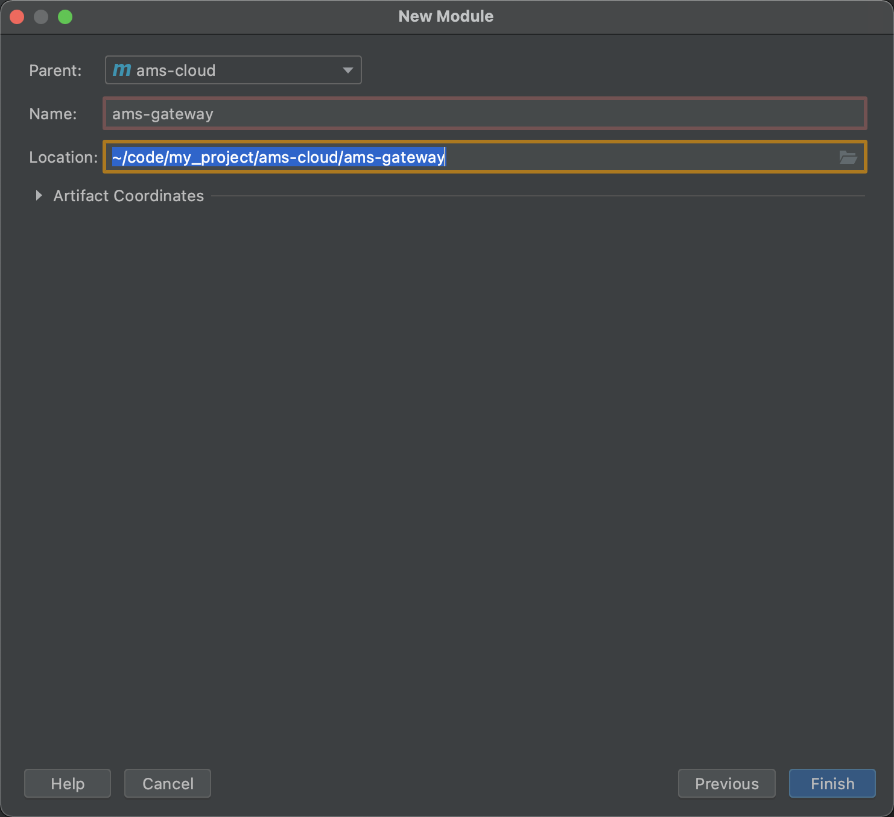
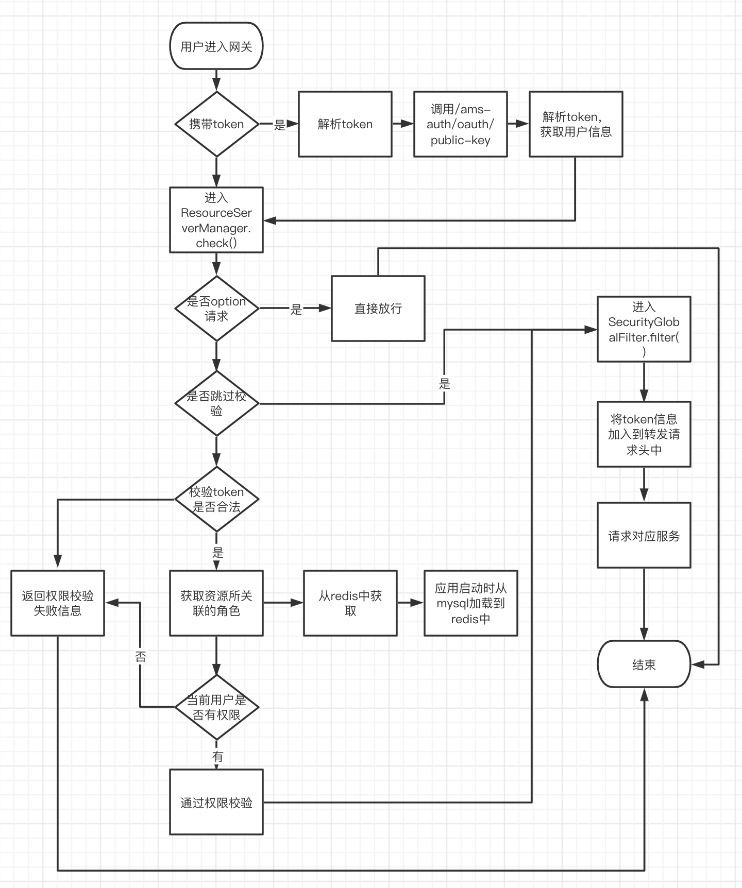

# 6.SpringCloud 整合Gateway

## 引言
这一期主要是基于前面的项目，集成gateway,通过gateway 进行请求路由。
## 初始化gateway 模块
### 创建网关模块

### 引入依赖
```
 <dependencies>
        <!--Spring Cloud & Alibaba-->
        <dependency>
            <groupId>org.springframework.cloud</groupId>
            <artifactId>spring-cloud-starter-bootstrap</artifactId>
        </dependency>

        <dependency>
            <groupId>org.springframework.cloud</groupId>
            <artifactId>spring-cloud-starter-gateway</artifactId>
        </dependency>

        <!-- 注册中心-->
        <dependency>
            <groupId>com.alibaba.cloud</groupId>
            <artifactId>spring-cloud-starter-alibaba-nacos-discovery</artifactId>
        </dependency>

        <dependency>
            <groupId>org.springframework.cloud</groupId>
            <artifactId>spring-cloud-starter-loadbalancer</artifactId>
        </dependency>

        <!-- 配置中心 -->
        <dependency>
            <groupId>com.alibaba.cloud</groupId>
            <artifactId>spring-cloud-starter-alibaba-nacos-config</artifactId>
        </dependency>

        <!-- OAuth2资源服务器-->
        <dependency>
            <groupId>org.springframework.security</groupId>
            <artifactId>spring-security-config</artifactId>
        </dependency>
        <dependency>
            <groupId>org.springframework.security</groupId>
            <artifactId>spring-security-oauth2-resource-server</artifactId>
        </dependency>
        <dependency>
            <groupId>org.springframework.security</groupId>
            <artifactId>spring-security-oauth2-jose</artifactId>
        </dependency>
        <dependency>
            <groupId>com.ams</groupId>
            <artifactId>common-base</artifactId>
            <version>${ams.version}</version>
        </dependency>
        <dependency>
            <groupId>com.ams</groupId>
            <artifactId>common-redis</artifactId>
            <version>${ams.version}</version>
        </dependency>
    </dependencies>
```
### 创建bootstrap.yml 文件
主要配置了nacos 连接信息
```
server:
  port: 9999

spring:
  application:
    name: ams-gateway
  cloud:
    nacos:
      # 注册中心
      discovery:
        server-addr: http://cloud.lebao.site:8848
      # 配置中心
      config:
        server-addr: ${spring.cloud.nacos.discovery.server-addr}
        file-extension: yaml
        shared-configs[0]:
          data-id: ams-common.yaml
          refresh: true
```
### 在nacos中添加gateway 配置文件
ams-gateway.yaml

```
spring:
  security:
    oauth2: 
      resourceserver:
        jwt:
          jwk-set-uri: 'http://localhost:9999/ams-auth/oauth/public-key'
  redis:
    timeout: PT30S
    database: 0
    host: ${redis.host}
    port: ${redis.port}
    password: ${redis.password}
    pool:
      # 连接池最大连接数（使用负值表示没有限制）
      maxactive: 64
      # 连接池中的最大空闲连接
      maxidle: 64
      # 连接池最大阻塞等待时间（使用负值表示没有限制）
      maxwait: -1
      # 连接池中的最小空闲连接
      minidle: 1
  cloud:
    gateway:
      discovery:
        locator:
          enabled: true # 启用服务发现
          lower-case-service-id: true
      routes:
        - id: 认证中心
          uri: lb://ams-auth
          predicates:
            - Path=/ams-auth/**
          filters:
            - StripPrefix=1
        - id: 系统服务
          uri: lb://ams-admin
          predicates:
            - Path=/ams-admin/**
          filters:
            - StripPrefix=1
# 配置白名单路径(无需登录)
security:
  ignoreUrls:
      - /ams-auth/oauth/token/**
      - /ams-auth/oauth/public-key 
      - /webjars/**

# 是否开启本地缓存
local-cache:
  enabled: false 

# 全局参数设置
ribbon:
  ReadTimeout: 120000
  ConnectTimeout: 10000
  SocketTimeout: 10000
  MaxAutoRetries: 0
  MaxAutoRetriesNextServer: 1
 
hystrix:
  command:
    default:
      execution:
        isolation:
          thread:
            timeoutInMilliseconds: 40000

feign:
  httpclient:
    enabled: true
  okhttp:
    enabled: false
  sentinel:  # 开启feign对sentinel的支持
    enabled: false 
```
到这里，网关基本骨架已经初始好，接下来就是配置网关相关信息

## 网关配置
### 开启注册客户端
```
/**
 * Created with IntelliJ IDEA.
 *
 * @date： 2021/11/24
 * @description：
 * @modifiedBy：
 * @version: 1.0
 */
@EnableDiscoveryClient
@SpringBootApplication
public class GatewayApp {
    public static void main(String[] args) {
        SpringApplication.run(GatewayApp.class, args);
    }
}
```
### 主要组件介绍
#### ResourceServerConfig
该组件主要是用来设置对哪些请求进行拦截，和如何解析token内容的
### ResourceServerManager
该组件主要用来做对资源权限的判断
### SecurityGlobalFilter
该组件是自定义的网关过滤器，主要用来将解析后的token信息存放在请求头中，转发给各个服务。

### 资源服务配置
```
package com.ams.gateway.security;

import com.ams.common.constant.SecurityConstants;
import com.ams.common.result.ResultCode;
import com.ams.gateway.util.ResponseUtils;
import lombok.AllArgsConstructor;
import org.springframework.context.annotation.Bean;
import org.springframework.context.annotation.Configuration;
import org.springframework.core.convert.converter.Converter;
import org.springframework.security.authentication.AbstractAuthenticationToken;
import org.springframework.security.config.annotation.web.reactive.EnableWebFluxSecurity;
import org.springframework.security.config.web.server.ServerHttpSecurity;
import org.springframework.security.oauth2.jwt.Jwt;
import org.springframework.security.oauth2.server.resource.authentication.JwtAuthenticationConverter;
import org.springframework.security.oauth2.server.resource.authentication.JwtGrantedAuthoritiesConverter;
import org.springframework.security.oauth2.server.resource.authentication.ReactiveJwtAuthenticationConverterAdapter;
import org.springframework.security.web.server.SecurityWebFilterChain;
import org.springframework.security.web.server.ServerAuthenticationEntryPoint;
import org.springframework.security.web.server.authorization.ServerAccessDeniedHandler;
import reactor.core.publisher.Mono;
/**
 * Created with IntelliJ IDEA.
 *
 * @date： 2021/11/24
 * @description：
 * @modifiedBy：
 * @version: 1.0
 */
@AllArgsConstructor
@Configuration
@EnableWebFluxSecurity
public class ResourceServerConfig {

    private final ResourceServerManager resourceServerManager;

    @Bean
    public SecurityWebFilterChain securityWebFilterChain(ServerHttpSecurity http) {
        http.oauth2ResourceServer().jwt().jwtAuthenticationConverter(jwtAuthenticationConverter());
        http.oauth2ResourceServer().authenticationEntryPoint(authenticationEntryPoint());
        http.authorizeExchange()
                .anyExchange().access(resourceServerManager)
                .and()
                .exceptionHandling()
                .accessDeniedHandler(accessDeniedHandler()) // 处理未授权
                .authenticationEntryPoint(authenticationEntryPoint()) //处理未认证
                .and().csrf().disable();
        return http.build();
    }

    /**
     * 自定义未授权响应
     */
    @Bean
    ServerAccessDeniedHandler accessDeniedHandler() {
        return (exchange, denied) -> {
            Mono<Void> mono = Mono.defer(() -> Mono.just(exchange.getResponse()))
                    .flatMap(response -> ResponseUtils.writeErrorInfo(response, ResultCode.ACCESS_UNAUTHORIZED));
            return mono;
        };
    }

    /**
     * token无效或者已过期自定义响应
     */
    @Bean
    ServerAuthenticationEntryPoint authenticationEntryPoint() {
        return (exchange, e) -> {
            Mono<Void> mono = Mono.defer(() -> Mono.just(exchange.getResponse()))
                    .flatMap(response -> ResponseUtils.writeErrorInfo(response, ResultCode.TOKEN_INVALID_OR_EXPIRED));
            return mono;
        };
    }

    @Bean
    public Converter<Jwt, ? extends Mono<? extends AbstractAuthenticationToken>> jwtAuthenticationConverter() {
        JwtGrantedAuthoritiesConverter jwtGrantedAuthoritiesConverter = new JwtGrantedAuthoritiesConverter();
        jwtGrantedAuthoritiesConverter.setAuthorityPrefix(SecurityConstants.AUTHORITY_PREFIX);
        jwtGrantedAuthoritiesConverter.setAuthoritiesClaimName(SecurityConstants.JWT_AUTHORITIES_KEY);

        JwtAuthenticationConverter jwtAuthenticationConverter = new JwtAuthenticationConverter();
        jwtAuthenticationConverter.setJwtGrantedAuthoritiesConverter(jwtGrantedAuthoritiesConverter);
        return new ReactiveJwtAuthenticationConverterAdapter(jwtAuthenticationConverter);
    }
}

```
### 资源权限校验配置
```
package com.ams.gateway.security;

import cn.hutool.core.collection.CollectionUtil;
import cn.hutool.core.convert.Convert;
import cn.hutool.core.util.StrUtil;
import com.ams.common.constant.GlobalConstants;
import com.ams.common.constant.SecurityConstants;
import com.ams.gateway.util.UrlPatternUtils;
import lombok.RequiredArgsConstructor;
import lombok.Setter;
import lombok.extern.slf4j.Slf4j;
import org.springframework.boot.context.properties.ConfigurationProperties;
import org.springframework.data.redis.core.RedisTemplate;
import org.springframework.http.HttpMethod;
import org.springframework.http.server.reactive.ServerHttpRequest;
import org.springframework.security.authorization.AuthorizationDecision;
import org.springframework.security.authorization.ReactiveAuthorizationManager;
import org.springframework.security.core.Authentication;
import org.springframework.security.core.GrantedAuthority;
import org.springframework.security.web.server.authorization.AuthorizationContext;
import org.springframework.stereotype.Component;
import org.springframework.util.AntPathMatcher;
import org.springframework.util.PathMatcher;
import reactor.core.publisher.Mono;

import java.util.ArrayList;
import java.util.List;
import java.util.Map;
/**
 * Created with IntelliJ IDEA.
 *
 * @date： 2021/11/24
 * @description：
 * @modifiedBy：
 * @version: 1.0
 */
@Component
@RequiredArgsConstructor
@Slf4j
@ConfigurationProperties(prefix = "security")
public class ResourceServerManager implements ReactiveAuthorizationManager<AuthorizationContext> {
    private final RedisTemplate redisTemplate;

    @Setter
    private List<String> ignoreUrls;

    @Override
    public Mono<AuthorizationDecision> check(Mono<Authentication> mono, AuthorizationContext authorizationContext) {
        ServerHttpRequest request = authorizationContext.getExchange().getRequest();
        if (request.getMethod() == HttpMethod.OPTIONS) { // 预检请求放行
            return Mono.just(new AuthorizationDecision(true));
        }
        PathMatcher pathMatcher = new AntPathMatcher();
        String method = request.getMethodValue();
        String path = request.getURI().getPath();

        // 跳过token校验，放在这里去做是为了能够动态刷新
        if (skipValid(path)) {
            return Mono.just(new AuthorizationDecision(true));
        }

        // 如果token为空 或者token不合法 则进行拦截
        String restfulPath = method + ":" + path; // RESTFul接口权限设计 @link https://www.cnblogs.com/example-author/p/14961707.html
        String token = request.getHeaders().getFirst(SecurityConstants.AUTHORIZATION_KEY);
        if (StrUtil.isBlank(token) || !StrUtil.startWithIgnoreCase(token, SecurityConstants.JWT_PREFIX)) {
            return Mono.just(new AuthorizationDecision(false));
        }

        // 从redis中获取资源权限
        Map<String, Object> urlPermRolesRules = redisTemplate.opsForHash().entries(GlobalConstants.URL_PERM_ROLES_KEY);
        List<String> authorizedRoles = new ArrayList<>(); // 拥有访问权限的角色
        boolean requireCheck = false; // 是否需要鉴权，默认未设置拦截规则不需鉴权

        // 获取当前资源 所需要的角色
        for (Map.Entry<String, Object> permRoles : urlPermRolesRules.entrySet()) {
            String perm = permRoles.getKey();
            if (pathMatcher.match(perm, restfulPath)) {
                List<String> roles = Convert.toList(String.class, permRoles.getValue());
                authorizedRoles.addAll(Convert.toList(String.class, roles));
                if (requireCheck == false) {
                    requireCheck = true;
                }
            }
        }

        // 如果资源不需要权限 则直接返回授权成功
        if (!requireCheck) {
            return Mono.just(new AuthorizationDecision(true));
        }

        // 判断JWT中携带的用户角色是否有权限访问
        Mono<AuthorizationDecision> authorizationDecisionMono = mono
                .filter(Authentication::isAuthenticated)
                .flatMapIterable(Authentication::getAuthorities)
                .map(GrantedAuthority::getAuthority)
                .any(authority -> {
                    String roleCode = authority.substring(SecurityConstants.AUTHORITY_PREFIX.length()); // 用户的角色
                    boolean hasAuthorized = CollectionUtil.isNotEmpty(authorizedRoles) && authorizedRoles.contains(roleCode);
                    return hasAuthorized;
                })
                .map(AuthorizationDecision::new)
                .defaultIfEmpty(new AuthorizationDecision(false));
        return authorizationDecisionMono;
    }

    /**
     * 跳过校验
     *
     * @param path
     * @return
     */
    private boolean skipValid(String path) {
        for (String skipPath : ignoreUrls) {
            if (UrlPatternUtils.match(skipPath, path)) {
                return true;
            }
        }
        return false;
    }
}
```
### 全局过滤器配置
```
package com.ams.gateway.security;

import cn.hutool.core.util.StrUtil;
import cn.hutool.json.JSONObject;
import cn.hutool.json.JSONUtil;
import com.ams.common.constant.SecurityConstants;
import com.ams.common.result.ResultCode;
import com.ams.gateway.util.ResponseUtils;
import com.nimbusds.jose.JWSObject;
import lombok.RequiredArgsConstructor;
import lombok.SneakyThrows;
import lombok.extern.slf4j.Slf4j;
import org.apache.logging.log4j.util.Strings;
import org.springframework.cloud.gateway.filter.GatewayFilterChain;
import org.springframework.cloud.gateway.filter.GlobalFilter;
import org.springframework.core.Ordered;
import org.springframework.data.redis.core.RedisTemplate;
import org.springframework.http.server.reactive.ServerHttpRequest;
import org.springframework.http.server.reactive.ServerHttpResponse;
import org.springframework.stereotype.Component;
import org.springframework.web.server.ServerWebExchange;
import reactor.core.publisher.Mono;

import java.net.URLEncoder;
/**
 * Created with IntelliJ IDEA.
 *
 * @date： 2021/11/24
 * @description：
 * @modifiedBy：
 * @version: 1.0
 */
@Component
@Slf4j
@RequiredArgsConstructor
public class SecurityGlobalFilter implements GlobalFilter, Ordered {

    @SneakyThrows
    @Override
    public Mono<Void> filter(ServerWebExchange exchange, GatewayFilterChain chain) {

        ServerHttpRequest request = exchange.getRequest();
        ServerHttpResponse response = exchange.getResponse();
        // 不是正确的的JWT不做解析处理
        String token = request.getHeaders().getFirst(SecurityConstants.AUTHORIZATION_KEY);
        if (StrUtil.isBlank(token) || !StrUtil.startWithIgnoreCase(token, SecurityConstants.JWT_PREFIX)) {
            return chain.filter(exchange);
        }
        // 解析JWT获取jti，以jti为key判断redis的黑名单列表是否存在，存在则拦截访问
        token = StrUtil.replaceIgnoreCase(token, SecurityConstants.JWT_PREFIX, Strings.EMPTY);
        String payload = StrUtil.toString(JWSObject.parse(token).getPayload());
        request = exchange.getRequest().mutate()
                .header(SecurityConstants.JWT_PAYLOAD_KEY, URLEncoder.encode(payload, "UTF-8"))
                .build();
        exchange = exchange.mutate().request(request).build();
        return chain.filter(exchange);
    }

    @Override
    public int getOrder() {
        return 0;
    }
}
```
到这里，网关就已经创建完成

### 网关主要流程


## 总结
本篇文章介绍了如何集成Gateway，介绍了Gateway核心组件以及分别是用来做什么的,最后通过整合，利用gateway作为前端访问的统一入口，然后通过gateway 进行转发到对应的后端服务中。后期将会整合sentinel，敬请期待
