# 7.SpringCloud 整合Sentinel

## 引言
这一期主要是整合sentinel，实现流控、降级和授权功能
## 开整
### 引入依赖
在common-web子模块下添加sentinel相关依赖,使用nacos作为数据源，目的是为了能够让配置的规则能够持久化到nacos中。
```c
        <dependency>
            <groupId>com.alibaba.cloud</groupId>
            <artifactId>spring-cloud-starter-alibaba-sentinel</artifactId>
        </dependency>
                <!-- Sentinel规则持久化至Nacos配置 -->
        <dependency>
            <groupId>com.alibaba.csp</groupId>
            <artifactId>sentinel-datasource-nacos</artifactId>
        </dependency>
```
### 创建配置文件
#### 创建默认阻塞异常处理器
只要实现BlockExceptionHandler 接口的handle方法就可以了.
这里主要对 降级、未授权、限流三种异常进行了处理
```c
package com.ams.common.web.sentinel;

import cn.hutool.http.HttpStatus;
import com.alibaba.csp.sentinel.adapter.spring.webmvc.callback.BlockExceptionHandler;
import com.alibaba.csp.sentinel.slots.block.BlockException;
import com.alibaba.csp.sentinel.slots.block.authority.AuthorityException;
import com.alibaba.csp.sentinel.slots.block.degrade.DegradeException;
import com.alibaba.csp.sentinel.slots.block.flow.FlowException;
import com.ams.common.result.R;
import com.ams.common.result.ResultCode;
import com.fasterxml.jackson.databind.ObjectMapper;
import org.springframework.stereotype.Component;

import javax.servlet.http.HttpServletRequest;
import javax.servlet.http.HttpServletResponse;


/**
 * Created with IntelliJ IDEA.
 *
 * @date： 2021/11/24
 * @description：
 * @modifiedBy：
 * @version: 1.0
 */
@Component
public class DefaultBlockExceptionHandler implements BlockExceptionHandler {

    @Override
    public void handle(HttpServletRequest request, HttpServletResponse response, BlockException e) throws Exception {
        response.setStatus(HttpStatus.HTTP_OK);
        response.setCharacterEncoding("UTF-8");
        response.setContentType("application/json;charset=utf-8");

        ObjectMapper objectMapper = new ObjectMapper();

        // 流控
        if (e instanceof FlowException) {
            objectMapper.writeValue(response.getWriter(), R.failed(ResultCode.FLOW_LIMITING));
            // 降级
        } else if (e instanceof DegradeException) {
            objectMapper.writeValue(response.getWriter(), R.failed(ResultCode.DEGRADATION));
            // 未授权
        } else if (e instanceof AuthorityException) {
            objectMapper.writeValue(response.getWriter(), R.failed(ResultCode.SERVICE_NO_AUTHORITY));
        }
    }
}

```
#### 创建sentinel 来源解析器
这个主要是辅助sentinel 收取功能，如果配置了服务授权的话，则会回调这个配置，获取调用方来源。
这里的处理逻辑是从请求头获取调用方名称
```c
package com.ams.common.web.sentinel;

import com.alibaba.csp.sentinel.adapter.spring.webmvc.callback.RequestOriginParser;
import org.springframework.stereotype.Component;
import org.springframework.util.StringUtils;

import javax.servlet.http.HttpServletRequest;
/**
 * Created with IntelliJ IDEA.
 *
 * @date： 2021/11/24
 * @description：
 * @modifiedBy：
 * @version: 1.0
 */
@Component
public class RequestOriginParserDefinition implements RequestOriginParser {
    // 获取调用方标识信息并返回
    @Override
    public String parseOrigin(HttpServletRequest request) {
        String serviceName = request.getHeader("serviceName");
        StringBuffer url = request.getRequestURL();
        if (url.toString().endsWith("favicon.ico")) {
            // 浏览器会向后台请求favicon.ico图标
            return serviceName;
        }
 
        if (StringUtils.isEmpty(serviceName)) {
            throw new IllegalArgumentException("serviceName must not be null");
        }
 
        return serviceName;
    }
}
```
#### 创建网关过滤器
该过滤器用来在请求头中添加当前服务名称
```c
package com.ams.gateway.security;

import lombok.RequiredArgsConstructor;
import lombok.SneakyThrows;
import lombok.extern.slf4j.Slf4j;
import org.springframework.beans.factory.annotation.Value;
import org.springframework.cloud.gateway.filter.GatewayFilterChain;
import org.springframework.cloud.gateway.filter.GlobalFilter;
import org.springframework.core.Ordered;
import org.springframework.http.server.reactive.ServerHttpRequest;
import org.springframework.stereotype.Component;
import org.springframework.web.server.ServerWebExchange;
import reactor.core.publisher.Mono;

/**
 * Created with IntelliJ IDEA.
 *
 * @date： 2021/11/24
 * @description：
 * @modifiedBy：
 * @version: 1.0
 */
@Component
@Slf4j
@RequiredArgsConstructor
public class PortalFilter implements GlobalFilter, Ordered {

    @Value("${spring.application.name}")
    private String applicationName;

    @SneakyThrows
    @Override
    public Mono<Void> filter(ServerWebExchange exchange, GatewayFilterChain chain) {

        ServerHttpRequest request = exchange.getRequest().mutate()
                .header("serviceName", applicationName)
                .build();
        exchange = exchange.mutate().request(request).build();
        return chain.filter(exchange);
    }

    @Override
    public int getOrder() {
        return -1;
    }
}
```
### 修改nacos配置
编辑 ams-admin,新增如下配置,注意sentinel面板地址要填写你自己的，nacos地址也要换成自己的nacos地址
```c
spring:
  cloud:
    sentinel:
      enabled: true
      eager: true # 取消控制台懒加载，项目启动即连接Sentinel
      transport:
        client-ip: localhost # 配置成服务所在机器的IP
        dashboard: localhost:8080 #配置成sentinel-dashboard 所在服务的IP
      datasource:
        ds:
          nacos:
            server-addr: http://cloud.lebao.site:8848
            dataId: ams-admin-degrade-rules
            groupId: DEFAULT_GROUP
            data-type: json
            rule-type: flow
```
#### 创建限流规则配置文件
在nacos 新建一个 ams-admin-degrade-rules 配置

```c
[
    {
        "resource": "/hello",
        "limitApp": "default",
        "grade": 1,
        "count": 5,
        "strategy": 0,
        "controlBehavior": 0,
        "clusterMode": false
    }
]
```
### 安装sentinel
推荐使用docker 安装，这里贴上docker安装sentinel的步骤

- 拉取镜像
```c
docker pull bladex/sentinel-dashboard
```

- 运行镜像
```c
docker run --name sentinel -d -p 8080:8858 -d bladex/sentinel-dashboard
```

- 访问地址

http://localhost:8080
默认用户名/密码：sentinel/sentinel
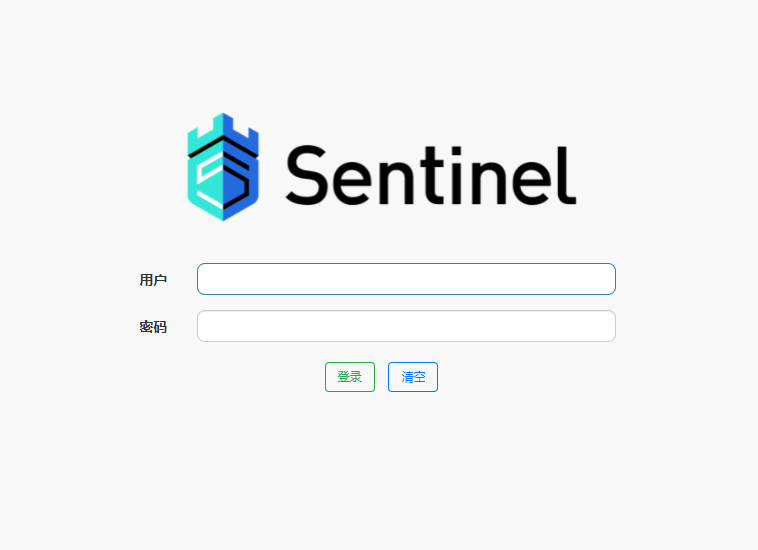
启动 ams-admin、ams-auth 和ams-gateway 模块
再次访问sentinel面板，就会看到我们配置的限流规则

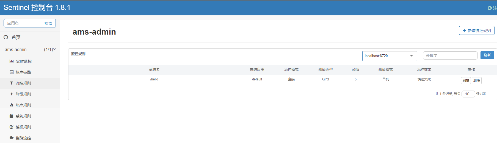

### 演示sentinel 基本功能
目前虽然说已经集成了nacos做规则持久化，但是不能将sentinel中手动添加的规则持久化到nacos中，这一块将在后面有专门的文章对这块进行补充，通过修改sentinel源码实现双向推送。

为我们先发起一个获取加密密码请求，生成调用链：

[http://localhost:9999/ams-admin/passwd/genPasswd/ams](http://localhost:9999/ams-admin/passwd/genPasswd/ams)
#### 演示流控

- 点击流控

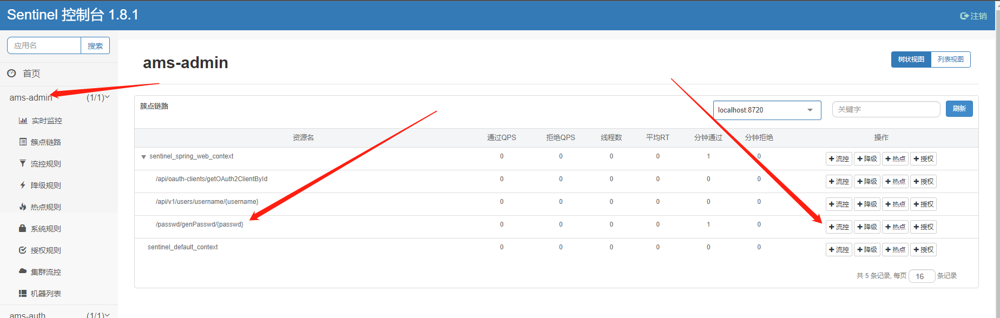

- 配置规则

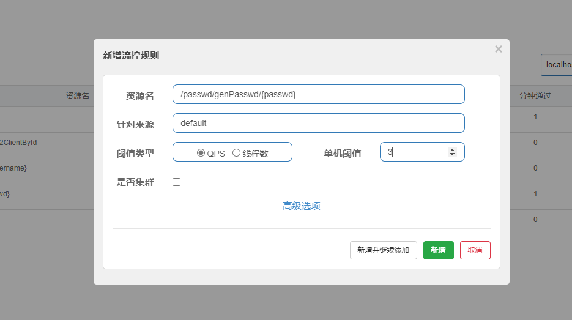

- 访问刚才的接口

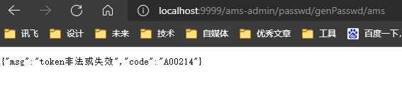

- 快速访问

会返回限流错误
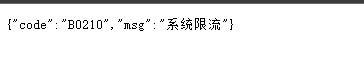
#### 演示授权

- 点击授权

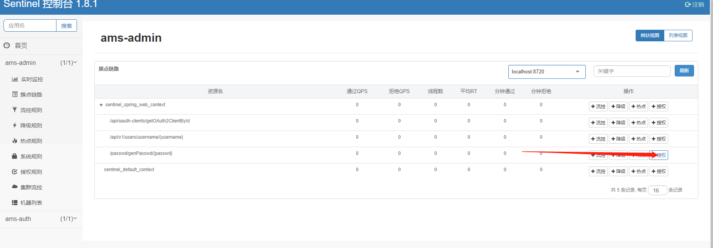

- 设置规则

设置只允许ams-test 才能调用
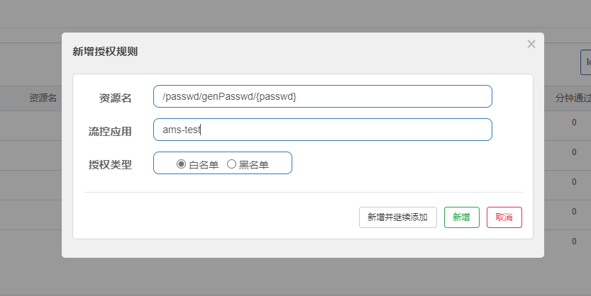

- 访问

[http://localhost:9999/ams-admin/passwd/genPasswd/ams](http://localhost:9999/ams-admin/passwd/genPasswd/ams)
目前是通过网关转发调用的，调用方是ams-gateway,，所以不会通过授权
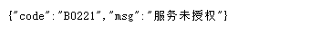
现在修改白名单为ams-gateway
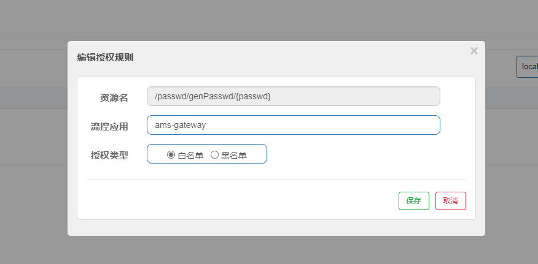

- 再次访问
- 访问成功，通过授权

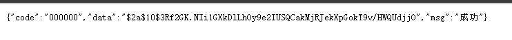
#### 演示降级

- 点击降级

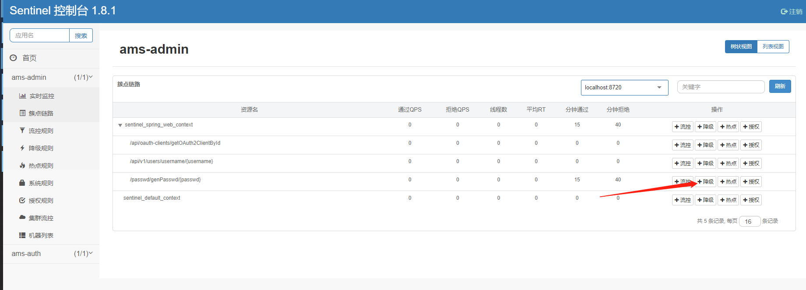

- 新建规则

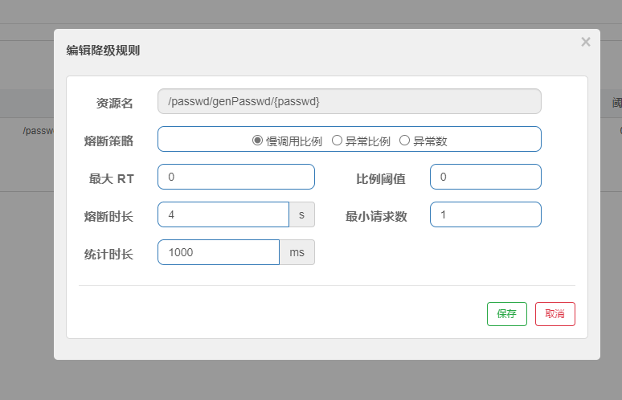

- 访问

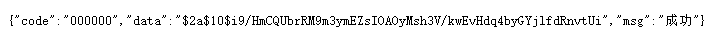

- 连续访问

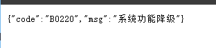
## 总结
本节主要介绍了sentinel的安装，以及如何使用springcloud 整合 sentinel实现接口服务的流控、降级和授权功能，下一节将会介绍如何整seata,实现分布式事务，敬请期待吧。
