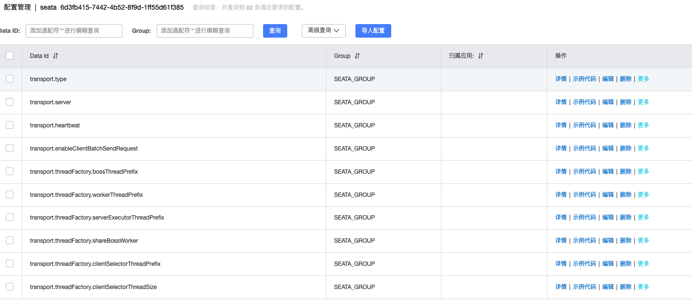
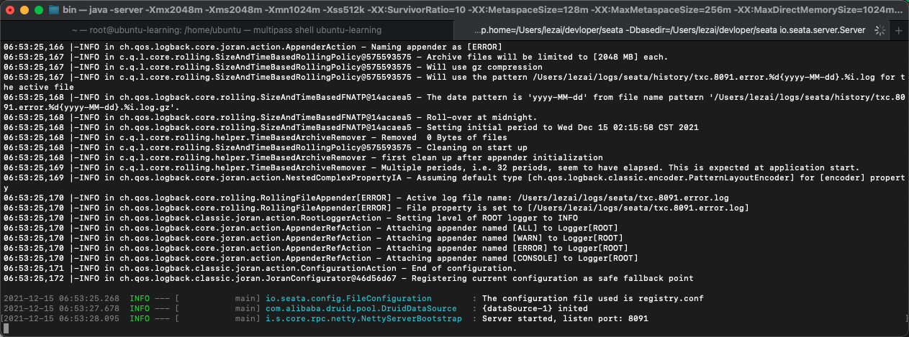
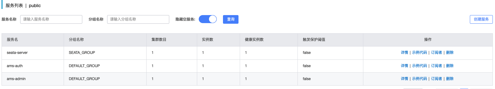

# 8.SpringCloud 整合 seata1.3

## 前言
本篇文章介绍了如何在Spring Cloud项目中引入seata，以及seata的安装过程
## 开整
### 安装seata
#### 下载安装包
链接:[https://pan.baidu.com/s/1OuSDMJDNLFxQN2KA6BfWNQ](https://pan.baidu.com/s/1OuSDMJDNLFxQN2KA6BfWNQ) (如果链接失效可以私信我)
#### 修改seata/config.txt
修改存储方式
```
store.db.dbType=mysql
store.db.driverClassName=com.mysql.jdbc.Driver
store.db.url=jdbc:mysql://你的IP:3306/seata?useUnicode=true
store.db.user=root
store.db.password=root
```
添加如下配置
```
service.vgroupMapping.demo-order=default
service.vgroupMapping.demo-storage=default
service.vgroupMapping.demo-account=default
```
#### 修改seata/conf/registry.conf
注册中心修改为nacos
```
  registry {
  # file 、nacos 、eureka、redis、zk、consul、etcd3、sofa
  type = "nacos"

  nacos {
    application = "seata-server"
    serverAddr = "你的IP:8848"
    group = "SEATA_GROUP"
    namespace = ""
    cluster = "default"
    username = "nacos"
    password = "nacos"
  }
```
配置中心也修改为nacos
```
config {
  # file、nacos 、apollo、zk、consul、etcd3
  type = "nacos"

  nacos {
    serverAddr = "你的IP:8848"
    namespace = "在nacos中创建一个命名空间，用来保存seata配置，提前配置好"
    group = "SEATA_GROUP"
    username = "nacos"
    password = "nacos"
  }
```
#### 执行nacos脚本，推送seata配置到nacos
```
sh nacos-config.sh -h 你的nacos -p 8848 -g SEATA_GROUP -t 上面创建的命名空间 -u nacos -w nacos
```
等待推送完成...
推送完成后，nacos中长这样

#### 创建seata 需要用到的表
创建数据库
```c
create database seata;
```
创建相关表
```c
CREATE TABLE `branch_table` (
  `branch_id` bigint(20) NOT NULL,
  `xid` varchar(128) NOT NULL,
  `transaction_id` bigint(20) DEFAULT NULL,
  `resource_group_id` varchar(32) DEFAULT NULL,
  `resource_id` varchar(256) DEFAULT NULL,
  `branch_type` varchar(8) DEFAULT NULL,
  `status` tinyint(4) DEFAULT NULL,
  `client_id` varchar(64) DEFAULT NULL,
  `application_data` varchar(2000) DEFAULT NULL,
  `gmt_create` datetime(6) DEFAULT NULL,
  `gmt_modified` datetime(6) DEFAULT NULL,
  PRIMARY KEY (`branch_id`),
  KEY `idx_xid` (`xid`)
) ENGINE=InnoDB DEFAULT CHARSET=utf8;

CREATE TABLE `global_table` (
  `xid` varchar(128) NOT NULL,
  `transaction_id` bigint(20) DEFAULT NULL,
  `status` tinyint(4) NOT NULL,
  `application_id` varchar(32) DEFAULT NULL,
  `transaction_service_group` varchar(32) DEFAULT NULL,
  `transaction_name` varchar(128) DEFAULT NULL,
  `timeout` int(11) DEFAULT NULL,
  `begin_time` bigint(20) DEFAULT NULL,
  `application_data` varchar(2000) DEFAULT NULL,
  `gmt_create` datetime DEFAULT NULL,
  `gmt_modified` datetime DEFAULT NULL,
  PRIMARY KEY (`xid`),
  KEY `idx_gmt_modified_status` (`gmt_modified`,`status`),
  KEY `idx_transaction_id` (`transaction_id`)
) ENGINE=InnoDB DEFAULT CHARSET=utf8;

CREATE TABLE `lock_table` (
  `row_key` varchar(128) NOT NULL,
  `xid` varchar(96) DEFAULT NULL,
  `transaction_id` bigint(20) DEFAULT NULL,
  `branch_id` bigint(20) NOT NULL,
  `resource_id` varchar(256) DEFAULT NULL,
  `table_name` varchar(32) DEFAULT NULL,
  `pk` varchar(36) DEFAULT NULL,
  `gmt_create` datetime DEFAULT NULL,
  `gmt_modified` datetime DEFAULT NULL,
  PRIMARY KEY (`row_key`),
  KEY `idx_branch_id` (`branch_id`)
) ENGINE=InnoDB DEFAULT CHARSET=utf8;
```
#### 启动seata服务
sh seata/bin/seata-server.sh
启动成功后，监听8091端口


看下nacos中是否注册了此服务:
看到如下内容表示，seata已经安装并注册成功

### 整合seata
代码在ams-cloud/ams-demo/demo-seata下面
#### 创建父工程
在ams-demo下创建父工程demo-seata
#### 引入依赖
```c
 <dependencies>
        <!-- 配置读取 -->
        <dependency>
            <groupId>org.springframework.boot</groupId>
            <artifactId>spring-boot-configuration-processor</artifactId>
        </dependency>

        <!-- 单元测试 -->
        <dependency>
            <groupId>org.springframework.boot</groupId>
            <artifactId>spring-boot-starter-test</artifactId>
            <scope>test</scope>
        </dependency>

        <!-- Spring Cloud & Alibaba -->
        <dependency>
            <groupId>org.springframework.cloud</groupId>
            <artifactId>spring-cloud-starter-bootstrap</artifactId>
        </dependency>

        <!-- 注册中心 -->
        <dependency>
            <groupId>com.alibaba.cloud</groupId>
            <artifactId>spring-cloud-starter-alibaba-nacos-discovery</artifactId>
        </dependency>

        <dependency>
            <groupId>org.springframework.cloud</groupId>
            <artifactId>spring-cloud-starter-loadbalancer</artifactId>
        </dependency>

        <!-- 配置中心 -->
        <dependency>
            <groupId>com.alibaba.cloud</groupId>
            <artifactId>spring-cloud-starter-alibaba-nacos-config</artifactId>
        </dependency>

        <dependency>
            <groupId>com.ams</groupId>
            <artifactId>common-mybatis-plus</artifactId>
            <version>1.0.0</version>
        </dependency>
        <dependency>
            <groupId>com.ams</groupId>
            <artifactId>common-base</artifactId>
            <version>${ams.version}</version>
        </dependency>

        <dependency>
            <groupId>com.ams</groupId>
            <artifactId>common-web</artifactId>
            <version>${ams.version}</version>
        </dependency>

        <!-- openfeign依赖 1. http客户端选择okhttp 2. loadbalancer替换ribbon -->
        <dependency>
            <groupId>org.springframework.cloud</groupId>
            <artifactId>spring-cloud-starter-openfeign</artifactId>
        </dependency>

        <dependency>
            <groupId>io.github.openfeign</groupId>
            <artifactId>feign-okhttp</artifactId>
        </dependency>
        <!--seata 必备-->
        <dependency>
            <groupId>com.alibaba.cloud</groupId>
            <artifactId>spring-cloud-starter-alibaba-seata</artifactId>
        </dependency>
    </dependencies>
```
修改父工程的打包方式为<packaging>pom</packaging>
#### 创建账户子模块
在demo-seata下创建demo-account子模块
##### 添加启动类
```c
package com.ams.demo.seater.order;

import io.seata.config.springcloud.EnableSeataSpringConfig;
import org.springframework.boot.SpringApplication;
import org.springframework.boot.autoconfigure.SpringBootApplication;
import org.springframework.boot.autoconfigure.jdbc.DataSourceAutoConfiguration;
import org.springframework.cloud.client.discovery.EnableDiscoveryClient;
import org.springframework.cloud.openfeign.EnableFeignClients;

/**
 * Created with IntelliJ IDEA.
 *
 * @date： 2021/12/8
 * @description：
 * @modifiedBy：
 * @version: 1.0
 */
@SpringBootApplication(exclude = DataSourceAutoConfiguration.class)
@EnableDiscoveryClient
@EnableFeignClients
public class DemoOrderApp {
    public static void main(String[] args) {
        SpringApplication.run(DemoOrderApp.class, args);
    }
}

```
##### 添加扣除余额接口
```c
package com.ams.demo.seater.account.controller;

import com.ams.common.result.R;
import com.ams.demo.seater.account.service.AccountService;
import lombok.RequiredArgsConstructor;
import org.springframework.web.bind.annotation.RequestMapping;
import org.springframework.web.bind.annotation.RequestParam;
import org.springframework.web.bind.annotation.RestController;

/**
 * Created with IntelliJ IDEA.
 *
 * @date： 2021/12/8
 * @description：
 * @modifiedBy：
 * @version: 1.0
 */
@RestController
@RequestMapping("/account")
@RequiredArgsConstructor
public class AccountController {
    private final AccountService accountService;

    @RequestMapping("/decrease")
    public R decrease(@RequestParam("userId") Long userId, @RequestParam("money") Integer money) {
        accountService.decrease(userId, money);
        return R.ok("余额扣减成功");
    }
}

```
##### 创建bootstrap.yml
```c
server:
  port: 20004

spring:
  application:
    name: ams-demo-account
  cloud:
    nacos:
      # 注册中心
      discovery:
        server-addr: http://你的nacos地址:8848
      # 配置中心
      config:
        server-addr: ${spring.cloud.nacos.discovery.server-addr}
        file-extension: yaml
        shared-configs[0]:
          data-id: ams-common.yaml
          refresh: true
    alibaba:
      seata:
        tx-service-group: demo-account

```
##### 新增nacos配置
在nacos新增配置 ams-demo-account.yaml
```c
spring:
  datasource:
    type: com.alibaba.druid.pool.DruidDataSource
    driver-class-name: com.mysql.cj.jdbc.Driver 
    url: jdbc:mysql://${mysql.host}:${mysql.port}/ams_account?zeroDateTimeBehavior=convertToNull&useUnicode=true&characterEncoding=UTF-8&serverTimezone=Asia/Shanghai&autoReconnect=true
    username: ${mysql.username}
    password: ${mysql.password}
  redis:
    database: 0
    host: ${redis.host}
    port: ${redis.port}
    password: ${redis.password}
  cache:
    # 缓存类型
    type: redis
    # 缓存时间(单位：ms)
    redis:
      time-to-live: 3600000
      # 缓存null值，防止缓存穿透
      cache-null-values: true
      # 允许使用缓存前缀，
      use-key-prefix: true
      # 缓存前缀，没有设置使用注解的缓存名称(value)作为前缀，和注解的key用双冒号::拼接组成完整缓存key
      key-prefix: 'admin:'
                
mybatis-plus:
  configuration:
    # 驼峰下划线转换
    map-underscore-to-camel-case: true
    # 这个配置会将执行的sql打印出来，在开发或测试的时候可以用
    log-impl: org.apache.ibatis.logging.stdout.StdOutImpl

# 全局参数设置
ribbon:
  ReadTimeout: 120000
  ConnectTimeout: 10000
  SocketTimeout: 10000
  MaxAutoRetries: 0
  MaxAutoRetriesNextServer: 1 

feign:
  httpclient:
    enabled: true
  okhttp:
    enabled: false
#Seata分布式事务配置(AT模式)
seata:
  enabled: true
  application-id: ${spring.application.name}
  #客户端和服务端在同一个事务组
  tx-service-group: demo-account
  enable-auto-data-source-proxy: true
  service:
    vgroup-mapping:
      demo-account: default
  config:
    type: nacos
    nacos:
      namespace: "填写在安装seata时创建的命名空间"
      serverAddr: 你的nacos地址:8848
      group: SEATA_GROUP
      username: "nacos"
      password: "nacos"
  #服务注册到nacos
  registry:
    type: nacos
    nacos:
      application: seata-server
      server-addr: 你的nacos地址:8848
      group: SEATA_GROUP
      namespace: "public"
      username: "nacos"
      password: "nacos"
      cluster: default

```
#### 创建库存子模块
在demo-seata下创建子模块 demo-storage
##### 添加启动类
```c
package com.ams.demo.seater.storage;

import io.seata.config.springcloud.EnableSeataSpringConfig;
import org.springframework.boot.SpringApplication;
import org.springframework.boot.autoconfigure.SpringBootApplication;
import org.springframework.boot.autoconfigure.jdbc.DataSourceAutoConfiguration;
import org.springframework.cloud.client.discovery.EnableDiscoveryClient;

/**
 * Created with IntelliJ IDEA.
 *
 * @date： 2021/12/8
 * @description：
 * @modifiedBy：
 * @version: 1.0
 */
@SpringBootApplication(exclude = DataSourceAutoConfiguration.class)
@EnableDiscoveryClient
@EnableSeataSpringConfig
public class DemoStorageApp {
    public static void main(String[] args) {
        SpringApplication.run(DemoStorageApp.class, args);
    }
}

```
##### 添加扣除库存接口
```java
package com.ams.demo.seater.storage.controller;

import com.ams.common.result.R;
import com.ams.demo.seater.storage.service.StorageService;
import lombok.RequiredArgsConstructor;
import org.springframework.web.bind.annotation.RequestMapping;
import org.springframework.web.bind.annotation.RequestParam;
import org.springframework.web.bind.annotation.RestController;

/**
 * Created with IntelliJ IDEA.
 *
 * @date： 2021/12/8
 * @description：
 * @modifiedBy：
 * @version: 1.0
 */
@RestController
@RequestMapping("/storage")
@RequiredArgsConstructor
public class StorageController {
    private final StorageService storageService;

    @RequestMapping("/decrease")
    public R decrease(@RequestParam("productId") Long productId, @RequestParam("count") Integer count) {
        storageService.decrease(productId, count);
        return R.ok("库存扣减成功");
    }
}

```
##### 创建bootstrap.yml
```java
server:
  port: 20005

spring:
  application:
    name: ams-demo-storage
  cloud:
    nacos:
      # 注册中心
      discovery:
        server-addr: http://你的nacosip:8848
      # 配置中心
      config:
        server-addr: ${spring.cloud.nacos.discovery.server-addr}
        file-extension: yaml
        shared-configs[0]:
          data-id: ams-common.yaml
          refresh: true
    alibaba:
      seata:
        tx-service-group: demo-storage
```
##### 新增nacos配置
在nacos新增配置 ams-demo-storage.yaml
```java
spring:
  datasource:
    type: com.alibaba.druid.pool.DruidDataSource
    driver-class-name: com.mysql.cj.jdbc.Driver 
    url: jdbc:mysql://${mysql.host}:${mysql.port}/ams_storage?zeroDateTimeBehavior=convertToNull&useUnicode=true&characterEncoding=UTF-8&serverTimezone=Asia/Shanghai&autoReconnect=true
    username: ${mysql.username}
    password: ${mysql.password}
  redis:
    database: 0
    host: ${redis.host}
    port: ${redis.port}
    password: ${redis.password}
  cache:
    # 缓存类型
    type: redis
    # 缓存时间(单位：ms)
    redis:
      time-to-live: 3600000
      # 缓存null值，防止缓存穿透
      cache-null-values: true
      # 允许使用缓存前缀，
      use-key-prefix: true
      # 缓存前缀，没有设置使用注解的缓存名称(value)作为前缀，和注解的key用双冒号::拼接组成完整缓存key
      key-prefix: 'admin:'
                
mybatis-plus:
  configuration:
    # 驼峰下划线转换
    map-underscore-to-camel-case: true
    # 这个配置会将执行的sql打印出来，在开发或测试的时候可以用
    log-impl: org.apache.ibatis.logging.stdout.StdOutImpl

# 全局参数设置
ribbon:
  ReadTimeout: 120000
  ConnectTimeout: 10000
  SocketTimeout: 10000
  MaxAutoRetries: 0
  MaxAutoRetriesNextServer: 1 

feign:
  httpclient:
    enabled: true
  okhttp:
    enabled: false
#Seata分布式事务配置(AT模式)
seata:
  enabled: true
  application-id: ${spring.application.name}
  #客户端和服务端在同一个事务组
  tx-service-group: demo-storage
  enable-auto-data-source-proxy: true
  service:
    vgroup-mapping:
      demo-storage: default
  config:
    type: nacos
    nacos:
      namespace: "填写在安装seata时创建的命名空间"
      serverAddr: 你的nacosip:8848
      group: SEATA_GROUP
      username: "nacos"
      password: "nacos"
  #服务注册到nacos
  registry:
    type: nacos
    nacos:
      application: seata-server
      server-addr: 你的nacosip:8848
      group: SEATA_GROUP
      namespace: "public"
      username: "nacos"
      password: "nacos"
      cluster: default

mybatis:
  mapperLocations: classpath:mapper/*.xml
logging:
  level:
    spring: info

```
#### 创建订单子模块
在demo-seata下创建demo-order子模块
##### 添加创建订单的接口
```java
package com.ams.demo.seater.order.controller;

import com.ams.common.result.R;
import com.ams.demo.seater.order.entity.Order;
import com.ams.demo.seater.order.service.OrderService;
import lombok.RequiredArgsConstructor;
import org.springframework.web.bind.annotation.RequestMapping;
import org.springframework.web.bind.annotation.RestController;

import java.util.List;

/**
 * Created with IntelliJ IDEA.
 *
 * @date： 2021/12/8
 * @description：
 * @modifiedBy：
 * @version: 1.0
 */
@RestController
@RequestMapping("/order")
@RequiredArgsConstructor
public class OrderController {
    private final OrderService orderService;

    @RequestMapping("/createOrder")
    public R createOrder() {
        orderService.createOrder();
        return R.ok("订单创建成功");
    }
}

```
##### 添加创建订单的service
```java
package com.ams.demo.seater.order.service.impl;

import com.ams.common.result.R;
import com.ams.demo.seater.order.dao.OrderMapper;
import com.ams.demo.seater.order.entity.Order;
import com.ams.demo.seater.order.service.AccountFeignService;
import com.ams.demo.seater.order.service.OrderService;
import com.ams.demo.seater.order.service.StorageFeignService;
import com.baomidou.mybatisplus.extension.service.impl.ServiceImpl;
import io.seata.spring.annotation.GlobalTransactional;
import lombok.RequiredArgsConstructor;
import org.springframework.stereotype.Service;

/**
 * Created with IntelliJ IDEA.
 *
 * @date： 2021/11/24
 * @description：
 * @modifiedBy：
 * @version: 1.0
 */
@Service
@RequiredArgsConstructor
public class OrderServiceImpl extends ServiceImpl<OrderMapper, Order> implements OrderService {
    private final AccountFeignService accountFeignService;
    private final StorageFeignService storageFeignService;

    @Override
    @GlobalTransactional(name = "ams-create-order",rollbackFor = Exception.class)
    public R createOrder() {
        Order order = Order.builder()
                .count(10)
                .money(100)
                .productId(1L)
                .status(0)
                .userId(1L)
                .build();
        // 创建订单
        save(order);
        // 扣除库存
        storageFeignService.decrease(order.getProductId(), order.getCount());
        // 扣余额
        accountFeignService.decrease(order.getUserId(), order.getMoney());
        //更新订单状态
        order.setStatus(1);
        updateById(order);
        return R.ok();
    }
}

```
##### 添加调用库存接口的feign
```java
package com.ams.demo.seater.order.service;

import com.ams.common.result.R;
import org.springframework.cloud.openfeign.FeignClient;
import org.springframework.web.bind.annotation.RequestMapping;
import org.springframework.web.bind.annotation.RequestParam;

/**
 *
 * @author: 示例作者
 * Date: 2021/12/13 11:05 下午
 * Description:
 */
@FeignClient(value = "ams-demo-storage")
@RequestMapping("/storage")
public interface StorageFeignService {
    @RequestMapping("/decrease")
    public R decrease(@RequestParam("productId") Long productId, @RequestParam("count") Integer count);
}

```
##### 添加调用账户接口的feign
```java
package com.ams.demo.seater.order.service;

import com.ams.common.result.R;
import org.springframework.cloud.openfeign.FeignClient;
import org.springframework.web.bind.annotation.RequestMapping;
import org.springframework.web.bind.annotation.RequestParam;

/**
 *
 * @author: 示例作者
 * Date: 2021/12/13 11:05 下午
 * Description:
 */
@FeignClient(value = "ams-demo-account")
@RequestMapping("/account")
public interface AccountFeignService {
    @RequestMapping("/decrease")
    public R decrease(@RequestParam("userId") Long userId, @RequestParam("money") Integer money);
}

```
##### 创建启动类
```java
package com.ams.demo.seater.order;

import org.springframework.boot.SpringApplication;
import org.springframework.boot.autoconfigure.SpringBootApplication;
import org.springframework.boot.autoconfigure.jdbc.DataSourceAutoConfiguration;
import org.springframework.cloud.client.discovery.EnableDiscoveryClient;
import org.springframework.cloud.openfeign.EnableFeignClients;

/**
 * Created with IntelliJ IDEA.
 *
 * @date： 2021/12/8
 * @description：
 * @modifiedBy：
 * @version: 1.0
 */
@SpringBootApplication(exclude = DataSourceAutoConfiguration.class)
@EnableDiscoveryClient
@EnableFeignClients
public class DemoOrderApp {
    public static void main(String[] args) {
        SpringApplication.run(DemoOrderApp.class, args);
    }
}

```
##### 创建bootstrap.yml
```java
server:
  port: 20003

spring:
  application:
    name: ams-demo-order
  cloud:
    nacos:
      # 注册中心
      discovery:
        server-addr: http://你的nacos地址:8848
      # 配置中心
      config:
        server-addr: ${spring.cloud.nacos.discovery.server-addr}
        file-extension: yaml
        shared-configs[0]:
          data-id: ams-common.yaml
          refresh: true
    alibaba:
      seata:
        tx-service-group: demo-order

```
##### 新增nacos配置
在naocs中创建ams-demo-order.yaml配置
```java
spring:
  datasource:
    type: com.alibaba.druid.pool.DruidDataSource
    driver-class-name: com.mysql.cj.jdbc.Driver 
    url: jdbc:mysql://${mysql.host}:${mysql.port}/ams_order?zeroDateTimeBehavior=convertToNull&useUnicode=true&characterEncoding=UTF-8&serverTimezone=Asia/Shanghai&autoReconnect=true
    username: ${mysql.username}
    password: ${mysql.password}
  redis:
    database: 0
    host: ${redis.host}
    port: ${redis.port}
    password: ${redis.password}
  cache:
    # 缓存类型
    type: redis
    # 缓存时间(单位：ms)
    redis:
      time-to-live: 3600000
      # 缓存null值，防止缓存穿透
      cache-null-values: true
      # 允许使用缓存前缀，
      use-key-prefix: true
      # 缓存前缀，没有设置使用注解的缓存名称(value)作为前缀，和注解的key用双冒号::拼接组成完整缓存key
      key-prefix: 'admin:'
                
mybatis-plus:
  configuration:
    # 驼峰下划线转换
    map-underscore-to-camel-case: true
    # 这个配置会将执行的sql打印出来，在开发或测试的时候可以用
    log-impl: org.apache.ibatis.logging.stdout.StdOutImpl

# 全局参数设置
ribbon:
  ReadTimeout: 120000
  ConnectTimeout: 10000
  SocketTimeout: 10000
  MaxAutoRetries: 0
  MaxAutoRetriesNextServer: 1 

feign:
  httpclient:
    enabled: true
  okhttp:
    enabled: false
#Seata分布式事务配置(AT模式)
seata:
  enabled: true
  application-id: ${spring.application.name}
  #客户端和服务端在同一个事务组
  tx-service-group: demo-order
  enable-auto-data-source-proxy: true
  service:
    vgroup-mapping:
      demo-order: default
  config:
    type: nacos
    nacos:
      namespace: "填写在安装seata时创建的命名空间"
      serverAddr: 你的nacos ip:8848
      group: SEATA_GROUP
      username: "nacos"
      password: "nacos"
  #服务注册到nacos
  registry:
    type: nacos
    nacos:
      application: seata-server
      server-addr: 你的nacos ip:8848
      group: SEATA_GROUP
      namespace: "public"
      username: "nacos"
      password: "nacos"
      cluster: default
logging:
  level:
    spring: info

```
#### 创建回滚表
在每个业务数据库下面创建回滚表
```java
CREATE TABLE `undo_log` (
  `branch_id` bigint(20) NOT NULL COMMENT 'branch transaction id',
  `xid` varchar(128) NOT NULL COMMENT 'global transaction id',
  `context` varchar(128) NOT NULL COMMENT 'undo_log context,such as serialization',
  `rollback_info` longblob NOT NULL COMMENT 'rollback info',
  `log_status` int(11) NOT NULL COMMENT '0:normal status,1:defense status',
  `log_created` datetime(6) NOT NULL COMMENT 'create datetime',
  `log_modified` datetime(6) NOT NULL COMMENT 'modify datetime',
  UNIQUE KEY `ux_undo_log` (`xid`,`branch_id`)
) ENGINE=InnoDB DEFAULT CHARSET=utf8 COMMENT='AT transaction mode undo table';
```
#### 验证
启动是三个服务，请求：http://localhost:20003/order/createOrder,通过设置异常，观察是否全局回滚
