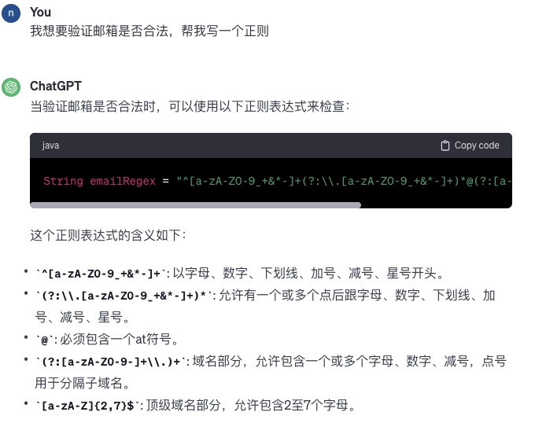
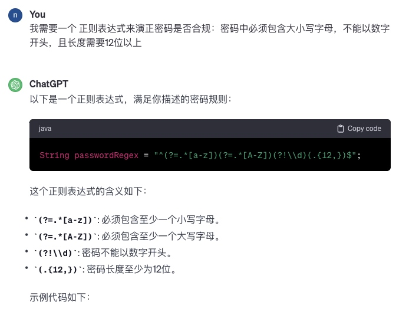

# 6.学习正则你需要知道的(最后才看)
## 正则的缺点
* 性能问题：在处理大型工程时，正则表达式的性能可能会让人感到捉急。特别是对于缺乏正则表达式语感的开发者来说，写出的表达式可能会导致效率低下。

* 难写和难读：对于新手来说，正则表达式可能难以理解和掌握。此外，由于其复杂性，其他人阅读和理解你的正则表达式也可能会有困难。

* 维护问题：如果源码结构发生变化，正则表达式可能需要重新检查和更新。这增加了维护的难度和工作量。

* 学习成本：尽管正则表达式容易学习，但由于其复杂性和特殊性，也非常容易忘记。

## 借助AI,帮你生成各种正则

好，正则表达式的系列教程到此就结束了，让我们一起期待下一个系列教程