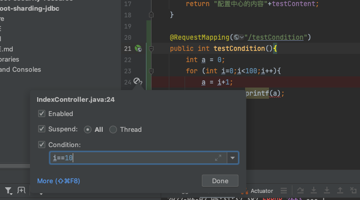
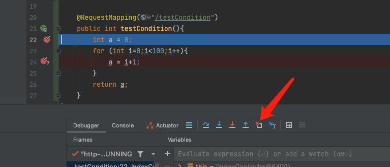
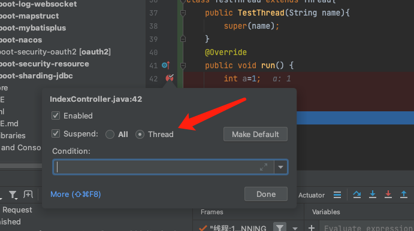
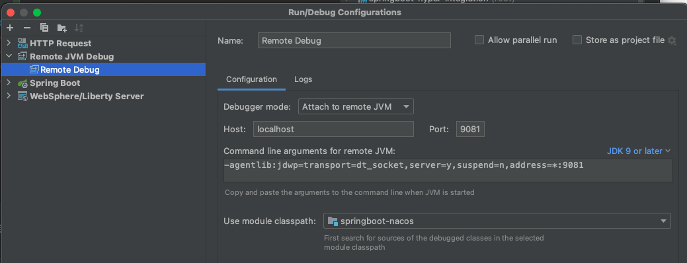
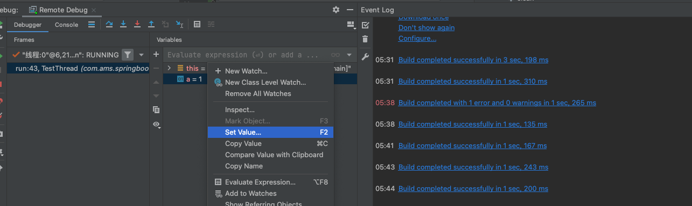
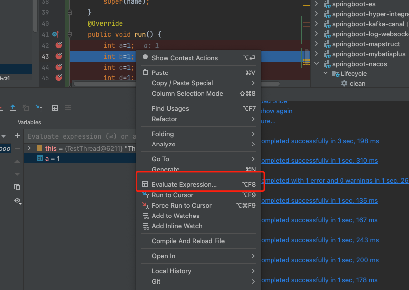
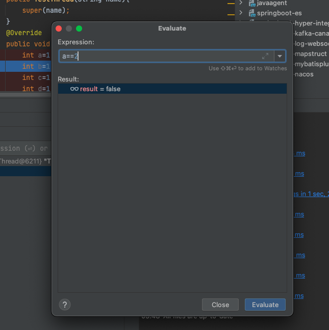

# IDEA 5大调试技巧-实现高效率开发

## 条件调试

## 回到上一步

## 多线程调试

## 远程断点调试

```
java -server -Xms512m -Xmx512m -Xdebug -Xnoagent -Djava.compiler=NONE -Xrunjdwp:transport=dt_socket,server=y,suspend=n,address=9081 -jar springboot-nacos-0.0.1-SNAPSHOT.jar

```
## 实时修改运行中的变量值和执行表达式



