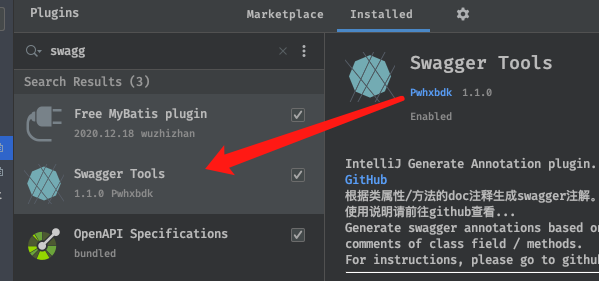
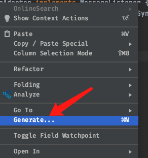
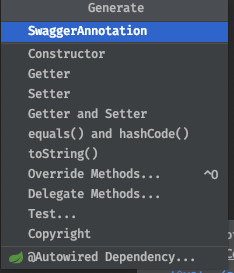

# IDEA技巧：如何根据注释生成swagger注解

相信大家在进行java项目开发，肯定会接触到swagger的，一款动态生成api文档的神奇，只需要在api上面加上注解，就可以生成文档，现在我简单介绍下swagger的快速入门，最后再说下如何根据注释快速生成这些烦人的注解。

## swagger日常操作

### 引入swagger依赖
```
<dependency>

<groupId>io.springfox</groupId>

<artifactId>springfox-swagger-ui</artifactId>

<version>2.9.2</version>

</dependency>


<dependency>

<groupId>io.springfox</groupId>

<artifactId>springfox-swagger2</artifactId>

<version>2.9.2</version>

</dependency>
```
### 开启swagger
```
@Configuration

@EnableSwagger2//开启Swagger2

public class Swagger2Config {


}
```
### swagger常用注解
```
@Api：修饰整个类，描述Controller的作用

@ApiOperation：描述一个类的一个方法，或者说一个接口

@ApiModel：用对象来接收参数 ，修饰类

@ApiModelProperty：用对象接收参数时，描述对象的一个字段

@ApiResponse：HTTP响应其中1个描述

@ApiResponses：HTTP响应整体描述，一般描述错误的响应

@ApiIgnore：使用该注解忽略这个API

@ApiError ：发生错误返回的信息

@ApiParam：单个参数描述

@ApiImplicitParam：一个请求参数，用在方法上

@ApiImplicitParams：多个请求参数
```
相信大家入门swagger肯定是不难的，但是大家估计都有一个共同的痛点，就是每次开发一个新接口的时候，要加上一堆注解，特别难受，有没有一款插件能够自动生成这些注解呢？


答案是有的。接下来我会给大家介绍下这款插件：Swagger Tools。

直接打开idea的插件仓库:搜索Swagger Tools，就可以直接安装。

安装之后重启下idea。

如何使用呢？
使用方式很简单，只要在需要生成注解的文件右击，选择gēgenerate->swaggerannotation，就可以直接生成，是不是很简单


本篇教程到此结束，后续会发布更多开发小技巧。

