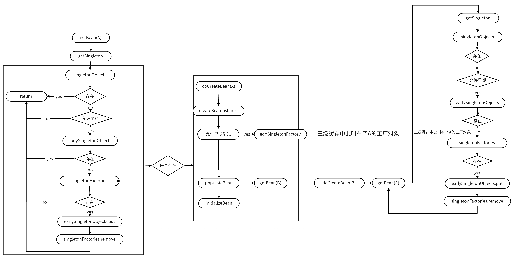
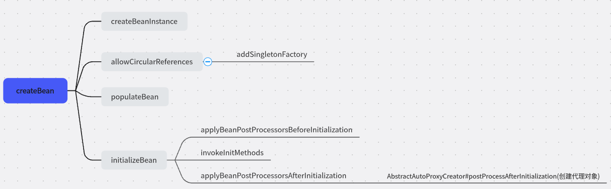
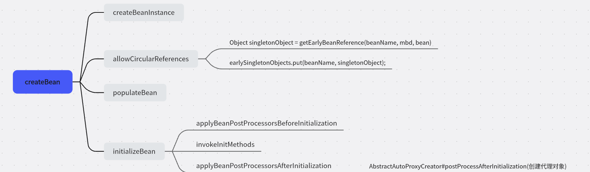
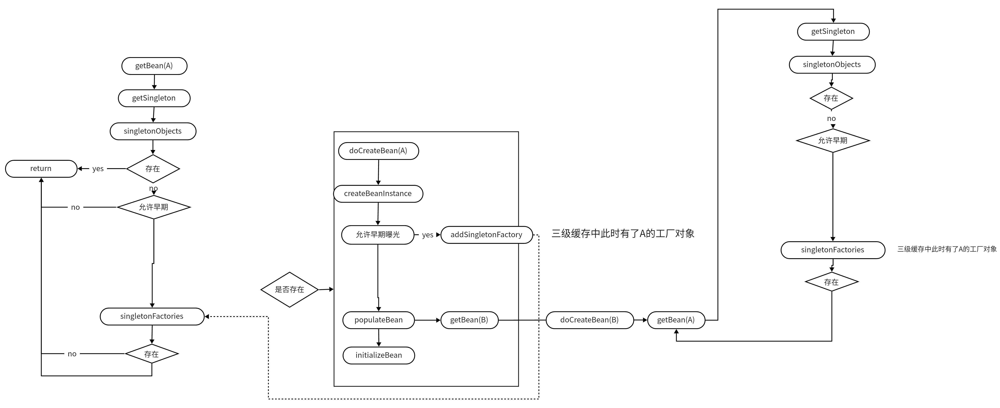

# Spring为什么非要三级缓存解决循环依赖？可以去掉二级缓存和三级缓存么？

## 回顾下三级缓存

## 回顾下Bean的生命周期

现在我们将Bean生命周期和三级缓存重新回顾了下，是不是感觉二级缓存和三级缓存是不是有点多余，如果去掉，会有什么影响么？相信大家都会有这样的疑问，而且这个问题在面试过程经常会被问到，所以接下来我们分别分析下，如果去掉三级缓存和缓存会带来什么影响：
## 去掉三级缓存
### 改造后
首先去掉三级缓存，也就是把对象工厂去掉，那么我们就得将Bean生命周期改成这样:

### 影响

- 创建实例后 ，直接将半成品对象放到二级缓存
- 如果对象被代理，那么在对象没有初始化完成之前，当前的代理对象已经被创建，并且放到二级缓存(违反了AOP原则)
- 早期曝光是为了解决循环依赖，如果没有循环依赖，这个半成品的代理对象不就多余了么
## 去掉二级缓存
### 改造后
上面分析了去掉三级缓存所带来的影响，我们接下来分析下入锅去掉二级缓存，会是什么样的：

改动点：当从三级缓存获取半成品时，不再将生成的半成品对象放到二级缓存(已经不存在了)，而也不会从三级缓存中删除。
再说问题之前，我们先讲一个知识点：关于从三级缓存中获取半成品对象时的问题
```
if (singletonFactory != null) {
   singletonObject = singletonFactory.getObject();
   this.earlySingletonObjects.put(beanName, singletonObject);
   this.singletonFactories.remove(beanName);
}
```
这段代码就是从三级缓存对象工厂通过调用getObject()方法获取半成品的对象，注意这个方法没调用一次就会产生新对象。
### 影响

- 如果对象没有被代理，则不会产生问题
- 如果被代理，但是有且仅有一个对象循环引用了自己，则不会产生问题
- 如果被代理，有多于一个对象循环引用了自己，如B和C 都循环引用了A 则会产生问题：singletonFactory.getObject()每次返回不同的代理对象，将导致引B和C维护的代理对象都不同。
