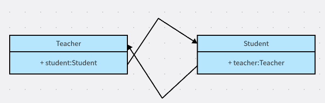
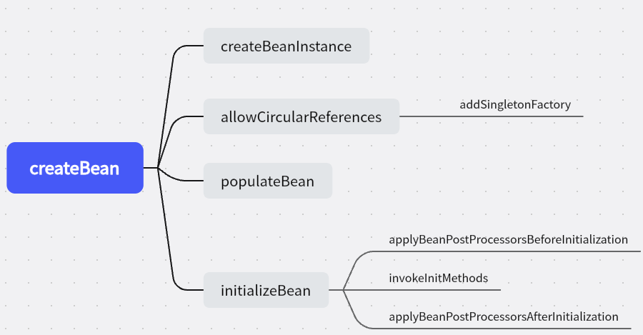
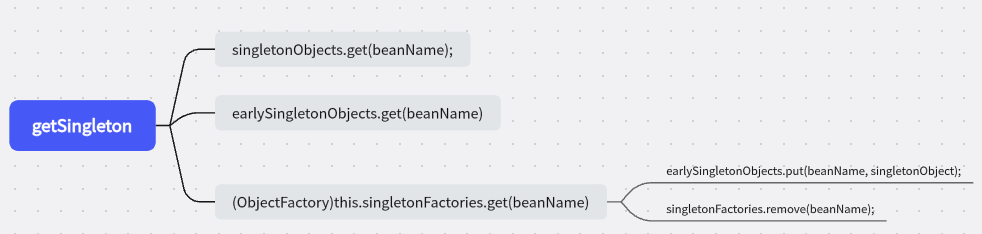
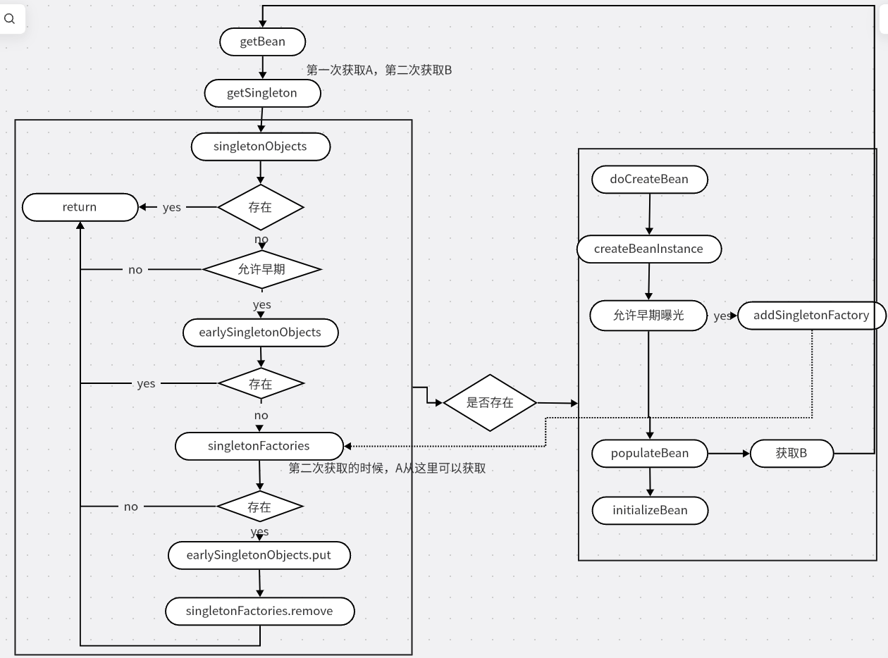

# Spring是如何通过三级缓存解决循环依赖？

## 什么是循环依赖
### 示例代码
```
@Component
public class Teacher {
    @Autowired
    private Student student;
}

@Component
public class Student {
    @Autowired
    private Teacher teacher;
}
```
### 代码解析
现有两个类Teacher和Student，这两个类相互引用，Student需要用到Teacher，Teacher需要使用Student，这个从表面看是符合逻辑的，但是我画个图给大家演示下，让大家看下在IOC容器初始化过程中会出现什么问题
### 动图演示
没有真的动...

通过这张图我们可以看出，两个对象相互依赖，但是在初始化的时候，会变成这样：teacher->student->teacher-student，因为在当teacher去依赖student对象时，student也需要teacher，此时就会导致student先要去获取teacher对象，但是teacher对象此时还没初始化好，导致一直这么找下去，最终导致死循环。
## 如何解决
### 先看初始化的部分源码
> 别怕，不难

```
protected Object doCreateBean(String beanName, RootBeanDefinition mbd, @Nullable Object[] args)
      throws BeanCreationException {

   if (instanceWrapper == null) {
      instanceWrapper = createBeanInstance(beanName, mbd, args);
   }
   // Eagerly cache singletons to be able to resolve circular references
   // even when triggered by lifecycle interfaces like BeanFactoryAware.
   boolean earlySingletonExposure = (mbd.isSingleton() && this.allowCircularReferences &&
         isSingletonCurrentlyInCreation(beanName));
   if (earlySingletonExposure) {
      if (logger.isTraceEnabled()) {
         logger.trace("Eagerly caching bean '" + beanName +
               "' to allow for resolving potential circular references");
      }
      addSingletonFactory(beanName, () -> getEarlyBeanReference(beanName, mbd, bean));
   }

   // Initialize the bean instance.
   Object exposedObject = bean;
   try {
      populateBean(beanName, mbd, instanceWrapper);
      exposedObject = initializeBean(beanName, exposedObject, mbd);
   }
   catch (Throwable ex) {
      if (ex instanceof BeanCreationException bce && beanName.equals(bce.getBeanName())) {
         throw bce;
      }
      else {
         throw new BeanCreationException(mbd.getResourceDescription(), beanName, ex.getMessage(), ex);
      }
   }

   return exposedObject;
}
```

### 再看三级缓存获取代码
别怕，不难
```
@Nullable
protected Object getSingleton(String beanName, boolean allowEarlyReference) {
    Object singletonObject = this.singletonObjects.get(beanName);
    if (singletonObject == null && this.isSingletonCurrentlyInCreation(beanName)) {
        singletonObject = this.earlySingletonObjects.get(beanName);
        if (singletonObject == null && allowEarlyReference) {
            synchronized(this.singletonObjects) {
                singletonObject = this.singletonObjects.get(beanName);
                if (singletonObject == null) {
                    singletonObject = this.earlySingletonObjects.get(beanName);
                    if (singletonObject == null) {
                        ObjectFactory<?> singletonFactory = (ObjectFactory)this.singletonFactories.get(beanName);
                        if (singletonFactory != null) {
                            singletonObject = singletonFactory.getObject();
                            this.earlySingletonObjects.put(beanName, singletonObject);
                            this.singletonFactories.remove(beanName);
                        }
                    }
                }
            }
        }
    }

    return singletonObject;
}
```


- singletonFactories：单例对象工厂缓存
- earlySingletonObjects：早期对象缓存
- singletonObjects：单例对象的完整缓存
### 怎么解决的
我们把上面的对象简化成这样：A->B,B->A 方便理解

- 当A调用getBean时，当前IOC容器是没有这个对象的，所以通过反射直接创建一个BeanInstance
- 创建完基础实例后，记住这时候还没进行初始化(属性赋值等操作)
- 紧接着会去判断当前对象是否是单例并且允许早期曝光并且正在创建；当前条件成立，则调用addSingletonFactory ，将当前的对象工厂放入三级缓存
- A调用populateBean 进行属性赋值，此时会去获取B对象
- 因为B对象此时也没有初始化，所以从缓存中是拿不到的，所以B也会进行初始化，和A执行相同操作：放入三级缓存
- 放入缓存后B调用populateBean 进行属性赋值，此时会去获取A对象，大家注意这里是关键了
- 当B去获取A对象时，只能从三级缓存singletonFactories中找到，因为A是刚才才放进去的，但是这只是A的工厂对象，拿到A工厂对象后，再调用getObject方法获取早期对象，放入二级缓存，同事删除三级缓存中的A工厂对象
- 这时B已经完成属性赋值操作，开始调用initializeBean 进行bean初始化
- A调用initializeBean 进行bean初始化


## 哪些场景下，循环依赖不能通过三级缓存解决
### 有参构造器注入
### 非single类型的Bean

