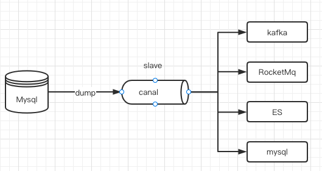

# springboot+canal+kafka+mysql 别再问缓存一致性怎么解决了！！

## 原理

canal 模拟 MySQL slave 的交互协议，伪装自己为 MySQL slave ，向 MySQL master 发送dump 协议
MySQL master 收到 dump 请求，开始推送 binary log 给 slave (即 canal )
canal 解析 binary log 对象(原始为 byte 流)
## 安装mysql
### docker安装
切记，这里的canal使用的是1.1.4版本，mysql需要是5.7版本
直接使用docker-compose安装
docker-compose.yml
```
version: '3'
services:
  mysql:
    image: registry.cn-hangzhou.aliyuncs.com/zhengqing/mysql:5.7  # 原镜像`mysql:5.7`
    container_name: mysql_3307                                    # 容器名为'mysql_3306'
    restart: unless-stopped                                               # 指定容器退出后的重启策略为始终重启，但是不考虑在Docker守护进程>启动时就已经停止了的容器
    volumes:                                                      # 数据卷挂载路径设置,将本机目录映射到容器目录
      - "./my.cnf:/etc/mysql/my.cnf"
      - "./data:/var/lib/mysql"
    environment:                        # 设置环境变量,相当于docker run命令中的-e
      TZ: Asia/Shanghai
      LANG: en_US.UTF-8
      MYSQL_ROOT_PASSWORD: root         # 设置root用户密码
      MYSQL_DATABASE: testcanal              # 初始化的数据库名称
    ports:                              # 映射端口
      - "3306:3306"
```
创建配置文件：my.cnf
```
[mysqld]
user=mysql                     # MySQL启动用户
default-storage-engine=INNODB  # 创建新表时将使用的默认存储引擎
character-set-server=utf8mb4      # 设置mysql服务端默认字符集
pid-file        = /var/run/mysqld/mysqld.pid  # pid文件所在目录
socket          = /var/run/mysqld/mysqld.sock # 用于本地连接的socket套接字
datadir         = /var/lib/mysql              # 数据文件存放的目录
#log-error      = /var/log/mysql/error.log
#bind-address   = 127.0.0.1                   # MySQL绑定IP
# Disabling symbolic-links is recommended to prevent assorted security risks
symbolic-links=0
sql_mode=STRICT_TRANS_TABLES,NO_ZERO_IN_DATE,NO_ZERO_DATE,ERROR_FOR_DIVISION_BY_ZERO,NO_ENGINE_SUBSTITUTION # 定义mysql应该支持的sql语法，数据校验等!

# 允许最大连接数
max_connections=200

# ================= ↓↓↓ mysql主从同步配置start ↓↓↓ =================

# 同一局域网内注意要唯一
server-id=3306
# 开启二进制日志功能 & 日志位置存放位置`/var/lib/mysql`
#log-bin=mysql-bin
log-bin=/var/lib/mysql/mysql-bin
# binlog格式
# 1. STATEMENT：基于SQL语句的模式，binlog 数据量小，但是某些语句和函数在复制过程可能导致数据不一致甚至出错；
# 2. MIXED：混合模式，根据语句来选用是 STATEMENT 还是 ROW 模式；
# 3. ROW：基于行的模式，记录的是行的完整变化。安全，但 binlog 会比其他两种模式大很多；
binlog_format=ROW
# FULL：binlog记录每一行的完整变更 MINIMAL：只记录影响后的行
binlog_row_image=FULL
# 日志文件大小
# max_binlog_size=1G
max_binlog_size=100M
# 定义清除过期日志的时间(这里设置为7天)
expire_logs_days=7

# ================= ↑↑↑ mysql主从同步配置end ↑↑↑ =================

[mysql]
default-character-set=utf8mb4

[client]
default-character-set=utf8mb4  # 设置mysql客户端默认字符集
root@ubuntu:~/app/docker-compose# 
```
### 启动mysql
docker-compose . up -d
## 安装kafka
### docker安装
直接使用docker-compose安装
**192.168.64.2 为你自己的主机IP**
docker-compose-kafka.yml
```
version: '3'
services:
  zookepper:
    image: wurstmeister/zookeeper                    # 原镜像`wurstmeister/zookeeper`
    container_name: zookeeper                        # 容器名为'zookeeper'
    restart: unless-stopped                                  # 指定容器退出后的重启策略为始终重启，但是不考虑在Docker守护进程启动时就已经停止了的容器
    volumes:                                         # 数据卷挂载路径设置,将本机目录映射到容器目录
      - "/etc/localtime:/etc/localtime"
    ports:                                           # 映射端口
      - "2181:2181"

  kafka:
    image: wurstmeister/kafka                                # 原镜像`wurstmeister/kafka`
    container_name: kafka                                    # 容器名为'kafka'
    restart: unless-stopped                                          # 指定容器退出后的重启策略为始终重启，但是不考虑在Docker守护进程启动时就已经停止了的容器
    volumes:                                                 # 数据卷挂载路径设置,将本机目录映射到容器目录
      - "/etc/localtime:/etc/localtime"
    environment:                                                       # 设置环境变量,相当于docker run命令中的-e
      KAFKA_ADVERTISED_HOST_NAME: 192.168.64.2                  # TODO 本机IP
      KAFKA_ADVERTISED_PORT: 9092                                      # 端口
      KAFKA_BROKER_ID: 0                                               # 在kafka集群中，每个kafka都有一个BROKER_ID来区分自己
      KAFKA_ADVERTISED_LISTENERS: PLAINTEXT://192.168.64.2:9092 # TODO 将kafka的地址端口注册给zookeeper
      KAFKA_LISTENERS: PLAINTEXT://0.0.0.0:9092                        # 配置kafka的监听端口
      KAFKA_ZOOKEEPER_CONNECT: 192.168.64.2:2181                # TODO zookeeper地址
      KAFKA_CREATE_TOPICS: "hello_world"
    ports:                              # 映射端口
      - "9092:9092"
    depends_on:                         # 解决容器依赖启动先后问题
      - zookepper

  kafka-manager:
    image: sheepkiller/kafka-manager                         # 原镜像`sheepkiller/kafka-manager`
    container_name: kafka-manager                            # 容器名为'kafka-manager'
    restart: unless-stopped                                          # 指定容器退出后的重启策略为始终重启，但是不考虑在Docker守护进程启动时就已经停止了的容器
    environment:                        # 设置环境变量,相当于docker run命令中的-e
      ZK_HOSTS: 192.168.64.2:2181  # TODO zookeeper地址
      APPLICATION_SECRET: zhengqing
      KAFKA_MANAGER_AUTH_ENABLED: "true"  # 开启kafka-manager权限校验
      KAFKA_MANAGER_USERNAME: admin       # 登陆账户
      KAFKA_MANAGER_PASSWORD: 123456      # 登陆密码
    ports:                              # 映射端口
      - "9000:9000"
    depends_on:                         # 解决容器依赖启动先后问题
      - kafka
```
### 启动kafka
```
docker-compose -f docker-compose-kafka.yml up -d
```
## 安装canal
### 下载canal
```
wget https://github.com/alibaba/canal/releases/download/canal-1.1.4/canal.deployer-1.1.4.tar.gz
```
### 修改配置文件
conf/example/instance.properties
```
# position info
# 配置mysql连接端口
canal.instance.master.address=127.0.0.1:3306
# 配置slaveId 和mysql的 id 不一样就行
canal.instance.mysql.slaveId=2
# 配置数据库 账号和密码
canal.instance.dbUsername=canal
canal.instance.dbPassword=canal
```
conf/canal.properties
```
# tcp, kafka, RocketMQ
# 修改为kafka
canal.serverMode = kafka
# 修改成自己的kafka地址
canal.mq.servers = 127.0.0.1:9092
```
### 启动canal
```
./bin/startup.sh
```
## 创建项目
创建一个springboot项目，过程省略
### 引入kafka依赖
```
        <dependency>
            <groupId>org.springframework.kafka</groupId>
            <artifactId>spring-kafka</artifactId>
        </dependency>
```
### 添加配置文件
```
spring:
  kafka:
    bootstrap-servers: 192.168.64.2:9092
    producer:
      retries: 0
      acks: 1
      batch-size: 16384
      buffer-memory: 33554432
      key-serializer: org.apache.kafka.common.serialization.StringSerializer
      #      value-serializer: com.itheima.demo.config.MySerializer
      value-serializer: org.apache.kafka.common.serialization.StringSerializer
    consumer:
      group-id: javagroup
      enable-auto-commit: true
      auto-commit-interval: 100
      auto-offset-reset: latest
      key-deserializer: org.apache.kafka.common.serialization.StringDeserializer
      #      value-deserializer: com.itheima.demo.config.MyDeserializer
      value-deserializer: org.apache.kafka.common.serialization.StringDeserializer
```
### 添加消费者
```
import org.apache.kafka.clients.consumer.ConsumerRecord;
import org.slf4j.Logger;
import org.slf4j.LoggerFactory;
import org.springframework.kafka.annotation.KafkaListener;
import org.springframework.stereotype.Component;

import java.util.Optional;


@Component
public class KafkaConsumer {
    private final Logger logger = LoggerFactory.getLogger(KafkaConsumer.class);

    //不指定group，默认取yml里配置的
    @KafkaListener(topics = {"example"})
    public void onMessage1(ConsumerRecord<?, ?> consumerRecord) {
        Optional<?> optional = Optional.ofNullable(consumerRecord.value());
        if (optional.isPresent()) {
            Object msg = optional.get();
            logger.info("message:{}", msg);
        }
    }
}
```
## 测试
修改数据库记录，查看打印信息


搞定！！！
