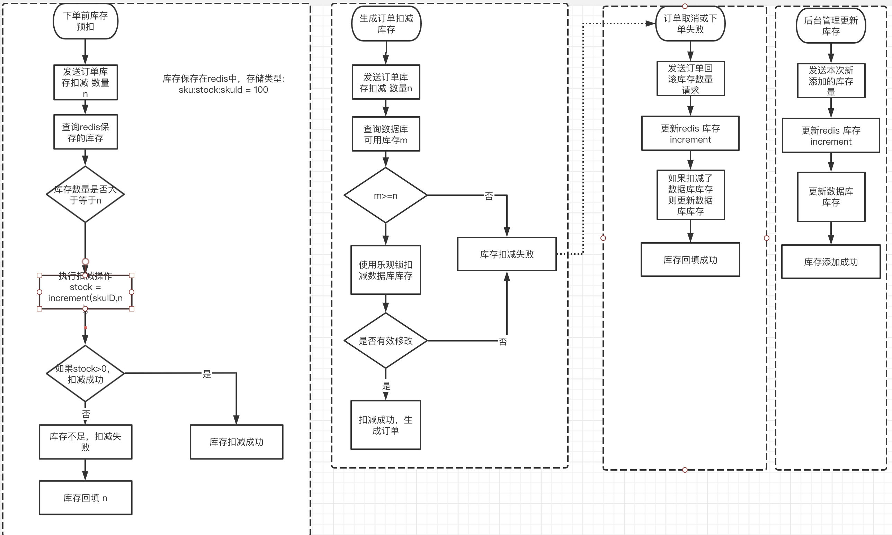

# 分享一个全网最全的订单库存扣减设计思路

## 背景
最近在做一个关于库存服务的设计方案，在网上找了很多资料，都没有一个大而全的设计方案，于是就参考网上现有的电商库存设计，设计出一个自认为非常优秀的关于库存服务这块的方案，仅供大家参考。

## 设计流程图

## 设计思路

为了扛住高并发，我这里在两个地方做了库存扣减，第一个使用redis做预扣库存，第二个是数据库扣除实际库存；
用户提交订单时，做的是reids中库存预扣，只有当实际支付完成后，才会做数据库层的库存扣减。
在用户提交订单时、支付完成时、订单取消或下单失败时、运营更新商品时，都会涉及到库存的操作，所以本文分别就这几种场景，设计出对应的库存扣减逻辑。
### 用户提交订单时库存预扣

- 查询redis当前的库存
   - 库存数量大于等于购买数量n，则继续后续操作
   - 如果小于，则库存扣减失败，订单创建失败
- 调用redis的原子方法(increment)，执行扣减操作stock = increment(skuID,-n );
   - 如果stock>=0,则代表扣减成功，则库存预扣成功，订单创建成功
   - 否则库存扣减失败，订单创建失败，再次调用increment(skuID,+n )，重要的一步是将redis库存回填
### 用户支付完成时扣除实际库存
#### 为什么要在用户支付完成后才实际的扣减库存呢？而不是下单时直接扣减实际库存呢？

- 优点：
   - 防止用户支付前取消订单，进行库存回填的时候，还得操作实际库存,增加库存不一致的风险
   - 为了提高并发，因为特别是在并发量比较大的时候，如果在下单时直接操作数据库库存，会导致创建订单花费的时间更长
   - 防止用户恶意下单，不支付，占用库存**(主要原因)**
- 缺点：

 用户支付时，有可能会出现库存不足，给用户造成不好的购物体验。
### 订单取消/下单失败，库存回滚
这里其实需要分为不同场景：

- 订单未支付前：订单取消或下单失败，则只需要回填redis库存
- 订单已经支付完成：订单取消/下单失败，则需要回填redis和数据库库存，并执行退款。
### 运营更新商品，操作库存

- redis库存增加：使用increment(skuID,+n );原子操作更新库存
- 数据库库存增加：使用乐观锁进行更新。

## 每日凌晨定时维护redis与数据库的库存数量
为了防止redis和数据的库存出现不一致的情况，每天都需要进行检查；库存以数据库中实际库存为主，将数据库中的库存减去未支付订单扣减的库存，更新到redis中。

