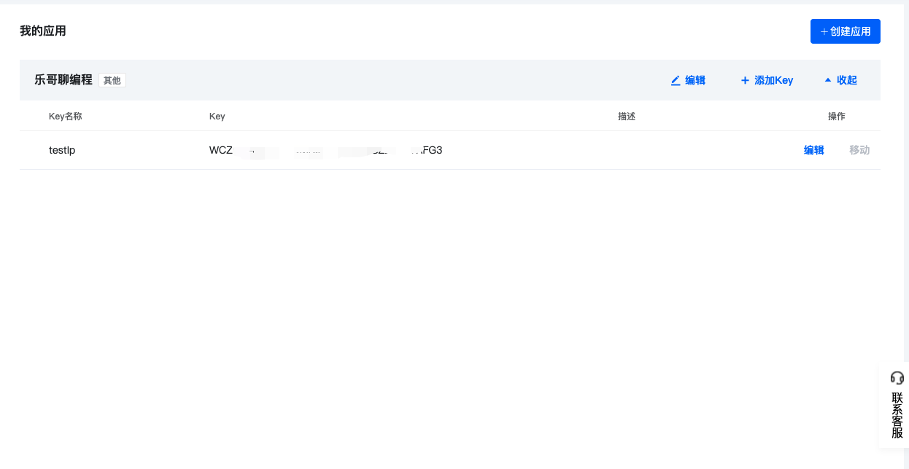

# 只要三步，让你的项目轻松实现IP属地的功能

## 开通腾讯位置服务
[https://lbs.qq.com/dev/console/application/mine](https://lbs.qq.com/dev/console/application/mine)
## 创建应用

### 配置restTemplate
```
import org.springframework.context.annotation.Bean;
import org.springframework.context.annotation.Configuration;
import org.springframework.http.client.ClientHttpRequestFactory;
import org.springframework.http.client.SimpleClientHttpRequestFactory;
import org.springframework.web.client.RestTemplate;

@Configuration
public class RestTemplateConfig {

   @Bean
   public RestTemplate restTemplate(ClientHttpRequestFactory factory) {
       return new RestTemplate(factory);
   }

   @Bean
   public ClientHttpRequestFactory simpleClientHttpRequestFactory() {
       SimpleClientHttpRequestFactory factory = new SimpleClientHttpRequestFactory();
       factory.setReadTimeout(150000); // ms
       factory.setConnectTimeout(150000); // ms
       return factory;
   }
}
```
### 添加controller
```
public class TestIPController {
    @Autowired
    private RestTemplate restTemplate;
    @RequestMapping
    public String testIP(HttpServletRequest request){
        JSONObject object = restTemplate.getForObject(String.format("https://apis.map.qq.com/ws/location/v1/ip?ip=%s&key=你的key", IPUtils.getIpAddr(request)), JSONObject.class);
        System.out.println(object.toJSONString());
        return "IP属地："+object.getJSONObject("result").getJSONObject("ad_info").getString("province");
    }
}
```
### 创建获取IP的工具类
```

public class IPUtils {
    /**
     * 获取ip
     * @param request
     * @return
     */
    public static String getIpAddr(HttpServletRequest request) {
        String ipAddress = null;
        try {
            ipAddress = request.getHeader("x-forwarded-for");
            if (ipAddress == null || ipAddress.length() == 0 || "unknown".equalsIgnoreCase(ipAddress)) {
                ipAddress = request.getHeader("Proxy-Client-IP");
            }
            if (ipAddress == null || ipAddress.length() == 0 || "unknown".equalsIgnoreCase(ipAddress)) {
                ipAddress = request.getHeader("WL-Proxy-Client-IP");
            }
            if (ipAddress == null || ipAddress.length() == 0 || "unknown".equalsIgnoreCase(ipAddress)) {
                ipAddress = request.getRemoteAddr();
                if (ipAddress.equals("127.0.0.1")) {
                    // 根据网卡取本机配置的IP
                    InetAddress inet = null;
                    try {
                        inet = InetAddress.getLocalHost();
                    } catch (UnknownHostException e) {
                        e.printStackTrace();
                    }
                    ipAddress = inet.getHostAddress();
                }
            }
            // 对于通过多个代理的情况，第一个IP为客户端真实IP,多个IP按照','分割
            if (ipAddress != null && ipAddress.length() > 15) {
                // "***.***.***.***".length()
                // = 15
                if (ipAddress.indexOf(",") > 0) {
                    ipAddress = ipAddress.substring(0, ipAddress.indexOf(","));
                }
            }
        } catch (Exception e) {
            ipAddress="";
        }
        return ipAddress;
    }

}
```