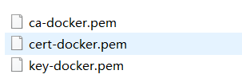
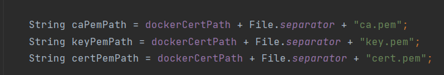
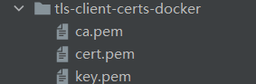

# 快速上手docker-java，示例全网最全，带你踩坑，带你飞

## 提前踩坑
刚入项目组，就开始用dokcer-java去干活了，由于之前没接触过，所以就开始全网找资料，于是乎，找了一堆博客，好像都差不多，虽然都能跑起来，但是我的需求并没有得以实现：

- 无法连接远程docker
- 无法实现路径挂载
- 无法实现安全连接(按照操作后，出现了Client sent an HTTP request to an HTTPS server的错误，很蛋疼)
- 如何实现docker 执行脚本文件，并携带参数
## 我们现在开始避坑
踩了这么多坑之后，我决定做下总结，于是就有了现在这篇 “号称全网最全的docker-java 快速入门案例” 的文章。

前提是docker环境已经安装，如果没有安装过可以参考我的文章：[https://blog.csdn.net/weixin_34311210/article/details/106181740](https://blog.csdn.net/weixin_34311210/article/details/106181740)
### 集成docker-java
#### 下载docker-java源码
```
git clone https://github.com/docker-java/docker-java.git

```
#### 编译包，生成本地jar
```
cd docker-java
mvn install -Dmaven.test.skip=true
```
#### 创建maven项目
过程省略...
#### 引入依赖
```
        <dependency>
            <groupId>com.github.docker-java</groupId>
            <artifactId>docker-java</artifactId>
            <version>0-SNAPSHOT</version>
        </dependency>
        
        <dependency>
            <groupId>com.alibaba</groupId>
            <artifactId>fastjson</artifactId>
            <version>1.2.4</version>
        </dependency>
```
注意：idea 设置的maven配置的仓库路径要和刚才打包的maven 的仓库路径要保持一致，否则是找不到你本地打包的jar

#### 修改docker信息，实现远程访问
进入docker服务器，修改配置文件
```
vi /lib/systemd/system/docker.service
找到ExecStart 开头的配置，注释原配置 进行备份
插入以下内容
ExecStart=/usr/bin/dockerd -H tcp://0.0.0.0:2375 -H unix://var/run/docker.sock
保存退出
systemctl daemon-reload
service docker restart

```
注意：如果是云服务或者防火墙打开的话，记得开放端口
浏览器输入：http://IP:2375/version 如果响应正常，则配置生效

#### 创建连接
```
    public DockerClient connectDocker(){
        DockerClient dockerClient = DockerClientBuilder.getInstance("tcp://ip:2375").build();
        Info info = dockerClient.infoCmd().exec();
        String infoStr = JSONObject.toJSONString(info);
        System.out.println("docker的环境信息如下：=================");
        System.out.println(info);
        return dockerClient;
    }
```
如果控制台打印了信息，则代表你已经通过java 连接上了docker，如果出现未知问题，可以在留言去留言，看到后会回复你的。

到目前为止，我们已经连上docker了，接下来我会写很多示例给大家去使用，避免大家全网找文档。

### 最强示例
#### 1.首先来一个高逼格的：丢弃普通连接，实现安全连接
```
vi /lib/systemd/system/docker.service
找到ExecStart 开头的配置，注释原配置 进行备份
插入以下内容
ExecStart=/usr/bin/dockerd -H fd:// --containerd=/run/containerd/containerd.sock -H tcp://0.0.0.0:2375 -H unix://var/run/docker.sock -D --tlsverify --tlscert=/etc/docker/certs.d/server-cert-docker.pem --tlskey=/etc/docker/certs.d/server-key-docker.pem --tlscacert=/etc/docker/certs.d/ca-docker.pem
保存退出
systemctl daemon-reload
service docker restart

```

- 编写生成证书的脚本，这是在网上找的，可以自动生成脚本并且完成拷贝

vim auto_gen_docker.sh
```
#!/bin/bash
#
# -------------------------------------------------------------
# 自动创建 Docker TLS 证书
# -------------------------------------------------------------
# 以下是配置信息
# --[BEGIN]------------------------------
CODE="docker"
IP="192.168.1.1"
PASSWORD="123456"
COUNTRY="CN"
STATE="HUNAN"
CITY="CHANGSHA"
ORGANIZATION="thyc"
ORGANIZATIONAL_UNIT="Dev"
COMMON_NAME="$IP"
EMAIL="author@example.com"
# --[END]--
# Generate CA key
openssl genrsa -aes256 -passout "pass:$PASSWORD" -out "ca-key-$CODE.pem" 4096
# Generate CA
openssl req -new -x509 -days 365 -key "ca-key-$CODE.pem" -sha256 -out "ca-$CODE.pem" -passin "pass:$PASSWORD" -subj "/C=$COUNTRY/ST=$STATE/L=$CITY/O=$ORGANIZATION/OU=$ORGANIZATIONAL_UNIT/CN=$COMMON_NAME/emailAddress=$EMAIL"
# Generate Server key
openssl genrsa -out "server-key-$CODE.pem" 4096
# Generate Server Certs.
openssl req -subj "/CN=$COMMON_NAME" -sha256 -new -key "server-key-$CODE.pem" -out server.csr
echo "subjectAltName = IP:$IP,IP:127.0.0.1" >> extfile.cnf
echo "extendedKeyUsage = serverAuth" >> extfile.cnf
openssl x509 -req -days 365 -sha256 -in server.csr -passin "pass:$PASSWORD" -CA "ca-$CODE.pem" -CAkey "ca-key-$CODE.pem" -CAcreateserial -out "server-cert-$CODE.pem" -extfile extfile.cnf
# Generate Client Certs.
rm -f extfile.cnf
openssl genrsa -out "key-$CODE.pem" 4096
openssl req -subj '/CN=client' -new -key "key-$CODE.pem" -out client.csr
echo extendedKeyUsage = clientAuth >> extfile.cnf
openssl x509 -req -days 365 -sha256 -in client.csr -passin "pass:$PASSWORD" -CA "ca-$CODE.pem" -CAkey "ca-key-$CODE.pem" -CAcreateserial -out "cert-$CODE.pem" -extfile extfile.cnf
rm -vf client.csr server.csr
chmod -v 0400 "ca-key-$CODE.pem" "key-$CODE.pem" "server-key-$CODE.pem"
chmod -v 0444 "ca-$CODE.pem" "server-cert-$CODE.pem" "cert-$CODE.pem"
# 打包客户端证书
mkdir -p "tls-client-certs-$CODE"
cp -f "ca-$CODE.pem" "cert-$CODE.pem" "key-$CODE.pem" "tls-client-certs-$CODE/"
cd "tls-client-certs-$CODE"
tar zcf "tls-client-certs-$CODE.tar.gz" *
mv "tls-client-certs-$CODE.tar.gz" ../
cd ..
rm -rf "tls-client-certs-$CODE"
# 拷贝服务端证书
mkdir -p /etc/docker/certs.d
cp "ca-$CODE.pem" "server-cert-$CODE.pem" "server-key-$CODE.pem" /etc/docker/certs.d/
```

- 执行脚本
```
chmod a+x auto_gen_docker.sh
sh auto_gen.sh
```

- 拷贝当前目录下的tls-client-certs-docker.tar 文件到项目的resource下，并解压，如图所示：

    

- 编写建立安全连接的方法
```
   public static DockerClient getDockerClient() {
        // 进行安全认证
        DockerClientConfig config = DefaultDockerClientConfig.createDefaultConfigBuilder()
                // 服务器ip
                .withDockerHost("tcp://IP:PORT")
                .withDockerTlsVerify(true)
                // 压缩包解压的路径
                .withDockerCertPath("D:\\code\\my_code\\test-skill\\src\\main\\resources\\tls-client-certs-docker")
                // API版本 可通过在服务器 docker version 命令查看
                .withApiVersion("1.37")
                // 默认
                .withRegistryUrl("https://index.docker.io/v1/")
                // 默认 
                .withRegistryUsername("docker")
                // 默认
                .withRegistryPassword("123456")
                // 默认
                .withRegistryEmail("author@example.com")
                .build();
        // docker命令执行工厂
        DockerCmdExecFactory dockerCmdExecFactory = new JerseyDockerCmdExecFactory()
                .withReadTimeout(60000)
                .withConnectTimeout(60000)
                .withMaxTotalConnections(100)
                .withMaxPerRouteConnections(10);
        dockerClient = DockerClientBuilder.getInstance(config).withDockerCmdExecFactory(dockerCmdExecFactory).build();
        return dockerClient;
    }
```
使用这个docker-client代替上面普通连接生成的docker-client
```
    public DockerClient connectDocker(){
        DockerClient dockerClient = getDockerClient();
        Info info = dockerClient.infoCmd().exec();
        String infoStr = JSONObject.toJSONString(info);
        System.out.println("docker的环境信息如下：=================");
        System.out.println(info);
        return dockerClient;
    }
```

执行后，应该会报如下这个错误
Client sent an HTTP request to an HTTPS server
这是我踩的其中一个坑，后面我通过跟踪源码，找到问题所在：
源码中需要验证认证文件是否存在：

但是我们压缩包里面的认证文件是这样的：

所导致没有识别到认证文件，从而导致docker以为我们没有采用https协议，默认就是用http；
但是我们服务端是开启了https的，所以会出现上面那个错误。

如何解决呢？源码是修改不了的，我们只需要把我们生成的认证文件修改成他需要的名称格式就可以了，相信有不少网友也遇到过这样的坑吧！

按要求修改后

重新运行 程序正常.
#### 2.创建容器
```
    public CreateContainerResponse createContainers(DockerClient client,String containerName,String imageName){
        //映射端口8088—>80
        ExposedPort tcp80 = ExposedPort.tcp(80);
        Ports portBindings = new Ports();
        portBindings.bind(tcp80, Ports.Binding.bindPort(8088));
        CreateContainerResponse container = client.createContainerCmd(imageName)
                .withName(containerName)
                .withHostConfig(newHostConfig().withPortBindings(portBindings))
                .withExposedPorts(tcp80).exec();
        return container;
    }
```
#### 3.加载镜像
```
    public LoadImageCmd loadImage(DockerClient client, String filePath){
        LoadImageCmd loadImageCmd = null;
        try {
            loadImageCmd = client.loadImageCmd(new FileInputStream(filePath));
        } catch (FileNotFoundException e) {
            e.printStackTrace();
        }
        return loadImageCmd;
    }
```
#### 4.拉取镜像
```
    /**
    * repository 镜像名称:tag名称
    **/
    public PullImageCmd pullImage(DockerClient client,String repository){
        PullImageCmd pullImageCmd = client.pullImageCmd(repository);
        return pullImageCmd;
    }
```
#### 5.删除镜像
```
    public void removeImage(DockerClient client,String imageId){
        client.removeImageCmd(imageId).exec();
    }
```
#### 6.移除容器
```
    public void removeContainer(DockerClient client,String containerId){
        client.removeContainerCmd(containerId).exec();
    }
```
#### 7.启动容器
```
    public void startContainer(DockerClient client,String containerId){
        client.startContainerCmd(containerId).exec();
    }
```
#### 8.停止容器
```
    public void stopContainer(DockerClient client,String containerId){
        client.stopContainerCmd(containerId).exec();
    }
```
#### 9.路径挂载
使用hostConfig方式，直接使用Volumes是行不通的，这个也是请教我领导的，自己确实琢磨了半天。
```
public CreateContainerResponse createContainers(DockerClient client,String containerName,String imageName){
        HostConfig hostConfig = newHostConfig();
        Bind bind = new Bind("服务器路径",new Volume("容器路径"));
        hostConfig.setBinds(bind);
        CreateContainerResponse container = client.createContainerCmd(imageName)
                .withName(containerName)
                .withHostConfig(hostConfig)
                .exec();
        return container;
    }
```
#### 10 执行命令
```
public CreateContainerResponse createContainers(DockerClient client,String containerName,String imageName){
        HostConfig hostConfig = newHostConfig();
        CreateContainerResponse container = client.createContainerCmd(imageName)
                .withName(containerName)
                .withHostConfig(hostConfig)
                .withCmd("python","/root/scripts/test.py")
                .exec();
        return container;
    }
```
#### 11 利用docker 执行脚本命令 传递参数
```
public CreateContainerResponse createContainers(DockerClient client,String containerName,String imageName){
        HostConfig hostConfig = newHostConfig();
        CreateContainerResponse container = client.createContainerCmd(imageName)
                .withName(containerName)
                .withHostConfig(hostConfig)
                // 注意命令和参数不能进行组合，必须都用逗号隔开,也就是空格全部换成这里的,分割
                .withCmd("python","/root/scripts/test.py","-t","999")
                .exec();
        return container;
    }
```
到这里，所有的docker-java示例全部编写完成，后续会增加更多的实战用例，敬请期待吧。如果运行过程中出现任何问题，直接在底部留言即可，我看到后会回复你的。
