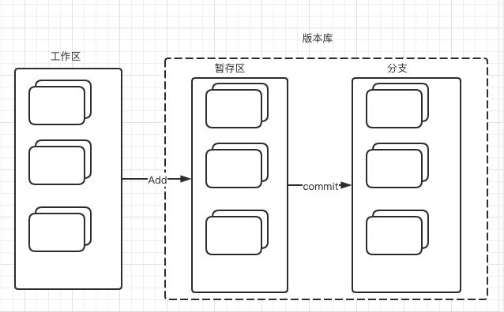

# 撤销git commit 操作的3个指令，原来真的有后悔药

## git 空间介绍

HEAD^ 上一个版本号
## **git reset --soft 版本号 **
_不删除工作区更改的代码，撤销commit，不撤销git add _
## git reset --mixed 版本号 
不删除工作区改动的代码，撤销commit，撤销git add .
## git reset --hard 版本号 (需谨慎使用，会还原你的代码)
_删除工作区的代码，撤销commit，撤销git add _