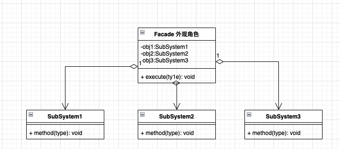

# 外观模式

## 定义
又称作门面模式，即对调用方提供一个一致的接口，然后门面自己去和其他子模块整合。
## 举个例子
例如装修：如果你找了装修公司，你只需要付完钱，剩下的如水电、贴砖、刷乳胶漆、木工、门窗，都不用你操心了，你只需要选择你需要装成什么样子，然后这些都交给装修公司去对接。
## 角色

- 外观角色：组合多个子系统提供一个对外的接口
- 子系统：系统的部分功能实现者
## 类图

## 代码实现
```
package com.example.facade;

/**
 * @date: 2022/5/23
 */
public class Facade {
    private SubSystem1 subSystem1 =new SubSystem1();
    private SubSystem2 subSystem2 =new SubSystem2();
    private SubSystem3 subSystem3 =new SubSystem3();
    public void method(){
        subSystem1.method();
        subSystem2.method();
        subSystem3.method();
    }
}

```
```
package com.example.facade;

/**
 * @date: 2022/5/23
 */
public class SubSystem1 {
    public void method(){
        System.out.println("SubSystem1 处理");
    }
}

```
```
package com.example.facade;

/**
 * @date: 2022/5/23
 */
public class SubSystem2 {
    public void method(){
        System.out.println("SubSystem2 处理");
    }
}

```
```
package com.example.facade;

/**
 * @date: 2022/5/23
 */
public class SubSystem3 {
    public void method(){
        System.out.println("SubSystem3 处理");
    }
}

```
