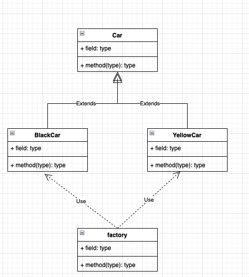
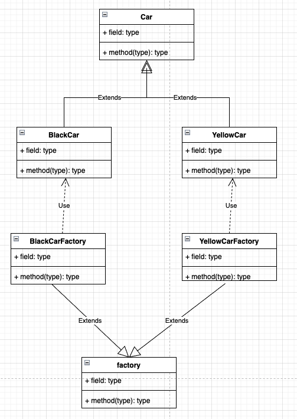
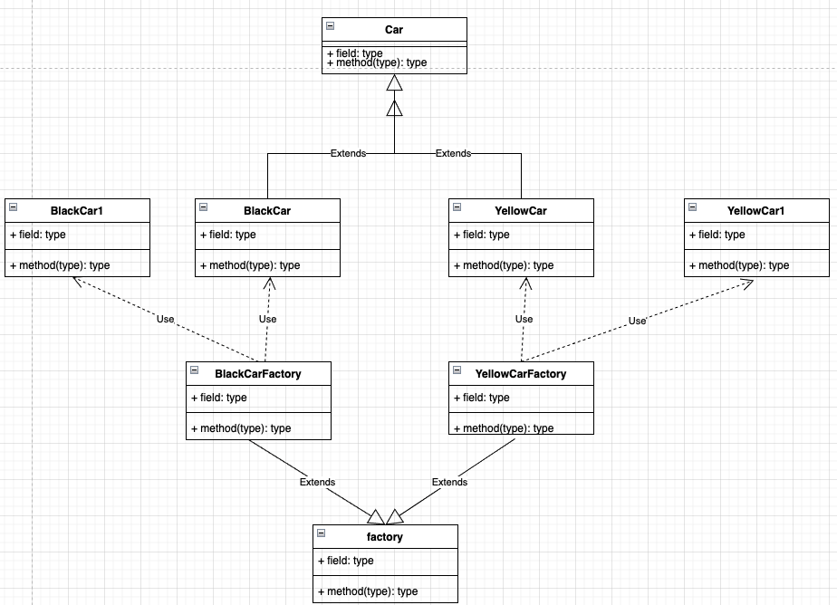

# 工厂模式
功能：将对象的实例化交给工厂去做，你只需要告诉工厂你需要什么对象，我给你造出来就行了。
目的：让使用者只需要关注自己需要的，而不需要关注这个东西是怎么创建的，能用就行。让实例创建和实例使用解耦
## 需求
我要生产汽车，但是汽车有很多不同的颜色。
## 简单工厂
### 类图

### 实现
```
public class SimpleFactory {
    private Map<String, Car> mapCar = new HashMap<>();
    public SimpleFactory(){
        mapCar.put("yellow",new YellowCar());
        mapCar.put("black",new BlackCar());
    }
    public Car createCar(String color){
        System.out.println(String.format("简单工厂正在生产%s汽车", color));
        Car car = mapCar.get(color);
        if (null == car) {
            System.out.println("对不起，没有这种颜色的汽车");
        }
        return car;
    }
}
```
### 测试
```
public class Test {
    public static void main(String[] args) {
        SimpleFactory simpleFactory = new SimpleFactory();
        while (true){
            System.out.println("请问需要什么颜色的汽车？yellow or black?");
            Scanner input=new Scanner(System.in);
            String color=input.next();//读取输入的字符串
            Car car = simpleFactory.createCar(color);
            if (Objects.nonNull(car)){
                car.carColor();
                car.carSpeed();
                car.carPrice();
            }
        }
    }
}
```
## 工厂方法
### 类图

### 实现
抽象一个工厂
```
public abstract class CarFactory {
    abstract Car createCar();
}
```
创建黑色汽车工厂
```
public class BlackCarFactory extends CarFactory {
    public Car createCar() {
        System.out.println("工厂方法 正在生产黑色汽车....");
        return new BlackCar();
    }
}

```
创建黄色汽车工厂
```
public class YellowCarFactory extends CarFactory{
    public Car createCar(){
        System.out.println("工厂方法 正在生产黄色汽车....");
        return new YellowCar();
    }
}
```
### 测试
```
public class Test {
    public static void main(String[] args) {

        while (true){
            CarFactory carFactory =null;
            System.out.println("请问需要什么颜色的汽车？yellow or black?");
            Scanner input = new Scanner(System.in);
            String color=input.next();//读取输入的字符串
            if (color.equals("yellow")){
                carFactory = new YellowCarFactory();
            }else if(color.equals("black")){
                carFactory = new BlackCarFactory();
            }else{
                System.out.println("没有此类颜色的车");
                continue;
            }
            Car car = carFactory.createCar();
            if (Objects.nonNull(car)){
                car.carColor();
                car.carSpeed();
                car.carPrice();
            }
        }
    }
}
```
## 抽象工厂
### 类图

### 需求
我要生产汽车，但是汽车有很多不同的颜色。而且有不同的型号
### 实现
创建抽象工厂,包含生产两个型号
```
public abstract class CarFactory {
    abstract Car createCar1();

    abstract Car createCar2();
}
```
创建黑色汽车工厂，包含两个车型
```
public class BlackCarFactory extends CarFactory {
    public Car createCar1() {
        System.out.println("抽象工厂 正在生产黑色汽车....");
        return new BlackCar();
    }
    public Car createCar2() {
        System.out.println("抽象工厂 正在生产黑色汽车2....");
        return new BlackCar();
    }
}
```
创建黄色汽车工厂，包含两个车型
```
public class YellowCarFactory extends CarFactory {
    public Car createCar1(){
        System.out.println("抽象工厂 正在生产黄色汽车1....");
        return new YellowCar();
    }
    public Car createCar2(){
        System.out.println("抽象工厂 正在生产黄色汽车2....");
        return new YellowCar();
    }
}
```
### 测试
```
public class Test {
    public static void main(String[] args) {

        while (true){
            CarFactory carFactory =null;
            System.out.println("请问需要什么颜色的汽车？yellow or black?");
            Scanner input = new Scanner(System.in);
            String color=input.next();//读取输入的字符串
            if (color.equals("yellow")){
                carFactory = new YellowCarFactory();
            }else if(color.equals("black")){
                carFactory = new BlackCarFactory();
            }else{
                System.out.println("没有此类颜色的车");
                continue;
            }
            Car car = null;
            System.out.println("请问需要什么型号的汽车？1 or 2?");
            input = new Scanner(System.in);
            String type=input.next();//读取输入的字符串
            if (type.equals("1")){
                car = carFactory.createCar1();
            }else if(type.equals("2")){
                car = carFactory.createCar2();
            }else{
                System.out.println("没有此类型号的车");
                continue;
            }
            if (Objects.nonNull(car)){
                car.carColor();
                car.carSpeed();
                car.carPrice();
            }
        }
    }
}
```
