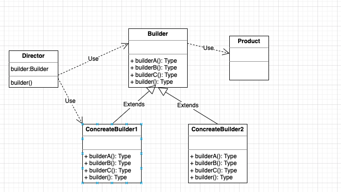

# 建造者模式

## 定义
虽然看不懂，但是还是要先甩出来。
将一个复杂对象的构建与其表示分离，使得同样的构建过程可以创建不同的表示
## 使用背景
当一些对象的基本属性经常性进行组合使用的时候，可以考虑使用建造者模式
## 四个角色

- Product（产品角色）： 一个具体的产品对象。
- Builder（抽象建造者）： 创建一个Product对象的各个部件指定的 接口/抽象类。
- ConcreteBuilder（具体建造者）： 实现接口，构建和装配各个部件。
- Director（指挥者）： 构建一个使用Builder接口的对象。它主要是用于创建一个复杂的对象。它主要有两个作用，一是：隔离了客户与对象的生产过程，二是：负责控制产品对象的生产过程
## 类图

## 代码演示
### 创建抽象builder
```
package com.example.builder;

public abstract class Builder {
    protected Computer computer = new Computer();
    public void builderMemory(){
    }

    public void builderCpu(){
    }

    public void builderDisk(){
    }
    public Computer builder(){
        return computer;
    }
}

```
### 创建基础配置电脑builder
```
package com.example.builder;

public class BasicComputerBuilder extends Builder{

    public void builderMemory(){
        System.out.println("4G内存");
        computer.setMemory("4G内存");
    }

    public void builderCpu(){
        System.out.println("3代处理器");
        computer.setCpu("3代处理器");
    }

    public void builderDisk(){
        System.out.println("512g机械硬盘");
        computer.setHardDisk("512g机械硬盘");
    }
}

```
### 创建高配版电脑builder
```
package com.example.builder;

public class HighComputerBuilder extends Builder{

    public void builderMemory(){
        System.out.println("32G内存");
        computer.setMemory("32G内存");
    }

    public void builderCpu(){
        System.out.println("11代处理器");
        computer.setCpu("11代处理器");
    }

    public void builderDisk(){
        System.out.println("1024g固态硬盘");
        computer.setHardDisk("1024g固态硬盘");
    }
}

```
### 创建指挥者 director
```
package com.example.builder;

public class Director {
    private Builder builder;
    public Director(Builder builder){
        this.builder = builder;
    }
    public Computer builder(){
        builder.builderDisk();
        builder.builderCpu();
        builder.builderMemory();
        return builder.builder();
    }
}

```
## 创建客户端
```
package com.example.builder;

public class Client {
    public static void main(String[] args) {
        Builder basicComputerBuilder = new BasicComputerBuilder();
        Computer basicComputer = new Director(basicComputerBuilder).builder();

        Builder highComputerBuilder = new HighComputerBuilder();
        Computer highComputer = new Director(highComputerBuilder).builder();

    }
}

```
## 运行截图

