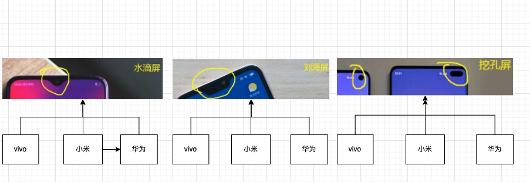
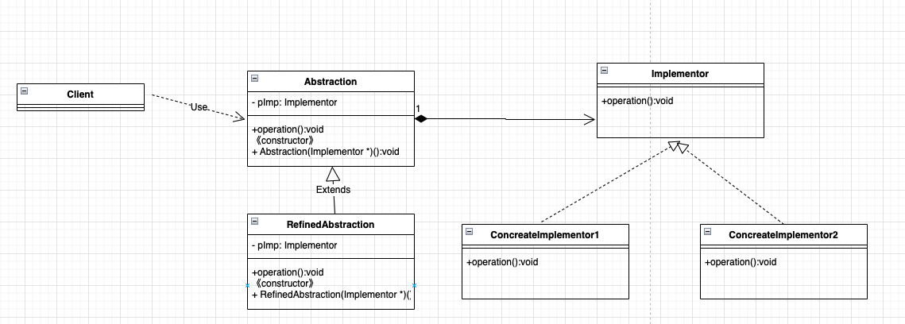
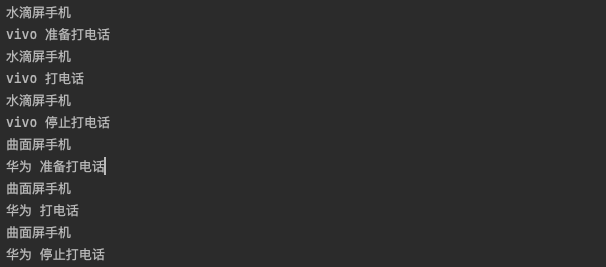

# 桥接模式

## 定义
将抽象与实现分离，使它们可以独立变化。它是用组合关系代替继承关系来实现，从而降低了抽象和实现这两个可变维度的耦合度。
## 角色

1. 抽象化（Abstraction）角色：定义抽象类，并包含一个对实现化对象的引用。
2. 扩展抽象化（Refined Abstraction）角色：是抽象化角色的子类，实现父类中的业务方法，并通过聚合关系调用实现化角色中的业务方法。
3. 实现化（Implementor）角色：定义实现化角色的接口，供扩展抽象化角色调用。
4. 具体实现化（Concrete Implementor）角色：给出实现化角色接口的具体实现。
## 场景

## 类图

## 代码
### 定义手机抽象品牌
```
package com.example.brige;

public interface Brand {
    void start();
    void call();
    void stop();
}
```
### 定义抽象手机
```
package com.example.brige;

public abstract class Phone {
    private Brand brand;
    public Phone(Brand brand){
        this.brand = brand;
    }

    public void start(){
        brand.start();
    }
    public void call(){
        brand.call();
    }
    public void stop(){
        brand.stop();
    }
}
```
### 定义曲面屏手机
```
package com.example.brige;

public class CurvedScreenPhone extends Phone{
    public CurvedScreenPhone(Brand brand) {
        super(brand);
    }

    @Override
    public void start() {
        System.out.println("曲面屏手机");
        super.start();
    }

    @Override
    public void call() {
        System.out.println("曲面屏手机");
        super.call();
    }

    @Override
    public void stop() {
        System.out.println("曲面屏手机");
        super.stop();
    }

}

```
### 定义水滴屏手机
```
package com.example.brige;

public class WaterDropScreenPhone extends Phone{
    public WaterDropScreenPhone(Brand brand) {
        super(brand);
    }

    @Override
    public void start() {
        System.out.println("水滴屏手机");
        super.start();
    }

    @Override
    public void call() {
        System.out.println("水滴屏手机");
        super.call();
    }

    @Override
    public void stop() {
        System.out.println("水滴屏手机");
        super.stop();
    }

}

```
### 定义vivo品牌
```
package com.example.brige;

public class VIVOBrand implements Brand{
    @Override
    public void start() {
        System.out.println("vivo 准备打电话");
    }

    @Override
    public void call() {
        System.out.println("vivo 打电话");
    }

    @Override
    public void stop() {
        System.out.println("vivo 停止打电话");
    }
}

```
### 定义华为品牌
```
package com.example.brige;

public class HuaWeiBrand implements Brand{
    @Override
    public void start() {
        System.out.println("华为 准备打电话");
    }

    @Override
    public void call() {
        System.out.println("华为 打电话");
    }

    @Override
    public void stop() {
        System.out.println("华为 停止打电话");
    }
}

```
### 定义客户端
```
package com.example.brige;

public class Client {
    public static void main(String[] args) {
        Phone waterDropScreenPhone = new WaterDropScreenPhone(new VIVOBrand());
        waterDropScreenPhone.start();
        waterDropScreenPhone.call();
        waterDropScreenPhone.stop();
        Phone curvedScreenPhone = new CurvedScreenPhone(new HuaWeiBrand());
        curvedScreenPhone.start();
        curvedScreenPhone.call();
        curvedScreenPhone.stop();
    }
}

```
## 测试

