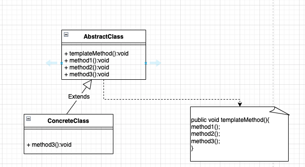

# 模版方法

## 定义
上层抽象类定义好操作的基本框架，一些特殊的子操作交给子类去实现，使得子类可以在不改变上层基类的情况下，可以定制操作的某一步骤。
## 组件

- 抽象类:
   - 模版方法：定义操作的骨架
   - 基本方法
      - 抽象方法：交给子类实现
      - 具体方法：基类自己实现，子类也可以进行覆盖
- 具体实现类
   - 实现基类的某个方法
## 类图

## 实现
```
package com.example.templatemethod;

/**
 * @date: 2022/5/24
 */
public abstract class AbstractTemplate {
    public void templateMethod() {
        method1();
        method2();
        method3();
    }

    abstract void method1();

    public void method2() {
        System.out.println("执行method2... 基类实现");
    }

    public void method3() {
        System.out.println("执行method3... 基类实现");
    }
}

```
```
package com.example.templatemethod;

/**
 * @date: 2022/5/24
 */
public class ConcreteClass extends AbstractTemplate{
    @Override
    void method1() {
        System.out.println("子类实现特定步骤....");
    }
}

```
