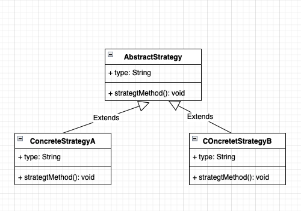

# 策略模式

## 定义
if条件的终结器，通过封装一系列算法，并且他们可以随便替换，根据不同环境使用不同策略。
## 组件

- 抽象策略：定义公用的接口，各种算法实现此接口
- 具体策略：具体算法实现的子类
## 类图

## 代码
```
package com.example.strategy;

/**
 * @date: 2022/5/25
 */
public abstract class AbstractStrategy {
    public String type;
    abstract void strategyMethod();
}

```
```
package com.example.strategy;

/**
 * @date: 2022/5/25
 */
public class ConcreteStrategyA extends AbstractStrategy {
    public ConcreteStrategyA(){
        this.type ="concreteStrategyA";
    }
    @Override
    void strategyMethod() {
        System.out.println("ConcreteStrategyA.strategyMethod......");
    }
}
```
```
package com.example.strategy;

/**
 * @date: 2022/5/25
 */
public class ConcreteStrategyB extends AbstractStrategy {

    public ConcreteStrategyB(){
        this.type ="concreteStrategyB";
    }

    @Override
    void strategyMethod() {
        System.out.println("ConcreteStrategyB.strategyMethod......");
    }
}

```
```
package com.example.strategy;

import java.util.ArrayList;
import java.util.HashMap;
import java.util.List;
import java.util.Map;

/**
 * @date: 2022/5/25
 */
public class Client {
    public static void main(String[] args) {
        List<AbstractStrategy> strategies= new ArrayList<>();
        strategies.add(new ConcreteStrategyA());
        strategies.add(new ConcreteStrategyB());
        Map<String,AbstractStrategy> strategyMap = new HashMap<>();
        strategies.forEach(strategy->strategyMap.put(strategy.type,strategy));
        strategyMap.get("concreteStrategyA").strategyMethod();
        strategyMap.get("concreteStrategyB").strategyMethod();

    }
}

```
