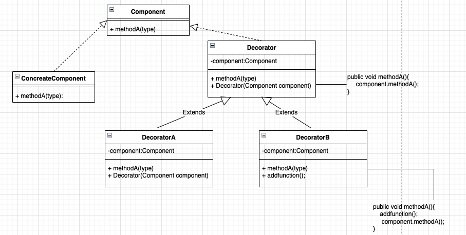

# 装饰器模式

## 定义
在不改变目标结构的情况下，动态的给对象增加功能
## 举例
如房子装修、相片加相框等，都是装饰器模式。
## 基本组件

- 抽象构件（Component）角色：定义一个抽象接口以规范准备接收附加责任的对象。
- 具体构件（ConcreteComponent）角色：实现抽象构件，通过装饰角色为其添加一些职责。
- 抽象装饰（Decorator）角色：继承抽象构件，并包含具体构件的实例，可以通过其子类扩展具体构件的功能。
- 具体装饰（ConcreteDecorator）角色：实现抽象装饰的相关方法，并给具体构件对象添加附加的责任。
## 类图

## 代码
```
package com.example.decorator;

/**
 * @date: 2022/5/22
 */
public interface Component {
    public void execute();
}


```
```
package com.example.decorator;

/**
 * @date: 2022/5/22
 */
public class ConcreteComponent implements Component{
    @Override
    public void execute() {
        System.out.println("开始执行原始操作...");
    }
}

```
```
package com.example.decorator;

/**
 * @date: 2022/5/22
 */
public abstract class Decorator implements Component{
    private Component component;

    public Decorator(Component component) {
        this.component = component;
    }

    @Override
    public void execute() {
        component.execute();
    }
}

```
```
package com.example.decorator;

/**
 * @date: 2022/5/22
 */
public class DecoratorA extends Decorator{
    public DecoratorA(Component component) {
        super(component);
    }

    @Override
    public void execute() {
        addExcExecute();
        super.execute();

    }
    public void addExcExecute(){
        System.out.println("对方法进行装饰处理");
    }
}

```
```
package com.example.decorator;

/**
 * @date: 2022/5/22
 */
public class Main {
    public static void main(String[] args) {
        Component component = new DecoratorA(new ConcreteComponent());
        component.execute();
    }
}

```
