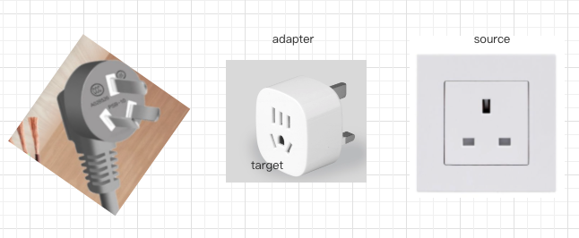
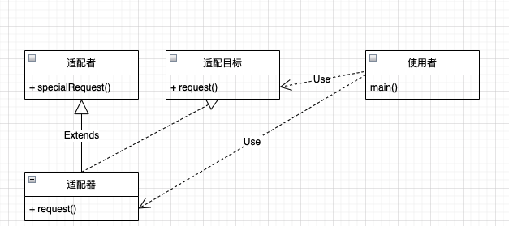
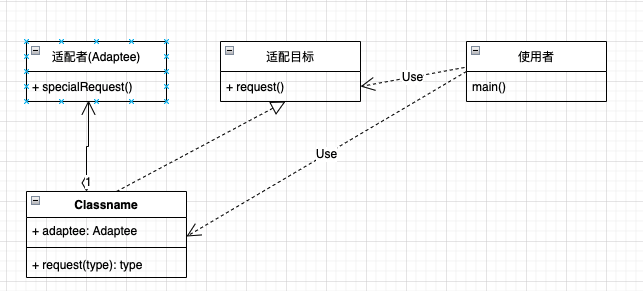

# 适配器模式

## 定义
适配器模式(Adapter Pattern)将某个类的接口转换成客户端期望的另一个接口表
示，主要目的是兼容性，让原本因接口不匹配不能一起工作的两个类可以协同
工作

## 类适配器
### 定义
适配器继承适配对象，并实现适配目标所有的方法，
### 类图

Java是单继承机制
### 代码演示
#### 国标接口(适配目标)
```
package com.example.adapter.ClassAdapter;

public interface NationalStandard {
    void use();
}

```
#### 英标(适配对象)
```
package com.example.adapter.ClassAdapter;

public class EnglandStandard {
    public void userDefault(){
        System.out.println("当前是英标");
    }
}

```
#### 适配器
```
package com.example.adapter.ClassAdapter;

public class Adapter extends EnglandStandard implements NationalStandard {
    @Override
    public void use() {
        userDefault();
        System.out.println("我已经给你转成国标使用");
    }
}

```
#### 客户端
```
package com.example.adapter.ClassAdapter;

public class Client {
    public static void main(String[] args) {
        NationalStandard nationalStandard = new Adapter();
        nationalStandard.use();
    }
}
```
## 对象适配器
### 定义
基于聚合原则，将适配的对象作为适配器的一个属性
### 类图

### 代码演示
```
package com.example.adapter.ObjectAdapter;

public class Adapter  implements NationalStandard {
    private EnglandStandard englandStandard = new EnglandStandard();
    @Override
    public void use() {
        englandStandard.userDefault();
        System.out.println("对象适配器：我已经给你转成国标使用");
    }
}

```
## 接口适配器
### 定义
适用于一个接口不想使用其所有的方法的情况
### 代码演示
```
public class Client {
    public static void main(String[] args) {
        new Player().listen(new AbsAdapterListener() {
            @Override
            public void start() {
                System.out.println("回调start方法");
            }
        });
        new Player().listen(new AbsAdapterListener() {
            @Override
            public void end() {
                System.out.println("回调end方法");
            }
        });
    }
}
```

